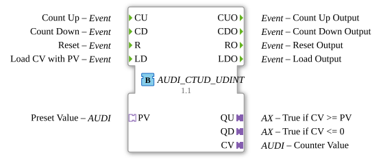
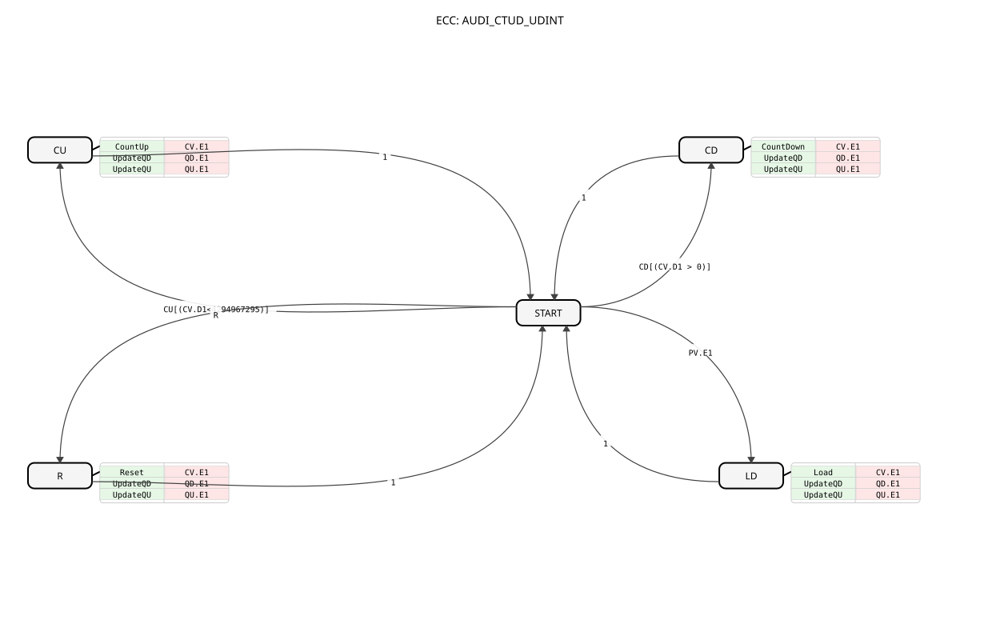

# AUDI_CTUD_UDINT (Adapter-basierter Auf-/Abwärtszähler)

## Einleitung

Der `AUDI_CTUD_UDINT` ist ein ereignisgesteuerter Auf-/Abwärtszähler (Counter Up/Down) für vorzeichenlose 32-Bit-Ganzzahlen (UDINT), der speziell für die Integration in adapterbasierte Systeme entwickelt wurde. Er nutzt `AUDI`-Adapter für die Übergabe des Zählwerts und des Vorgabewerts, was eine saubere Trennung von Ereignis- und Datenfluss ermöglicht.

## Schnittstellenstruktur

### **Ereignis-Eingänge**

- **CU**: `Event` - Zählt den Wert um eins hoch (`Count Up`; nur wenn `CV.D1` < 4294967295).
- **CD**: `Event` - Zählt den Wert um eins herunter (`Count Down`; nur wenn `CV.D1` > 0).
- **R**: `Event` - Setzt den Zähler auf Null zurück (`Reset`).
- **LD**: `Event` - Lädt den Zählwert `CV.D1` mit dem Vorgabewert `PV.D1` (`Load CV with PV`).

### **Ereignis-Ausgänge**

- **CUO**: `Event` - Bestätigung von `CU` (`Count Up Output`).
- **CDO**: `Event` - Bestätigung von `CD` (`Count Down Output`).
- **RO**: `Event` - Bestätigung von `R` (`Reset Output`).
- **LDO**: `Event` - Bestätigung von `LD` (`Load Output`).

### **Output-Variablen**

Keine klassischen Daten-Ausgänge; die Statussignale `QU` und `QD` werden als AX-Adapter (Plugs) ausgegeben, siehe Abschnitt Adapter.

### **Adapter**

- **QU** (Plug): `AX` - `TRUE`, wenn der Zählwert (`CV.D1`) größer oder gleich dem Vorgabewert (`PV.D1`) ist. Das Ereignis `QU.E1` wird nur bei einer Änderung von `QU` ausgelöst.
- **QD** (Plug): `AX` - `TRUE`, wenn der Zählwert (`CV.D1`) kleiner oder gleich Null ist. Das Ereignis `QD.E1` wird nur bei einer Änderung von `QD` ausgelöst.
- **CV** (Plug): `AUDI` - Der aktuelle Zählwert (`Counter Value`).
- **PV** (Socket): `AUDI` - Der Vorgabewert (`Preset Value`), gegen den der Zähler geprüft wird (für `QU`).

## Funktionsweise

Der Zähler reagiert auf die Ereignis-Eingänge `CU`, `CD`, `R` und `LD`. Ein `CU`-Ereignis erhöht `CV.D1` um 1, ein `CD`-Ereignis verringert `CV.D1` um 1. Ein `R`-Ereignis setzt `CV.D1` auf 0, ein `LD`-Ereignis setzt `CV.D1` auf `PV.D1`.

Trifft am `PV`-Adapter ein Ereignis (`PV.E1`) ein, werden nur die Statussignale `QU`/`QD` neu bewertet; der Zählwert `CV.D1` bleibt unverändert.

Der Zählwert wird über den `CV`-Adapter als `AUDI`-Signal ausgegeben. Nach jeder Zählaktion bestätigen `CUO`, `CDO`, `RO` bzw. `LDO` den Vorgang, und `CV.E1` signalisiert die Wertänderung; `QU.E1`/`QD.E1` werden nur bei einer Änderung des jeweiligen Status ausgelöst (On-Change-Triggering).

## Technische Besonderheiten

✔ **Adapter-basiert**: Nahtlose Integration in AX-Systeme.
✔ **Ereignisgesteuert**: Keine zyklischen Aufrufe notwendig.
✔ **UDINT-Basis**: Unterstützt den vollen Wertebereich von vorzeichenlosen 32-Bit-Ganzzahlen.
✔ **On-Change-Triggering**: `QU.E1` und `QD.E1` feuern nur, wenn sich `QU` bzw. `QD` ändern; `PV.E1` bewertet beide Status neu.

## Anwendungsszenarien

- **Stückzählung**: Zählen von Objekten in Fertigungslinien.
- **Betriebsstundenzähler**: Erfassen von Betriebszeiten (in Kombination mit Timern).
- **Positionsüberwachung**: Einfache Positionszähler in Handling-Systemen.

## 🛠️ Zugehörige Übungen

- [Uebung_009_AX](https://meisterschulen-am-ostbahnhof-munchen-docs.readthedocs.io/projects/4diac-exercises-docs/de/latest/Uebungen/test_AX/Uebungen_doc/Uebung_009_AX/)
- [Uebung_083_AX](https://meisterschulen-am-ostbahnhof-munchen-docs.readthedocs.io/projects/4diac-exercises-docs/de/latest/Uebungen/test_AX/Uebungen_doc/Uebung_083_AX/)

---

### 🌐 Passende Themen-Unterseiten auf ms-muc-docs.de

- [🌐 E_CTU Event Counter Baustein auf ms-muc-docs.de](https://www.ms-muc-docs.de/iec-61499/event-function-blocks/e_ctu/)
