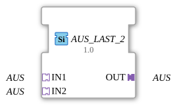

# AUS_LAST_2

## Einleitung

Der Funktionsblock `AUS_LAST_2` führt 2 gleichartige `USINT`-Adapter-Signale (**IN1** bis **IN2**) auf einen gemeinsamen Ausgang (**OUT**) zusammen, nach dem Prinzip **Last Writer Wins**: Der Socket, der zuletzt ein Ereignis gesendet hat, gewinnt, und sein Wert wird sofort an OUT durchgereicht. Es ist eine reine Arbitrierung nach zeitlicher Reihenfolge, keine Verknüpfung der Werte.

## Schnittstellenstruktur

### **Adapter**

**Eingangsadapter (Sockets):**

- **IN1**: USINT-Adapter (unidirectional)
- **IN2**: USINT-Adapter (unidirectional)

**Ausgangsadapter (Plug):**

- **OUT**: USINT-Adapter (unidirectional), zusammengeführtes Signal

## Funktionsweise

Der Socket mit dem letzten Ereignis gewinnt. OUT übernimmt sofort dessen Wert und sendet das Adapter-Ereignis, auch wenn der Wert gleich bleibt. Es gibt keine feste Priorität, nur die zeitliche Reihenfolge.

## Technische Besonderheiten

- Generischer Funktionsblock ohne ECC (`GenericClassName` = `GEN_AUS_LAST`); das Verhalten ist in der Firmware (FORTE) umgesetzt, die Typbeschreibung enthält keinen Algorithmus. Bis Version 1.0 war `AUS_LAST_2` ein Basic-FB mit ECC; Version 1.1 ist generisch, die Schnittstelle bleibt gleich.
- Schnittstelle: Sockets `IN1` und `IN2`, Plug `OUT`.
- Alle Größen `AUS_LAST_2` bis `AUS_LAST_9` haben dieselbe Funktion und unterscheiden sich nur in der Zahl der Sockets.
- Stand: Laut Entwicklung ist `AD_LAST_3` auf Hardware getestet (Trainer20, ESP32-S31); die übrigen Typen und Größen sind es nicht.

## Anwendungsszenarien

- Zusammenführen gleichwertiger Signalquellen zu einem nachgeschalteten Adapterpfad, zum Beispiel ein manueller und ein automatischer Sollwertgeber.
- Arbitrierung zwischen mehreren Bedienstellen, die denselben Wert schreiben dürfen.
- Vereinfachung von Netzwerken, die sonst `F_SEL`/`E_RS` inline verdrahten müssten.
