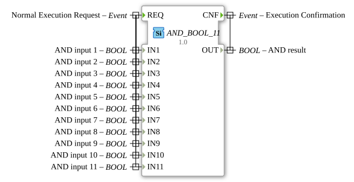

# AND_BOOL_11

* * * * * * * * * *

## Einleitung

Der Funktionsblock `AND_BOOL_11` ist ein generischer Baustein zur Berechnung der logischen UND-Verknüpfung (Klassifikation `standard boolean function`, IEC 61131-3). Er verknüpft 11 separate BOOL-Eingänge (`IN1` bis `IN11`) und liefert das Ergebnis am Ausgang `OUT`. Er ergänzt die Standard-AND_BOOL-Familie (bisher bis `AND_BOOL_10`) um die Variante mit 11 Eingängen.

## Schnittstellenstruktur

### **Ereignis-Eingänge**

-   **REQ (Normal Execution Request):** Löst die Berechnung aus. Das Ereignis ist mit allen 11 Daten-Eingängen (`IN1` bis `IN11`) verknüpft.

### **Ereignis-Ausgänge**

-   **CNF (Execution Confirmation):** Signalisiert den Abschluss der Berechnung. Das Ereignis ist mit dem Datenausgang `OUT` verknüpft.

### **Daten-Eingänge**

-   **IN1 (AND input 1):** Boolescher Eingang 1.
-   **IN2 (AND input 2):** Boolescher Eingang 2.
-   **IN3 (AND input 3):** Boolescher Eingang 3.
-   **IN4 (AND input 4):** Boolescher Eingang 4.
-   **IN5 (AND input 5):** Boolescher Eingang 5.
-   **IN6 (AND input 6):** Boolescher Eingang 6.
-   **IN7 (AND input 7):** Boolescher Eingang 7.
-   **IN8 (AND input 8):** Boolescher Eingang 8.
-   **IN9 (AND input 9):** Boolescher Eingang 9.
-   **IN10 (AND input 10):** Boolescher Eingang 10.
-   **IN11 (AND input 11):** Boolescher Eingang 11.

### **Daten-Ausgänge**

-   **OUT (AND result):** Das Ergebnis der UND-Verknüpfung aller 11 Eingänge. Der Ausgang ist nur TRUE, wenn **alle** Eingänge `IN1` bis `IN11` den Wert TRUE haben, sonst FALSE.

### **Adapter**

Dieser Funktionsblock verfügt über keine Adapterschnittstellen.

## Funktionsweise

Bei jedem Eintreffen des Ereignisses `REQ` werden alle 11 Eingänge gelesen und die Operation `OUT = IN1 AND IN2 AND ... AND IN11` berechnet. Anschließend wird das Ergebnis an `OUT` bereitgestellt und `CNF` ausgelöst.

## Technische Besonderheiten

-   **Generischer Baustein:** Der Typ trägt das Attribut `GenericClassName = 'GEN_AND_BOOL'`; diese Instanz ist fest auf 11 Eingänge ausgelegt.
-   **Package:** `iec61131::booleanOperators`.
-   **Zustandslos:** Der Baustein ist speicherlos: `OUT` hängt ausschließlich von den Werten der Eingänge zum Zeitpunkt von `REQ` ab.

## Anwendungsszenarien

-   **Freigabe- und Sicherheitsverknüpfungen:** Alle Bedingungen (z. B. Türkontakte, Not-Aus, Betriebsbereitschaft) müssen erfüllt sein, bevor eine Aktion starten darf.
-   **Mehrfachbedingungen:** Prüfen, ob viele Voraussetzungen gleichzeitig erfüllt sind, ohne mehrere kleinere AND-Bausteine kaskadieren zu müssen.

## ⚖️ Vergleich mit ähnlichen Bausteinen

-   [`OR_BOOL_11`](./OR_BOOL_11.md): Führt die ODER-Verknüpfung durch: Das Ergebnis ist TRUE, sobald mindestens ein Eingang TRUE ist, während `AND_BOOL_11` verlangt, dass alle Eingänge TRUE sind.
-   [`AND_BOOL_10`](./AND_BOOL_10.md): Gleichartiger Baustein der Familie mit 10 Eingängen.

## Fazit

`AND_BOOL_11` ist ein einfacher, ereignisgesteuerter Baustein für die UND-Verknüpfung von 11 booleschen Signalen mit fester Schnittstelle.

---

### 🌐 Passende Themen-Unterseiten auf ms-muc-docs.de

- [🌐 Eclipse 4diac IDE & Farb-Referenz auf ms-muc-docs.de](https://www.ms-muc-docs.de/iec-61499/eclipse-4diac/)
