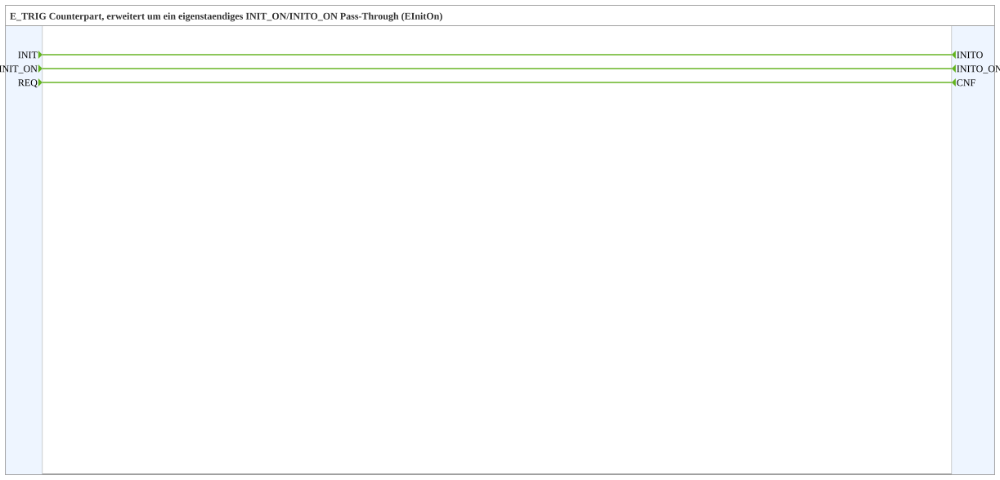

# INIT_ON

* * * * * * * * * *

## Einleitung

`INIT_ON` ist das Gegenstück zu `E_TRIG`, erweitert um einen eigenständigen `INIT_ON`/`INITO_ON`-Pass-Through (Ereignistyp `EInitOn`). Der Baustein enthält keine Logik; jedes Eingangsereignis wird direkt an den zugehörigen Ausgang weitergereicht.

## Schnittstellenstruktur

### **Ereignis-Eingänge**

| Name | Typ | Kommentar |
| --- | --- | --- |
| INIT | EInit | Initialisierungsanforderung |
| INIT_ON | EInitOn | Initialisierungsanforderung, eigener Kanal unabhängig von `INIT` |
| REQ | Event | Dienstanforderung |

### **Ereignis-Ausgänge**

| Name | Typ | Kommentar |
| --- | --- | --- |
| INITO | EInit | Initialisierungsbestätigung |
| INITO_ON | EInitOn | Initialisierungsbestätigung, eigener Kanal unabhängig von `INITO` |
| CNF | Event | Bestätigung der angeforderten Dienstanforderung |

### **Daten-Eingänge**

Keine.

### **Daten-Ausgänge**

Keine.

### **Adapter**

Keine.

## Funktionsweise

Der Baustein besteht nur aus Ereignisverbindungen:

- `INIT` → `INITO`
- `REQ` → `CNF`
- `INIT_ON` → `INITO_ON`

## Technische Besonderheiten

- Reine Durchleitung ohne Logik und ohne Daten
- Der `INIT_ON`-Kanal ist unabhängig vom `INIT`-Kanal

## Anwendungsszenarien

- Weiterreichen von Initialisierungsereignissen eines eigenen Kanals (`EInitOn`) in einer Kette von Bausteinen

## ⚖️ Vergleich mit ähnlichen Bausteinen

- [INIT](./INIT.md) enthält nur `INIT`/`REQ` ohne den `INIT_ON`-Kanal
- [INIT_OFF](./INIT_OFF.md) bietet statt dessen einen `INIT_OFF`/`INITO_OFF`-Kanal (`EInitOff`), [INIT_ON_OFF](./INIT_ON_OFF.md) bietet beide Kanäle

## Fazit

`INIT_ON` reicht `INIT`, `INIT_ON` und `REQ` unverändert als `INITO`, `INITO_ON` und `CNF` weiter.
