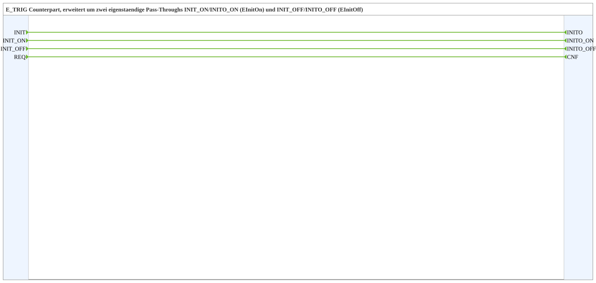

# INIT_ON_OFF

* * * * * * * * * *

## Einleitung

`INIT_ON_OFF` ist das Gegenstück zu `E_TRIG`, erweitert um zwei eigenständige Pass-Throughs: `INIT_ON`/`INITO_ON` (Ereignistyp `EInitOn`) und `INIT_OFF`/`INITO_OFF` (Ereignistyp `EInitOff`). Der Baustein enthält keine Logik; jedes Eingangsereignis wird direkt an den zugehörigen Ausgang weitergereicht.

## Schnittstellenstruktur

### **Ereignis-Eingänge**

- **INIT** (`EInit`): Initialisierungsanforderung
- **INIT_ON** (`EInitOn`): Initialisierungsanforderung, eigener Kanal unabhängig von `INIT`
- **INIT_OFF** (`EInitOff`): Initialisierungsanforderung, eigener Kanal unabhängig von `INIT`
- **REQ**: Serviceanforderung

### **Ereignis-Ausgänge**

- **INITO** (`EInit`): Initialisierungsbestätigung
- **INITO_ON** (`EInitOn`): Initialisierungsbestätigung, eigener Kanal unabhängig von `INITO`
- **INITO_OFF** (`EInitOff`): Initialisierungsbestätigung, eigener Kanal unabhängig von `INITO`
- **CNF**: Bestätigung des angeforderten Dienstes

### **Daten-Eingänge**

*Keine Daten-Eingänge vorhanden*

### **Daten-Ausgänge**

*Keine Daten-Ausgänge vorhanden*

### **Adapter**

Dieser Funktionsblock verwendet keine Adapter.

## Funktionsweise

Reine Ereignisverbindungen:

- `INIT` → `INITO`
- `REQ` → `CNF`
- `INIT_ON` → `INITO_ON`
- `INIT_OFF` → `INITO_OFF`

## Technische Besonderheiten

- Composite-Funktionsblock (`FBNetwork`) ohne Daten und ohne internen Zustand
- Die drei Initialisierungskanäle sind voneinander unabhängig, sodass ein- und ausschaltbezogene Initialisierungen getrennt verdrahtet werden können.
- Siehe auch [`INIT`](INIT.md).

## Anwendungsszenarien

- Getrennte Initialisierungs-Ereignisse für Ein- und Ausschaltpfad in einem Netzwerk

## 🛠️ Zugehörige Übungen

- [Uebung_006g_AX](https://meisterschulen-am-ostbahnhof-munchen-docs.readthedocs.io/projects/4diac-exercises-docs/de/latest/Uebungen/test_AX/Uebungen_doc/Uebung_006g_AX/)

## Fazit

`INIT_ON_OFF` stellt drei unabhängige Initialisierungs-Durchreichungen und eine `REQ`/`CNF`-Durchreichung bereit.
