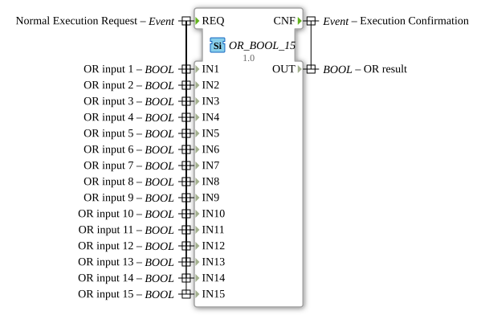

# OR_BOOL_15

* * * * * * * * * *

## Einleitung

Der Funktionsblock `OR_BOOL_15` ist ein generischer Baustein zur Berechnung der logischen ODER-Verknüpfung (Klassifikation `standard boolean function`, IEC 61131-3). Er verknüpft 15 separate BOOL-Eingänge (`IN1` bis `IN15`) und liefert das Ergebnis am Ausgang `OUT`. Er ergänzt die Standard-OR_BOOL-Familie (bisher bis `OR_BOOL_16`) um die Variante mit 15 Eingängen.

## Schnittstellenstruktur

### **Ereignis-Eingänge**

-   **REQ (Normal Execution Request):** Löst die Berechnung aus. Das Ereignis ist mit allen 15 Daten-Eingängen (`IN1` bis `IN15`) verknüpft.

### **Ereignis-Ausgänge**

-   **CNF (Execution Confirmation):** Signalisiert den Abschluss der Berechnung. Das Ereignis ist mit dem Datenausgang `OUT` verknüpft.

### **Daten-Eingänge**

-   **IN1 (OR input 1):** Boolescher Eingang 1.
-   **IN2 (OR input 2):** Boolescher Eingang 2.
-   **IN3 (OR input 3):** Boolescher Eingang 3.
-   **IN4 (OR input 4):** Boolescher Eingang 4.
-   **IN5 (OR input 5):** Boolescher Eingang 5.
-   **IN6 (OR input 6):** Boolescher Eingang 6.
-   **IN7 (OR input 7):** Boolescher Eingang 7.
-   **IN8 (OR input 8):** Boolescher Eingang 8.
-   **IN9 (OR input 9):** Boolescher Eingang 9.
-   **IN10 (OR input 10):** Boolescher Eingang 10.
-   **IN11 (OR input 11):** Boolescher Eingang 11.
-   **IN12 (OR input 12):** Boolescher Eingang 12.
-   **IN13 (OR input 13):** Boolescher Eingang 13.
-   **IN14 (OR input 14):** Boolescher Eingang 14.
-   **IN15 (OR input 15):** Boolescher Eingang 15.

### **Daten-Ausgänge**

-   **OUT (OR result):** Das Ergebnis der ODER-Verknüpfung aller 15 Eingänge. Der Ausgang ist TRUE, wenn mindestens ein Eingang TRUE ist, und nur FALSE, wenn alle Eingänge `IN1` bis `IN15` FALSE sind.

### **Adapter**

Dieser Funktionsblock verfügt über keine Adapterschnittstellen.

## Funktionsweise

Bei jedem Eintreffen des Ereignisses `REQ` werden alle 15 Eingänge gelesen und die Operation `OUT = IN1 OR IN2 OR ... OR IN15` berechnet. Anschließend wird das Ergebnis an `OUT` bereitgestellt und `CNF` ausgelöst.

## Technische Besonderheiten

-   **Generischer Baustein:** Der Typ trägt das Attribut `GenericClassName = 'GEN_OR_BOOL'`; diese Instanz ist fest auf 15 Eingänge ausgelegt.
-   **Package:** `iec61131::booleanOperators`.
-   **Zustandslos:** Der Baustein ist speicherlos: `OUT` hängt ausschließlich von den Werten der Eingänge zum Zeitpunkt von `REQ` ab.

## Anwendungsszenarien

-   **Sammelstörung:** Mehrere Fehler- oder Warnsignale zu einem gemeinsamen Signal zusammenfassen.
-   **Mehrfach-Auslösung:** Eine Aktion soll starten, sobald mindestens eine von vielen Bedingungen oder Tasten aktiv ist.

## ⚖️ Vergleich mit ähnlichen Bausteinen

-   [`AND_BOOL_15`](./AND_BOOL_15.md): Führt die UND-Verknüpfung durch: Das Ergebnis ist nur TRUE, wenn alle Eingänge TRUE sind, während bei `OR_BOOL_15` mindestens ein TRUE-Eingang genügt.
-   [`OR_BOOL_16`](./OR_BOOL_16.md): Gleichartiger Baustein der Familie mit 16 Eingängen.

## Fazit

`OR_BOOL_15` ist ein einfacher, ereignisgesteuerter Baustein für die ODER-Verknüpfung von 15 booleschen Signalen mit fester Schnittstelle.

---

### 🌐 Passende Themen-Unterseiten auf ms-muc-docs.de

- [🌐 Eclipse 4diac IDE & Farb-Referenz auf ms-muc-docs.de](https://www.ms-muc-docs.de/iec-61499/eclipse-4diac/)
