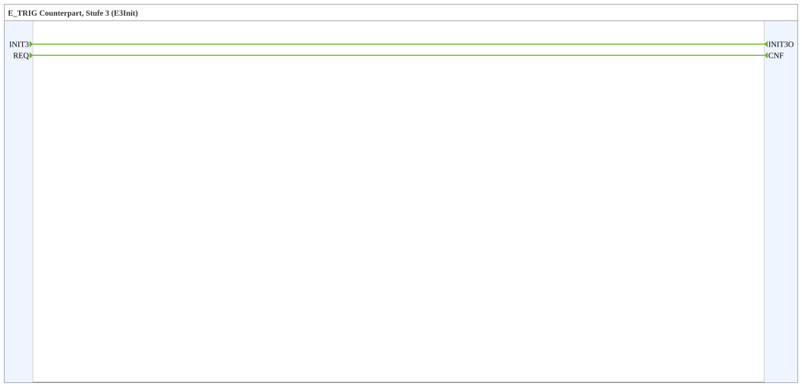

# INIT3

* * * * * * * * * *

## Einleitung

`INIT3` ist Stufe 3 der gestuften Initialisierung (Bibliothek `init_stages`, Paket `events::init`). Der Funktionsblock ist das Gegenstück zu einem [`E_TRIG`](../../../../StandardLibraries/events/E_TRIG.md) mit dem Ereignistyp `E3Init`: Der `E_TRIG` löst den unverbundenen Eingang `INIT3` aus, `INIT3O` wird an das `INIT` des Ziels angeschlossen. Sie läuft nach Stufe 2. Der Baustein enthält keine Logik.

## Schnittstellenstruktur

### **Ereignis-Eingänge**

| Name | Typ | Kommentar |
| ---- | --- | --------- |
| INIT3 | E3Init | Initialisierungsanforderung |
| REQ | Event | Dienstanforderung |

### **Ereignis-Ausgänge**

| Name | Typ | Kommentar |
| ---- | --- | --------- |
| INIT3O | E3Init | Initialisierungsbestätigung |
| CNF | Event | Bestätigung der Anforderung |

### **Daten-Eingänge**

Keine.

### **Daten-Ausgänge**

Keine.

### **Adapter**

Keine.

## Funktionsweise

Reine Ereignisverbindungen im inneren FBNetzwerk:

- `INIT3` → `INIT3O`
- `REQ` → `CNF`

## Verwendung

1. `INIT3` direkt neben das Ziel setzen, das in dieser Stufe initialisiert werden soll.
2. `INIT3O` mit dem `INIT` des Ziels verbinden. Es muss nichts durch die Hierarchie verdrahtet werden.
3. In `EMB_RES` einen `E_TRIG` mit `EVENTTYPE` `'E3Init'` in die Kette der Stufen einhängen (siehe [`init_stages`](../../index.md)).

## Technische Besonderheiten

- Composite-Funktionsblock ohne Daten und ohne internen Zustand.
- Der Ereignistyp `E3Init` ist eigenständig; nur ein `E_TRIG` mit diesem `EVENTTYPE` löst den Eingang aus.
- Eine Stufe gilt als durch, wenn alle ihre Eingänge angestoßen sind, nicht, wenn die Ziele fertig initialisiert sind.
- Siehe auch [`INIT`](INIT.md) (Standardstufe, `EInit`).

## Fazit

`INIT3` verbindet Initialisierungsstufe 3 mit dem Ziel, ohne Verdrahtung durch die Hierarchie.
