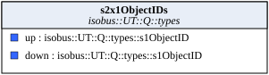

# s2x1ObjectIDs

* * * * * * * * * *

## Einleitung

Beschreibung aus dem Kommentar des Typs: a Struct holding 2x1 Object IDs

Paket: `isobus::UT::Q::types`

## Schnittstellenstruktur

### **Felder**

-   **up** (Typ: `isobus::UT::Q::types::s1ObjectID`): forward, up, right, clockwise (Vorgabewert: `(u16ObjId := ID_NULL)`)
-   **down** (Typ: `isobus::UT::Q::types::s1ObjectID`): backward, down, left, counter-clockwise (Vorgabewert: `(u16ObjId := ID_NULL)`)

Hinweis: Diese Seite wurde aus der Typdefinition (`s2x1ObjectIDs.dtp`) erzeugt und gibt nur die Schnittstelle wieder. Eine ausführliche Beschreibung des Verhaltens fehlt noch.
