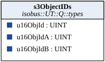

# s3ObjectIDs

* * * * * * * * * *

## Einleitung

Beschreibung aus dem Kommentar des Typs: a Struct holding 3 Object IDs

Paket: `isobus::UT::Q::types`

## Schnittstellenstruktur

### **Felder**

-   **u16ObjId** (Typ: `UINT`): Object ID Softkey (Vorgabewert: `ID_NULL`)
-   **u16ObjIdA** (Typ: `UINT`): Object ID AUX (Vorgabewert: `ID_NULL`)
-   **u16ObjIdB** (Typ: `UINT`): Object ID Button (Vorgabewert: `ID_NULL`)

Hinweis: Diese Seite wurde aus der Typdefinition (`s3ObjectIDs.dtp`) erzeugt und gibt nur die Schnittstelle wieder. Eine ausführliche Beschreibung des Verhaltens fehlt noch.
