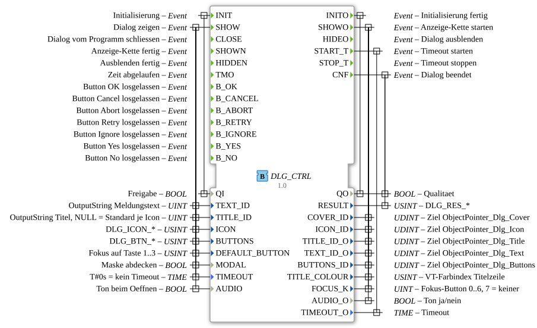

# DLG_CTRL

* * * * * * * * * *

## Einleitung

Beschreibung aus dem Kommentar des Typs: Ablaufsteuerung eines VT-Dialogs (MessageBox)

Paket: `isobus::UT::dialog`

## Schnittstellenstruktur

### **Ereignis-Eingänge**

-   **INIT** (Typ: `EInit`): Initialisierung (mit Daten: `QI`)
-   **SHOW** (Typ: `Event`): Dialog zeigen (mit Daten: `TEXT_ID`, `TITLE_ID`, `ICON`, `BUTTONS`, `DEFAULT_BUTTON`, `MODAL`, `TIMEOUT`, `AUDIO`)
-   **CLOSE** (Typ: `Event`): Dialog vom Programm schliessen
-   **SHOWN** (Typ: `Event`): Anzeige-Kette fertig
-   **HIDDEN** (Typ: `Event`): Ausblenden fertig
-   **TMO** (Typ: `Event`): Zeit abgelaufen
-   **B_OK** (Typ: `Event`): Button OK losgelassen
-   **B_CANCEL** (Typ: `Event`): Button Cancel losgelassen
-   **B_ABORT** (Typ: `Event`): Button Abort losgelassen
-   **B_RETRY** (Typ: `Event`): Button Retry losgelassen
-   **B_IGNORE** (Typ: `Event`): Button Ignore losgelassen
-   **B_YES** (Typ: `Event`): Button Yes losgelassen
-   **B_NO** (Typ: `Event`): Button No losgelassen

### **Ereignis-Ausgänge**

-   **INITO** (Typ: `EInit`): Initialisierung fertig (mit Daten: `QO`)
-   **SHOWO** (Typ: `Event`): Anzeige-Kette starten (mit Daten: `COVER_ID`, `ICON_ID`, `TITLE_ID_O`, `TEXT_ID_O`, `BUTTONS_ID`, `TITLE_COLOUR`, `FOCUS_K`, `AUDIO_O`)
-   **HIDEO** (Typ: `Event`): Dialog ausblenden
-   **START_T** (Typ: `Event`): Timeout starten (mit Daten: `TIMEOUT_O`)
-   **STOP_T** (Typ: `Event`): Timeout stoppen
-   **CNF** (Typ: `Event`): Dialog beendet (mit Daten: `QO`, `RESULT`)

### **Daten-Eingänge**

-   **QI** (Typ: `BOOL`): Freigabe (Vorgabewert: `TRUE`)
-   **TEXT_ID** (Typ: `UINT`): OutputString Meldungstext (Vorgabewert: `UINT#65535`)
-   **TITLE_ID** (Typ: `UINT`): OutputString Titel, NULL = Standard je Icon (Vorgabewert: `UINT#65535`)
-   **ICON** (Typ: `USINT`): DLG_ICON_* (Vorgabewert: `USINT#1`)
-   **BUTTONS** (Typ: `USINT`): DLG_BTN_* (Vorgabewert: `USINT#1`)
-   **DEFAULT_BUTTON** (Typ: `USINT`): Fokus auf Taste 1..3 (Vorgabewert: `USINT#1`)
-   **MODAL** (Typ: `BOOL`): Maske abdecken (Vorgabewert: `FALSE`)
-   **TIMEOUT** (Typ: `TIME`): T#0s = kein Timeout (Vorgabewert: `T#0s`)
-   **AUDIO** (Typ: `BOOL`): Ton beim Oeffnen (Vorgabewert: `FALSE`)

### **Daten-Ausgänge**

-   **QO** (Typ: `BOOL`): Qualitaet
-   **RESULT** (Typ: `USINT`): DLG_RES_*
-   **COVER_ID** (Typ: `UDINT`): Ziel ObjectPointer_Dlg_Cover
-   **ICON_ID** (Typ: `UDINT`): Ziel ObjectPointer_Dlg_Icon
-   **TITLE_ID_O** (Typ: `UDINT`): Ziel ObjectPointer_Dlg_Title
-   **TEXT_ID_O** (Typ: `UDINT`): Ziel ObjectPointer_Dlg_Text
-   **BUTTONS_ID** (Typ: `UDINT`): Ziel ObjectPointer_Dlg_Buttons
-   **TITLE_COLOUR** (Typ: `USINT`): VT-Farbindex Titelzeile
-   **FOCUS_K** (Typ: `UINT`): Fokus-Button 0..6, 7 = keiner
-   **AUDIO_O** (Typ: `BOOL`): Ton ja/nein
-   **TIMEOUT_O** (Typ: `TIME`): Timeout

### **Adapter (Sockets)**

Keine.

### **Adapter (Plugs)**

Keine.

Hinweis: Diese Seite wurde aus der Typdefinition (`DLG_CTRL.fbt`) erzeugt und gibt nur die Schnittstelle wieder. Eine ausführliche Beschreibung des Verhaltens fehlt noch.
