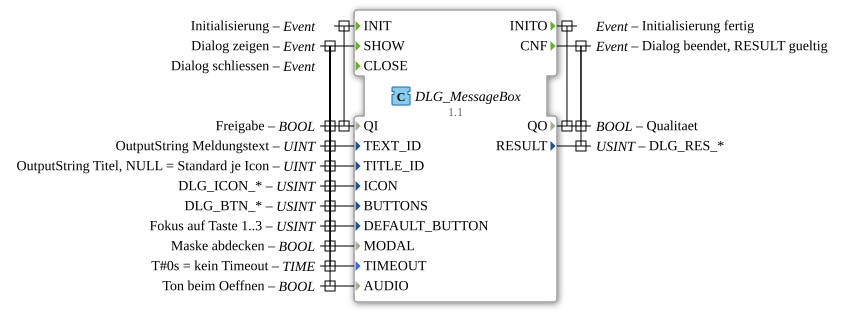

# DLG_MessageBox

* * * * * * * * * *

## Einleitung

Beschreibung aus dem Kommentar des Typs: VT-Dialog wie Windows-MessageBox (eine Instanz je Anwendung)

Paket: `isobus::UT::dialog`

## Schnittstellenstruktur

### **Ereignis-Eingänge**

-   **INIT** (Typ: `EInit`): Initialisierung (mit Daten: `QI`)
-   **SHOW** (Typ: `Event`): Dialog zeigen (mit Daten: `QI`, `TEXT_ID`, `TITLE_ID`, `ICON`, `BUTTONS`, `DEFAULT_BUTTON`, `MODAL`, `TIMEOUT`, `AUDIO`)
-   **CLOSE** (Typ: `Event`): Dialog schliessen

### **Ereignis-Ausgänge**

-   **INITO** (Typ: `EInit`): Initialisierung fertig (mit Daten: `QO`)
-   **CNF** (Typ: `Event`): Dialog beendet, RESULT gueltig (mit Daten: `QO`, `RESULT`)

### **Daten-Eingänge**

-   **QI** (Typ: `BOOL`): Freigabe (Vorgabewert: `TRUE`)
-   **TEXT_ID** (Typ: `UINT`): OutputString Meldungstext (Vorgabewert: `ID_NULL`)
-   **TITLE_ID** (Typ: `UINT`): OutputString Titel, NULL = Standard je Icon (Vorgabewert: `ID_NULL`)
-   **ICON** (Typ: `USINT`): DLG_ICON_* (Vorgabewert: `USINT#1`)
-   **BUTTONS** (Typ: `USINT`): DLG_BTN_* (Vorgabewert: `USINT#1`)
-   **DEFAULT_BUTTON** (Typ: `USINT`): Fokus auf Taste 1..3 (Vorgabewert: `USINT#1`)
-   **MODAL** (Typ: `BOOL`): Maske abdecken (Vorgabewert: `FALSE`)
-   **TIMEOUT** (Typ: `TIME`): T#0s = kein Timeout (Vorgabewert: `T#0s`)
-   **AUDIO** (Typ: `BOOL`): Ton beim Oeffnen (Vorgabewert: `FALSE`)

### **Daten-Ausgänge**

-   **QO** (Typ: `BOOL`): Qualitaet
-   **RESULT** (Typ: `USINT`): DLG_RES_*

### **Adapter (Sockets)**

Keine.

### **Adapter (Plugs)**

Keine.

## Funktionsweise (aus der Quelle)

Diese Beschreibung ist aus der Typdefinition abgeleitet und gibt Zustände, Übergänge und Algorithmen wieder. Sie wurde nicht auf Hardware getestet.

### Interne Bausteine

-   **CTRL**: Instanz von `isobus::UT::dialog::DLG_CTRL`
-   **QN_COVER**: Instanz von `isobus::UT::Q::Q_NumericValue`
-   **QN_ICON**: Instanz von `isobus::UT::Q::Q_NumericValue`
-   **QN_TITLE**: Instanz von `isobus::UT::Q::Q_NumericValue`
-   **QN_TEXT**: Instanz von `isobus::UT::Q::Q_NumericValue`
-   **QN_BUTTONS**: Instanz von `isobus::UT::Q::Q_NumericValue`
-   **QF_TITLE**: Instanz von `isobus::UT::Q::Q_FillAttributes`
-   **QH_SHOW**: Instanz von `isobus::UT::Q::Q_ObjHideShow`
-   **QH_HIDE**: Instanz von `isobus::UT::Q::Q_ObjHideShow`
-   **FOCUS**: Instanz von `iec61499::events::E_DEMUX_8`
-   **QS_OK**: Instanz von `isobus::UT::Q::Q_ObjSelectInput`
-   **QS_CANCEL**: Instanz von `isobus::UT::Q::Q_ObjSelectInput`
-   **QS_ABORT**: Instanz von `isobus::UT::Q::Q_ObjSelectInput`
-   **QS_RETRY**: Instanz von `isobus::UT::Q::Q_ObjSelectInput`
-   **QS_IGNORE**: Instanz von `isobus::UT::Q::Q_ObjSelectInput`
-   **QS_YES**: Instanz von `isobus::UT::Q::Q_ObjSelectInput`
-   **QS_NO**: Instanz von `isobus::UT::Q::Q_ObjSelectInput`
-   **FOCUS_DONE**: Instanz von `iec61499::events::E_MUX_8`
-   **AUDIO_SW**: Instanz von `iec61499::events::E_SWITCH`
-   **Q_AUDIO**: Instanz von `isobus::UT::Q::Q_CtrlAudioSignal`
-   **AUDIO_DONE**: Instanz von `iec61499::events::E_MERGE`
-   **TIMER**: Instanz von `iec61499::events::E_DELAY`
-   **BTN_OK**: Instanz von `isobus::UT::io::Button::Button_IE`
-   **BTN_CANCEL**: Instanz von `isobus::UT::io::Button::Button_IE`
-   **BTN_ABORT**: Instanz von `isobus::UT::io::Button::Button_IE`
-   **BTN_RETRY**: Instanz von `isobus::UT::io::Button::Button_IE`
-   **BTN_IGNORE**: Instanz von `isobus::UT::io::Button::Button_IE`
-   **BTN_YES**: Instanz von `isobus::UT::io::Button::Button_IE`
-   **BTN_NO**: Instanz von `isobus::UT::io::Button::Button_IE`

Hinweis: Diese Seite wurde aus der Typdefinition (`DLG_MessageBox.fbt`) erzeugt und gibt nur die Schnittstelle wieder. Eine ausführliche Beschreibung des Verhaltens fehlt noch.
