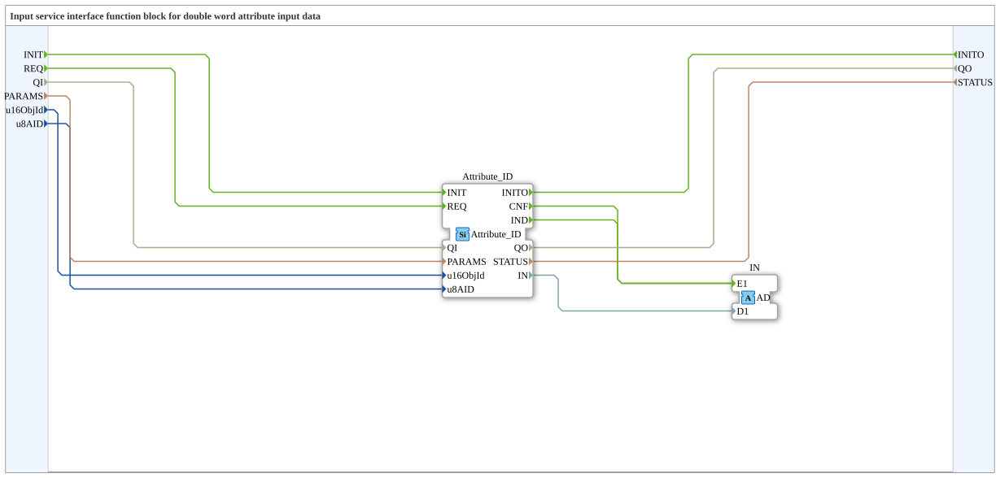

# Attribute_IDA

* * * * * * * * * *

## Einleitung

`Attribute_IDA` ist ein Eingabe-Service-Interface-Funktionsblock für Doppelwort-Attributdaten (`DWORD`). Er kapselt [`Attribute_ID`](./Attribute_ID.md) und stellt den gelesenen Attributwert eines VT-Objekts (Objekt-ID `u16ObjId`, Attribut-ID `u8AID`) nicht über einen Datenausgang, sondern über den Adapter-Plug `IN` (`AD`) bereit. Ereignis und Wert werden dabei in einer Adapterverbindung gebündelt.

## Verwendete Funktionsbausteine (FBs)

### Sub-Bausteine: Attribute_IDA

- **Typ**: Composite-Funktionsblock
- **Verwendete interne FBs**:
    - **Attribute_ID**: `isobus::UT::io::Attribute::Attribute_ID` – liest das Attribut des VT-Objekts
- **Import**: `isobus::UT::Q::const::IDs::ID_NULL`

## Schnittstellenstruktur

### **Ereignis-Eingänge**

- **INIT** (`EInit`): Service-Initialisierung
    - Verknüpft mit: `QI`, `PARAMS`, `u16ObjId`, `u8AID`
- **REQ**: Service-Anfrage
    - Verknüpft mit: `QI`

### **Ereignis-Ausgänge**

- **INITO** (`EInit`): Initialisierungsbestätigung
    - Verknüpft mit: `QO`, `STATUS`

### **Daten-Eingänge**

- **QI** (`BOOL`): Ereignis-Eingangsqualifizierer
- **PARAMS** (`STRING`): Service-Parameter
- **u16ObjId** (`UINT`, Initialwert `ID_NULL`): Objekt-ID
- **u8AID** (`USINT`): Attribut-ID des Objekts

### **Daten-Ausgänge**

- **QO** (`BOOL`): Ereignis-Ausgangsqualifizierer
- **STATUS** (`STRING`): Service-Status

### **Adapter**

- **IN** (Plug): `adapter::types::unidirectional::AD` – Eingabedaten von der Ressource (Ereignis `E1`, Daten `D1` mit dem `DWORD`-Attributwert)

## Programmablauf und Verbindungen

- `INIT` → `Attribute_ID.INIT`; `REQ` → `Attribute_ID.REQ`; `Attribute_ID.INITO` → `INITO`
- `Attribute_ID.IND` → `IN.E1` und `Attribute_ID.CNF` → `IN.E1`
- `u16ObjId`, `u8AID`, `PARAMS`, `QI` → gleichnamige Eingänge von `Attribute_ID`
- `Attribute_ID.IN` → `IN.D1`
- `Attribute_ID.STATUS` → `STATUS`; `Attribute_ID.QO` → `QO`

## Technische Besonderheiten

- Sowohl `IND` als auch `CNF` des inneren Bausteins lösen `IN.E1` aus; der Wert liegt jeweils an `IN.D1`
- Der Adapter bündelt Ereignis- und Datenfluss in einer Verbindungslinie
- Version 1.0 (2026-09-15)

## Anwendungsszenarien

- Auslesen von Attributwerten eines VT-Objekts und Weiterverarbeitung über `AD`-Adapter, z. B. über `AD_TO_AX`-Konverter

## ⚖️ Vergleich mit ähnlichen Bausteinen

- [Attribute_ID](./Attribute_ID.md) stellt `IN` als Datenausgang und `CNF`/`IND` als Ereignisausgänge bereit, `Attribute_IDA` bündelt beides im Adapter `IN`.

## Fazit

`Attribute_IDA` liefert den Attributwert eines VT-Objekts als `DWORD` über einen `AD`-Adapter.
