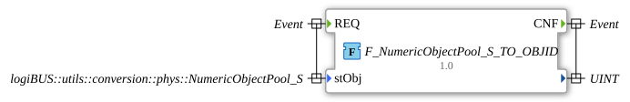

# F_NumericObjectPool_S_TO_OBJID

* * * * * * * * * *

## Einleitung

`F_NumericObjectPool_S_TO_OBJID` extrahiert die ISOBUS-Object-ID (`u16ObjId`) aus einer `NumericObjectPool_S`-Struktur (`logiBUS::utils::conversion::phys::NumericObjectPool_S`).

## Schnittstellenstruktur

### **Ereignis-Eingänge**

- **REQ**: Ausführungsanforderung (assoziiert mit `stObj`)

### **Ereignis-Ausgänge**

- **CNF**: Bestätigung (assoziiert mit dem Funktionsergebnis)

### **Daten-Eingänge**

- **stObj** (`logiBUS::utils::conversion::phys::NumericObjectPool_S`): Object-Pool-Struktur einer VT-Zahlenvariable

### **Daten-Ausgänge**

- **(Funktionsergebnis)** (UINT): die Object ID `stObj.u16ObjId`

### **Adapter**

Es werden keine Adapter verwendet.

## Funktionsweise

Die Funktion besteht aus einer einzigen Zuweisung: `F_NumericObjectPool_S_TO_OBJID := stObj.u16ObjId;`. Bei `REQ` wird die Object ID aus der Struktur gelesen und mit `CNF` ausgegeben.

## Technische Besonderheiten

- Reine Funktion ohne Zustand, Version 1.0 (2026-10-11)
- Der Ausgang besitzt keinen eigenen Namen, sondern ist der Rückgabewert der Funktion
- Die Funktion liegt im Paket `logiBUS::utils::conversion::phys`

## Anwendungsszenarien

- Zugriff auf die Object ID einer VT-Zahlenvariable, wenn ein Baustein nur die einfache `UINT`-ID statt der ganzen `NumericObjectPool_S`-Struktur erwartet

## Fazit

`F_NumericObjectPool_S_TO_OBJID` liefert die `u16ObjId` einer `NumericObjectPool_S`-Struktur als `UINT`.
