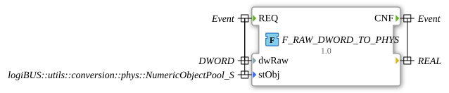

# F_RAW_DWORD_TO_PHYS

* * * * * * * * * *

## Einleitung

Die Funktion `F_RAW_DWORD_TO_PHYS` wandelt einen ISOBUS-Rohwert (`DWORD`) in einen physikalischen `REAL`-Wert um. Die ISOBUS-Formel lautet: `Anzeige = (Rohwert + Offset) * Skalierung`.

## Schnittstellenstruktur

### **Ereignis-Eingänge**

- **REQ**: Startet die Umrechnung. Verbundene Daten: `dwRaw`, `stObj`.

### **Ereignis-Ausgänge**

- **CNF**: Signalisiert die abgeschlossene Umrechnung. Das Ergebnis liegt am Daten-Ausgang an.

### **Daten-Eingänge**

- **dwRaw** (`DWORD`): ISOBUS-Rohwert
- **stObj** (`logiBUS::utils::conversion::phys::NumericObjectPool_S`): Object-Pool-Eigenschaften der Zahlenvariable (Offset `i32Offset`, Skalierung `r32Scale`)

### **Daten-Ausgänge**

- **(unbenannt)** (`REAL`): Physikalischer Wert (Rückgabewert der Funktion)

### **Adapter**

Keine Adapter vorhanden.

## Funktionsweise

1. `dwRaw` wird als vorzeichenlose Zahl interpretiert (`DWORD_TO_UDINT`) und zu `LINT` erweitert (`i64Raw`).
2. `stObj.i32Offset` wird ohne Umwandlung als `LINT` verwendet (`i64Offset`).
3. Das Ergebnis ist `LINT_TO_REAL(i64Raw + i64Offset) * stObj.r32Scale`.

**Beispiel:** `raw = 50000`, `scale = 0.01`, `offset = -100000` → `50000 + (-100000) = -50000` → `-50000 * 0.01 = -500.0`.

## Technische Besonderheiten

- Implementiert als ST-Funktion (`FUNCTION ... : REAL`) im Paket `logiBUS::utils::conversion::phys`.
- Die Zwischenwerte sind `LINT`, um einen Überlauf zu vermeiden.
- Der Rohwert wird als Bitmuster ohne Vorzeichen behandelt und dann auf 64 Bit erweitert.

## Anwendungsszenarien

- Umrechnung von ISOBUS-Rohwerten (z. B. aus einer VT-Zahlenvariable) in physikalische Größen

## ⚖️ Vergleich mit ähnlichen Bausteinen

- [F_RAW_TO_PHYS](./F_RAW_TO_PHYS.md) und [F_RAW_TO_PHYS_LREAL](./F_RAW_TO_PHYS_LREAL.md) sind verwandte Umrechnungen; die Gegenrichtung leisten [F_PHYS_TO_RAW](./F_PHYS_TO_RAW.md) und [F_PHYS_LREAL_TO_RAW](./F_PHYS_LREAL_TO_RAW.md).

## Fazit

`F_RAW_DWORD_TO_PHYS` rechnet einen ISOBUS-`DWORD`-Rohwert mit Offset und Skalierung aus dem Object Pool in einen `REAL`-Wert um.
