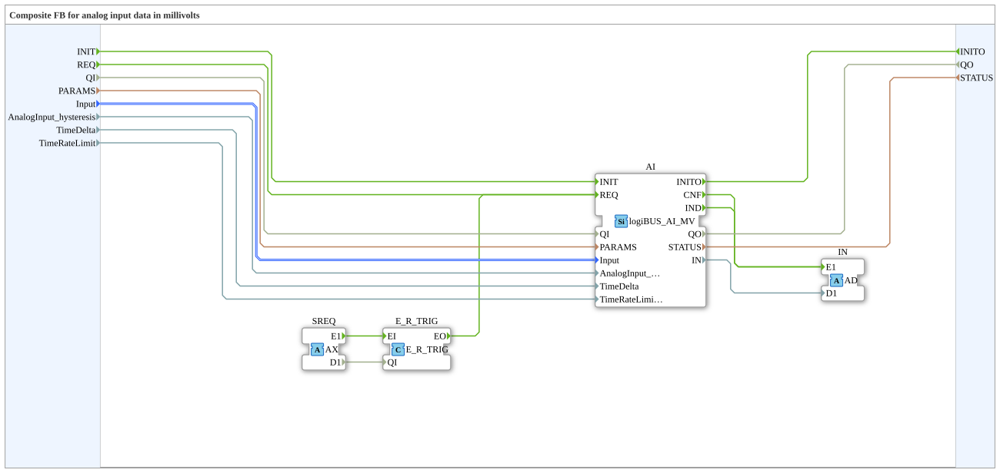

# logiBUS_AI_MVA

* * * * * * * * * *

## Einleitung

`logiBUS_AI_MVA` ist ein Composite-Baustein um [`logiBUS_AI_MV`](logiBUS_AI_MV.md) mit Adapter-Ausgang: `IN` (Adapter `AD`) liefert die kalibrierte Spannung am Pin in Millivolt. Er verhält sich zu `logiBUS_AI_MV` wie [`logiBUS_AI_IDA`](logiBUS_AI_IDA.md) zu `logiBUS_AI_ID`.

## Schnittstellenstruktur

### **Ereignis-Eingänge**

| Ereignis | Typ   | Mit                                                                 | Beschreibung                                        |
| -------- | ----- | ------------------------------------------------------------------- | --------------------------------------------------- |
| INIT     | EInit | QI, PARAMS, Input, AnalogInput_hysteresis, TimeDelta, TimeRateLimit | Service-Initialisierung, wird direkt durchgereicht  |
| REQ      | Event | QI                                                                  | Sofortige Abfrage                                   |

### **Ereignis-Ausgänge**

| Ereignis | Typ   | Mit        | Beschreibung                    |
| -------- | ----- | ---------- | ------------------------------- |
| INITO    | EInit | QO, STATUS | Bestätigung der Initialisierung |

### **Daten-Eingänge**

| Name                   | Typ                           | Initialwert | Beschreibung                                                                            |
| ---------------------- | ----------------------------- | ----------- | --------------------------------------------------------------------------------------- |
| QI                     | BOOL                          | –           | Event-Input-Qualifier                                                                   |
| PARAMS                 | STRING                        | –           | Service-Parameter                                                                       |
| Input                  | logiBUS::io::AI::logiBUS_AI_S | Invalid     | Auswahl des Eingangs (I1..I8)                                                           |
| AnalogInput_hysteresis | DWORD                         | –           | IND, wenn sich die Spannung um mehr als so viele mV ändert (0 = aus, 1 = jede Änderung) |
| TimeDelta              | DWORD                         | 250         | Zyklisches IND spätestens nach so vielen ms (0 oder 16#FFFFFFFF = aus)                  |
| TimeRateLimit          | DWORD                         | 100         | Höchstens ein IND pro so vielen ms (kleiner als TimeDelta)                              |

### **Daten-Ausgänge**

| Name   | Typ    | Beschreibung           |
| ------ | ------ | ---------------------- |
| QO     | BOOL   | Event-Output-Qualifier |
| STATUS | STRING | Service-Status         |

### **Adapter**

| Richtung | Name | Typ                                | Beschreibung                                                                                                                  |
| -------- | ---- | ---------------------------------- | ----------------------------------------------------------------------------------------------------------------------------- |
| Plug     | IN   | adapter::types::unidirectional::AD | Liefert die kalibrierte Spannung am Pin in mV als Adapter-Ereignis und -Daten (`E1`/`D1`) statt der einzelnen `CNF`/`IND`-Events des inneren Bausteins |
| Socket   | SREQ | adapter::types::unidirectional::AX | Externe Service-Anforderung, über `E_R_TRIG` flankengetriggert auf `AI.REQ`                                                   |

## Funktionsweise

Der Baustein kapselt `logiBUS_AI_MV` (Instanz `AI`). Das interne Netzwerk verbindet:

- **INIT** → **AI.INIT** und **AI.INITO** → **INITO**.
- **REQ** → **AI.REQ**: sofortige Abfrage.
- **SREQ.E1** → **E_R_TRIG** → **AI.REQ**: Ein externer Adapter kann ebenfalls eine Abfrage anstoßen.
- **AI.IND** und **AI.CNF** → **IN.E1**, **AI.IN** → **IN.D1**: Neue Daten liegen am Plug `IN` an.
- QI, PARAMS, Input, AnalogInput_hysteresis, TimeDelta und TimeRateLimit gehen direkt an den inneren Baustein, QO und STATUS kommen von dort.

Wert von `IN`, Hysterese und Zeitsteuerung sind wie bei [`logiBUS_AI_MV`](logiBUS_AI_MV.md): `D1` ist die Spannung am Pin in mV, `AnalogInput_hysteresis` gilt in mV.

## Technische Besonderheiten

- **Kalibrierung nötig:** Gibt es für den Kanal keine Kalibrierung, meldet INIT `QO` = FALSE und `STATUS` = `ADC calibration not available`. Das betrifft den ESP32-S31: Mit ESP-IDF 6.1 gibt es dafür noch keine Kalibrierung. Auf ESP32-S3 und ESP32-P4 läuft der Baustein.
- **Die Spannung an der Klemme** hängt vom Spannungsteiler der Platine ab und ist nicht eingerechnet.

## Vergleich mit ähnlichen Bausteinen

- **[`logiBUS_AI_MV`](logiBUS_AI_MV.md):** Der innere Baustein ohne Adapter und ohne externen Anfrage-Socket.
- **[`logiBUS_AI_IDA`](logiBUS_AI_IDA.md):** Gleicher Aufbau, aber `IN` liefert den Rohwert (0-4095) statt Millivolt.
