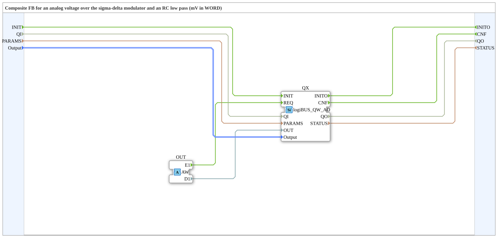

# logiBUS_QWA_AO

* * * * * * * * * *

## Einleitung

Der Funktionsblock `logiBUS_QWA_AO` ist ein Composite um `logiBUS_QW_AO`. Er bekommt die Spannung in mV über einen Adapter (Socket `OUT`, Typ `AW`, in `D1`).

**Voraussetzung:** Auf dem Board oder einer Zusatzplatine muss ein RC-Filter vorhanden sein. Der Baustein ist nicht für die Leistungsausgänge gedacht.

## Schnittstellenstruktur

### **Ereignis-Eingänge**

| Ereignis | Typ | Verknüpft mit / Kommentar |
|---|---|---|
| INIT | EInit | Service-Initialisierung; verknüpft mit QI, PARAMS, Output |
| *kein weiterer Ereignis-Eingang* | | *Neue Werte kommen über den Adapter* |

### **Ereignis-Ausgänge**

| Ereignis | Typ | Verknüpft mit / Kommentar |
|---|---|---|
| INITO | EInit | Initialisierungsbestätigung; verknüpft mit QO, STATUS |
| CNF | Event | Bestätigung der angeforderten Service-Operation; verknüpft mit QO, STATUS |

### **Daten-Eingänge**

| Variable | Typ | Kommentar |
|---|---|---|
| QI | BOOL | Ereignis-Eingangsqualifizierer |
| PARAMS | STRING | Service-Parameter |
| Output | logiBUS::io::DQ::logiBUS_DO_S | Identifiziert den Ausgang Output_Q1..Q8; Initialwert `logiBUS_DO::Invalid` |

### **Daten-Ausgänge**

| Variable | Typ | Kommentar |
|---|---|---|
| QO | BOOL | Ereignis-Ausgangsqualifizierer |
| STATUS | STRING | Service-Status |

### **Adapter**

| Typ | Name | Richtung | Kommentar |
|---|---|---|---|
| adapter::types::unidirectional::AW | OUT | Socket | Empfängt Ereignis (E1) und Spannung in mV (D1) |

## Funktionsweise

Das Composite leitet `INIT` mit `QI`, `PARAMS` und `Output` an den internen `logiBUS_QW_AO` (`QX`) weiter. Ereignis `E1` und Wert `D1` des Adapters `OUT` gehen als `REQ` und `OUT` an `QX`; `CNF` von `QX` geht nach außen.

## Technische Besonderheiten

- Auflösung 256 Stufen, etwa 13 mV; Bereich 0..3287 mV.
- VDD_IO wird mit 3300 mV angenommen, nicht gemessen.
- Die tatsächliche Spannung hängt vom RC-Filter und der Last ab.
- Quelle: Kommentare der `.fbt` in `logiBUS_io-3.3.0`; das Verhalten der Firmware ist dort beschrieben und hier nicht auf der Hardware geprüft.

## Vergleich

| Baustein | Unterschied |
|---|---|
| `logiBUS_QD_SDM` | gleiche Pulsdichte, aber Wert 0..8191 und 1 MHz; kein Spannungswert in mV |

## Anwendungsszenarien

- Einfacher Analogausgang (Sollwert, Hilfsspannung) mit RC-Filter am Logikausgang.
- Spannungssollwerte in mV für nachgeschaltete Elektronik.
