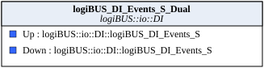

# logiBUS_DI_Events_S_Dual

* * * * * * * * * *

## Einleitung

Beschreibung aus dem Kommentar des Typs: logiBUS DI Events Struct Dual

Paket: `logiBUS::io::DI`

## Schnittstellenstruktur

### **Felder**

-   **Up** (Typ: `logiBUS::io::DI::logiBUS_DI_Events_S`): forward, up, right, clockwise
-   **Down** (Typ: `logiBUS::io::DI::logiBUS_DI_Events_S`): backward, down, left, counter-clockwise

Hinweis: Diese Seite wurde aus der Typdefinition (`logiBUS_DI_Events_S_Dual.dtp`) erzeugt und gibt nur die Schnittstelle wieder. Eine ausführliche Beschreibung des Verhaltens fehlt noch.
