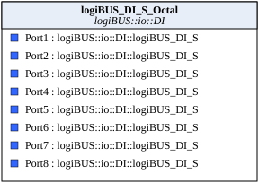

# logiBUS_DI_S_Octal

* * * * * * * * * *

## Einleitung

Beschreibung aus dem Kommentar des Typs: logiBUS DI Struct Octal

Paket: `logiBUS::io::DI`

## Schnittstellenstruktur

### **Felder**

-   **Port1** (Typ: `logiBUS::io::DI::logiBUS_DI_S`) (Vorgabewert: `(Pin := 255)`)
-   **Port2** (Typ: `logiBUS::io::DI::logiBUS_DI_S`) (Vorgabewert: `(Pin := 255)`)
-   **Port3** (Typ: `logiBUS::io::DI::logiBUS_DI_S`) (Vorgabewert: `(Pin := 255)`)
-   **Port4** (Typ: `logiBUS::io::DI::logiBUS_DI_S`) (Vorgabewert: `(Pin := 255)`)
-   **Port5** (Typ: `logiBUS::io::DI::logiBUS_DI_S`) (Vorgabewert: `(Pin := 255)`)
-   **Port6** (Typ: `logiBUS::io::DI::logiBUS_DI_S`) (Vorgabewert: `(Pin := 255)`)
-   **Port7** (Typ: `logiBUS::io::DI::logiBUS_DI_S`) (Vorgabewert: `(Pin := 255)`)
-   **Port8** (Typ: `logiBUS::io::DI::logiBUS_DI_S`) (Vorgabewert: `(Pin := 255)`)

Hinweis: Diese Seite wurde aus der Typdefinition (`logiBUS_DI_S_Octal.dtp`) erzeugt und gibt nur die Schnittstelle wieder. Eine ausführliche Beschreibung des Verhaltens fehlt noch.
