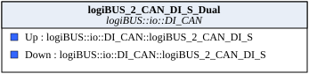

# logiBUS_2_CAN_DI_S_Dual

* * * * * * * * * *

## Einleitung

Beschreibung aus dem Kommentar des Typs: logiBUS 2 CAN DI Struct Dual

Paket: `logiBUS::io::DI_CAN`

## Schnittstellenstruktur

### **Felder**

-   **Up** (Typ: `logiBUS::io::DI_CAN::logiBUS_2_CAN_DI_S`): forward, up, right, clockwise (Vorgabewert: `(Pin := 255)`)
-   **Down** (Typ: `logiBUS::io::DI_CAN::logiBUS_2_CAN_DI_S`): backward, down, left, counter-clockwise (Vorgabewert: `(Pin := 255)`)

Hinweis: Diese Seite wurde aus der Typdefinition (`logiBUS_2_CAN_DI_S_Dual.dtp`) erzeugt und gibt nur die Schnittstelle wieder. Eine ausführliche Beschreibung des Verhaltens fehlt noch.
