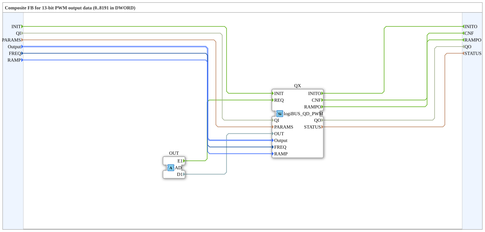

# logiBUS_QDA_PWM

* * * * * * * * * *

## Einleitung

Der Funktionsblock **logiBUS_QDA_PWM** ist ein Composite-Baustein zur Ansteuerung eines PWM-Ausgangs (Double Word) über ein logiBUS-System. Er kapselt die Initialisierung und die Triggerung eines internen PWM-Ausgangsbausteins und stellt eine Adapter-Schnittstelle zur Verfügung, um von außerhalb Aufträge (Ereignis und Daten) zu empfangen. Der Baustein wurde für den Einsatz in der Agrartechnik entwickelt und ist unter der EPL 2.0 lizenziert.

## Schnittstellenstruktur

### **Ereignis-Eingänge**

| Ereignis                         | Typ   | Kommentar                                |
| -------------------------------- | ----- | ---------------------------------------- |
| INIT                             | EInit | Service-Initialisierung                  |
| *kein weiterer Ereignis-Eingang* |       | *Alle Trigger erfolgen über den Adapter* |

### **Ereignis-Ausgänge**

| Ereignis | Typ   | Kommentar                                |
| -------- | ----- | ---------------------------------------- |
| INITO    | EInit | Bestätigung der Initialisierung          |
| CNF      | Event | Bestätigung eines angeforderten Dienstes |
| RAMPO    | Event | Rampe beendet, Wert erreicht (mit `QO`)  |

### **Daten-Eingänge**

| Variable | Typ                           | Kommentar                                                                 |
| -------- | ----------------------------- | ------------------------------------------------------------------------- |
| QI       | BOOL                          | Eingangs-Qualifier (Initialisierung freigeben)                            |
| PARAMS   | STRING                        | Service-Parameter (z. B. Adressierung, Konfiguration)                     |
| Output   | logiBUS::io::DQ::logiBUS_DO_S | Identifikation des Ausgangs (z. B. Output_Q1..Q8); Initialwert: *Invalid* |
| FREQ     | UDINT                         | PWM-Frequenz in Hz, gelesen bei INIT; Initialwert `400`                   |
| RAMP     | TIME                          | Rampenzeit zum neuen Wert, gelesen bei INIT; Initialwert `T#0ms` (Sprung) |

### **Daten-Ausgänge**

| Variable | Typ    | Kommentar                                   |
| -------- | ------ | ------------------------------------------- |
| QO       | BOOL   | Ausgangs-Qualifier (Initialisierungsstatus) |
| STATUS   | STRING | Dienststatus (Fehler-/Erfolgsmeldung)       |

### **Adapter**

| Typ                                | Name | Richtung | Kommentar                                                               |
| ---------------------------------- | ---- | -------- | ----------------------------------------------------------------------- |
| adapter::types::unidirectional::AD | OUT  | Socket   | Empfängt Trigger-Ereignis (E1) und Ausgangsdaten (D1) von der Ressource |

## Funktionsweise

Der Funktionsblock ist als Composite realisiert und enthält eine interne Instanz des Bausteins `logiBUS::io::DQ::logiBUS_QD_PWM` (hier als *QX* bezeichnet). Die Logik lässt sich wie folgt beschreiben:

1. **Initialisierung:**
   Ein INIT-Ereignis am Eingang löst die Initialisierung des internen Bausteins aus. Dabei werden die Daten-Eingänge *QI*, *PARAMS*, *Output*, *FREQ* und *RAMP* an den internen Baustein weitergeleitet. Nach erfolgreicher Initialisierung wird das Ereignis *INITO* ausgegeben, zusammen mit den Ausgangsdaten *QO* und *STATUS*.

2. **Triggerung über Adapter:**
   Der Adapter *OUT* nimmt von außen ein Ereignis *E1* und einen Datenwert *D1* entgegen. Das Ereignis wird als *REQ* (Request) an den internen Baustein weitergegeben, die Daten *D1* als *OUT*-Wert. Der interne Baustein verarbeitet diese Anforderung und quittiert mit dem Ereignis *CNF*, das über den Ausgang *CNF* nach außen geleitet wird. Die zugehörigen Ausgangsdaten *QO* und *STATUS* werden aktualisiert.

Damit ermöglicht der Baustein eine saubere Trennung von Initialisierung und zyklischer Ausgabe: Die Konfiguration erfolgt einmalig über INIT, die eigentliche PWM-Ausgabe wird über den Adapter getriggert.

## Frequenz und Rampe (ab Version 1.2)

- **`FREQ`** (UDINT, in Hz, Standard `400`): PWM-Frequenz, wird nur bei `INIT` gelesen. Eine neue Frequenz braucht ein neues `INIT`. Ausgänge mit gleicher Frequenz teilen sich einen LEDC-Timer. Es gibt 4 Timer, auch das LED-Blinken belegt einen.
- **`RAMP`** (TIME, Standard `T#0ms`): Übergangszeit zum neuen Wert als Hardware-Rampe, blockiert nicht. `T#0ms` ist ein Sprung. Im Composite wird `RAMP` nur bei `INIT` übernommen; die Rampenzeit gilt dann für jeden neuen Wert, der über den Adapter kommt.
- **`RAMPO`** (Ereignis-Ausgang, mit `QO`): Der Wert ist erreicht. Das ist das Ende der Rampe, bei `T#0ms` direkt nach dem Sprung. Nach `INIT` kommt kein `RAMPO`.
- Der Tastgrad bleibt `0` bis `8191` (13 Bit).
- Quelle dieser Aussagen: Kommentare in der Bausteinbeschreibung (`.fbt`) und `PWM_KONZEPT.md`; das Verhalten der Firmware ist dort beschrieben und hier nicht geprüft.

### Hinweise zu den Leistungsstufen

Die Firmware prüft die Frequenz nicht gegen die Leistungsstufe des Boards. Die folgenden Grenzen sind nur ein Hinweis (Quelle: Kommentar zu `FREQ` im Baustein und `PWM_KONZEPT.md`):

| Leistungsstufe | Hinweis |
|---|---|
| APIXON 15 PWR Q1 (BTH50030) | höchstens 100 Hz |
| BTS7030, BTT6030, BTH6070 | für Ventile 100 bis 200 Hz |
| Trainer20 | ohne Leistungsstufe |

Welches Board welche Leistungsstufe trägt, steht noch nicht fest und ist hier nicht dokumentiert.

## Änderung gegenüber Version 1.1

- **Neu:** Eingänge `FREQ` und `RAMP`, Ereignis `RAMPO`.
- **Verhaltensänderung:** Der Standardwert von `RAMP` ist `T#0ms` (Sprung). Bisher ging jeder neue Wert als feste Rampe über 500 ms an den Ausgang. Bestehende Programme springen deshalb jetzt auf den neuen Wert. Wer das weiche Anfahren behalten will, setzt `RAMP = T#500ms`.
- **Voraussetzung:** Die ELF `logiBUS_io-3.1.0` (`-xtensa.elf` für S3, `-riscv32.elf` für P4/S31) braucht eine Firmware mit den neuen Host-Symbolen `elf_isr_ledc_fade_end`, `ledc_cb_register`, `ledc_fade_stop`, `ledc_get_duty`, `ledc_timer_pause`, `lroundf` und `powf`; auf P4/S31 zusätzlich `ledc_fill_multi_fade_param_list` und `ledc_set_multi_fade` (Host-Tabellen: LOGIBUS `3142a703`). Auf älterer Firmware lädt die ELF nicht, das Laden bricht wegen des fehlenden Symbols ab. `FORTE_ABI` bleibt `6`, daran ist der Unterschied nicht zu erkennen. Firmware und ELF immer zusammen ausliefern. (Angabe aus der Entwicklung, nicht an der Firmware geprüft.)
- **Stand:** Noch nicht auf Hardware getestet.

## Technische Besonderheiten

- **Composite-Baustein:** Der FB kapselt die gesamte Logik eines PWM-Ausgangsbausteins und bietet eine standardisierte Adapter-Schnittstelle für den Datenaustausch mit der Ressource.
- **13-Bit-PWM-Ausgabe (`0`–`8191`):** Das Adapter-Datenelement *D1* (`DWORD`) erwartet einen 13-Bit-Rohwert (`0` = 0 % Tastgrad, `8191` = 100 % Tastgrad, $2^{13} = 8192$ Zustände).
- **Initialisierungsparameter:** Über *PARAMS* (STRING) können flexible Konfigurationsdaten übergeben werden, die für die Adressierung oder Parametrierung des logiBUS-Moduls notwendig sind.
- **Fehlerbehandlung:** Der Ausgang *STATUS* liefert eine textuelle Beschreibung des Dienstzustands (z. B. Fehlermeldungen bei ungültiger Konfiguration).

## Zustandsübersicht

Da es sich um einen Composite-Baustein ohne eigenen Zustandsautomaten handelt, wird der Zustand durch den internen Baustein *logiBUS_QD_PWM* definiert. Typische Zustände sind:

- **IDLE:** Warten auf Initialisierung oder Trigger.
- **INITIALIZING:** Während der Initialisierung (INIT empfangen, INITO noch nicht gesendet).
- **OPERATIONAL:** Bereit für zyklische Trigger (über Adapter).
- **ERROR:** Fehlerzustand, erkennbar an *QO = FALSE* oder *STATUS* mit Fehlertext.

Der interne FB wechselt zwischen diesen Zuständen abhängig von den Ereignissen und Daten.

## Anwendungsszenarien

- **Landwirtschaftliche Maschinen:** Steuerung von PWM-betriebenen Aktoren (z. B. Hydraulikventile, Motordrehzahl) über ein logiBUS-Netzwerk.
- **Automatisierungsanlagen:** Ausgabe von pulsweitenmodulierten Signalen mit 13-Bit-Auflösung (`0`–`8191`), gesteuert durch eine übergeordnete Steuerung.
- **Fernwartung und Konfiguration:** Über den Adapter können von einer übergeordneten Ressource (z. B. HMI oder SPS) neue PWM-Werte gesendet werden, ohne den Initialisierungsvorgang zu wiederholen.

## Vergleich mit ähnlichen Bausteinen

| Baustein             | Typ              | Besonderheit                                                                     |
| -------------------- | ---------------- | -------------------------------------------------------------------------------- |
| logiBUS_QD_PWM       | Composite/ Basic | Direkt ansteuerbar über INIT, REQ, CNF; ohne Adapter-Schnittstelle.              |
| **logiBUS_QDA_PWM**  | Composite        | Wie logiBUS_QD_PWM, aber mit Adapter für externe Triggerung und Datenversorgung. |
| logiBUS_DO (einfach) | Basic            | Einfacher digitaler Ausgang, keine PWM-Funktion.                                 |

Der hier beschriebene Baustein bietet eine höhere Flexibilität, da die eigentliche Ausgabe über den Adapter asynchron von der Initialisierung erfolgen kann. Nachteilig ist die Abhängigkeit von der korrekten Bereitstellung der Adapter-Signale.

## Fazit

Der Funktionsblock **logiBUS_QDA_PWM** ist eine praktische Kapselung eines PWM-Ausgangs für logiBUS. Durch die Kombination von INIT-gestützter Konfiguration und adapterbasierter Triggerung eignet er sich besonders für Anwendungen, bei denen eine einmalige Parametrierung und eine anschließende zyklische oder ereignisgesteuerte Ausgabe erforderlich ist. Die Verwendung standardisierter Typen und die klare Trennung der Schnittstellen erleichtern die Integration in IEC 61499-basierte Steuerungssysteme.

---

### 🌐 Passende Themen-Unterseiten auf ms-muc-docs.de

- [🌐 Das PWM-Signal & Infografik auf ms-muc-docs.de](https://www.ms-muc-docs.de/automatisierung/das-pwm-signal-die-kunst-spannung-zu-zerhacken/das-pwm-signal-die-kunst-spannung-zu-zerhacken-website/)
