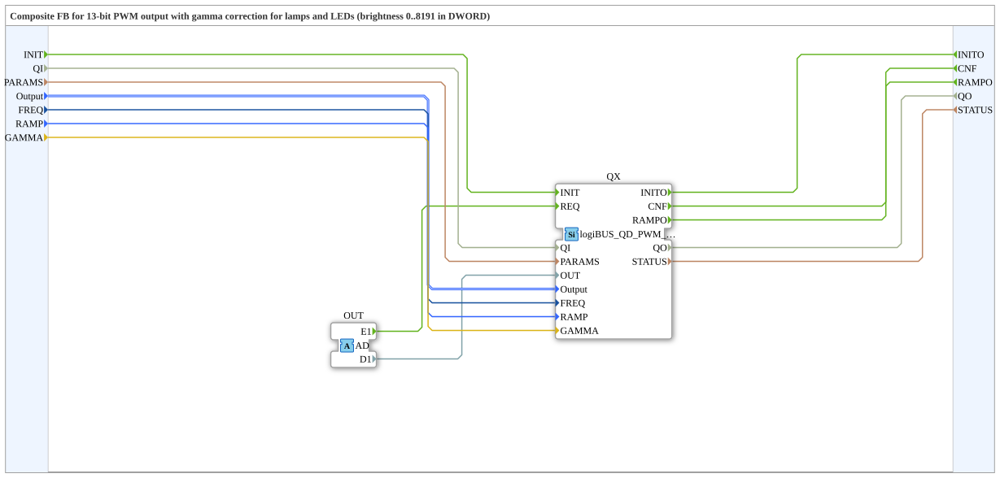

# logiBUS_QDA_PWM_G

* * * * * * * * * *

## Einleitung

Der Funktionsblock `logiBUS_QDA_PWM_G` ist die Gamma-Variante von `logiBUS_QDA_PWM`: Er gibt einen PWM-Wert mit Gammakorrektur für LEDs und Lampen aus. `OUT` ist die Helligkeit, wie das Auge sie sieht (`0` bis `8191`). Der Tastgrad wird daraus berechnet. Der Baustein ist ein Composite mit Adapter-Schnittstelle und enthält intern `logiBUS_QD_PWM_G`.

## Schnittstellenstruktur

### **Ereignis-Eingänge**

| Ereignis | Typ | Verknüpft mit / Kommentar |
|---|---|---|
| INIT | EInit | Service-Initialisierung; verknüpft mit QI, PARAMS, Output, FREQ, RAMP, GAMMA |
| *kein weiterer Ereignis-Eingang* | | *Alle Trigger erfolgen über den Adapter* |

### **Ereignis-Ausgänge**

| Ereignis | Typ | Verknüpft mit / Kommentar |
|---|---|---|
| INITO | EInit | Initialisierungsbestätigung; verknüpft mit QO, STATUS |
| CNF | Event | Bestätigung der angeforderten Service-Operation; verknüpft mit QO, STATUS |
| RAMPO | Event | Rampe beendet, Wert erreicht (bei `RAMP = T#0ms` direkt nach dem Sprung, nicht nach INIT); verknüpft mit QO |

### **Daten-Eingänge**

| Variable | Typ | Kommentar |
|---|---|---|
| QI | BOOL | Ereignis-Eingangsqualifizierer |
| PARAMS | STRING | Service-Parameter |
| Output | logiBUS::io::DQ::logiBUS_DO_S | Identifiziert den Ausgang Output_Q1..Q8; Initialwert `logiBUS_DO::Invalid` |
| FREQ | UDINT | PWM-Frequenz in Hz, gelesen bei INIT; Initialwert `400` |
| RAMP | TIME | Übergangszeit zum neuen Wert, gelesen bei INIT; Initialwert `T#0ms` (Sprung) |
| GAMMA | REAL | Exponent der Helligkeitskurve, gelesen bei INIT; Initialwert `2.2` |

### **Daten-Ausgänge**

| Variable | Typ | Kommentar |
|---|---|---|
| QO | BOOL | Ereignis-Ausgangsqualifizierer |
| STATUS | STRING | Service-Status |

### **Adapter**

| Typ | Name | Richtung | Kommentar |
|---|---|---|---|
| adapter::types::unidirectional::AD | OUT | Socket | Empfängt Trigger-Ereignis (E1) und Helligkeit (D1) von der Ressource |

## Funktionsweise

Das Composite leitet `INIT` mit `QI`, `PARAMS`, `Output`, `FREQ`, `RAMP` und `GAMMA` an den internen `logiBUS_QD_PWM_G` (`QX`) weiter. Das Ereignis `E1` und der Wert `D1` des Adapters `OUT` gehen als `REQ` und `OUT` an `QX`. `CNF` und `RAMPO` von `QX` gehen nach außen. Die Eingänge `RAMP` und `GAMMA` werden, wie alle Composite-Eingänge, nur bei `INIT` übernommen.

## Gamma: Möglichkeiten

ESP-IDF legt keinen Gamma-Wert fest; jede Formel ist möglich. Dieser Baustein rechnet `pow()` mit dem Exponenten `GAMMA`:

Tastgrad = 8191 · (`OUT` / 8191)^`GAMMA`

Der Tastgrad wird auf ganze Zahlen gerundet. Die Werte der Tabelle sind nachgerechnet, nicht an Hardware gemessen; die Rundung in der Firmware kann um einen Schritt abweichen.

| `GAMMA` | Bedeutung |
|---|---|
| 1.0 | keine Korrektur, wie der Baustein ohne `_G` |
| 2.2 | Näherung an sRGB, Initialwert |
| 2.6, 2.8 | Werte aus den Espressif-Beispielen, für viele LEDs gleichmäßiger |
| andere | für Lampen oder Lasten mit eigener Kennlinie; am besten an einer LED ausprobieren |

**Ungültige `GAMMA`-Werte:** Werte kleiner oder gleich `0`, `NaN` und nicht endliche Werte laufen linear wie `GAMMA = 1.0`. Es gibt keinen Fehler, keine `STATUS`-Meldung und keine Sperre; die Firmware lässt alles zu. (Angabe aus der Entwicklung, steht im Kommentar von `GAMMA` im Baustein ab dem Stand `f71f3fd3d`; in der hier verwendeten Quelle noch nicht enthalten und nicht geprüft.)

Beispiel für einige Helligkeitswerte (gerundeter Tastgrad):

| OUT | GAMMA 1.0 | GAMMA 2.2 | GAMMA 2.6 | GAMMA 2.8 |
|---|---|---|---|---|
| 512 | 512 | 18 | 6 | 3 |
| 1024 | 1024 | 84 | 37 | 24 |
| 2048 | 2048 | 388 | 223 | 169 |
| 4096 | 4096 | 1783 | 1351 | 1177 |
| 6144 | 6144 | 4351 | 3878 | 3661 |

## Wann `_G`, wann nicht

- **`_G` für LEDs und Lampen:** Bei linearem Tastgrad wirkt das Dimmen unten zu schnell und oben zu langsam.
- **Ohne `_G` für Ventile, Motoren und Heizungen:** Dort wirkt der Tastgrad linear, eine Gammakurve wäre falsch.
- Ob eine Last Gamma bekommt, entscheidet allein die Wahl des Bausteins.

## Technische Besonderheiten

- Gleiche Schnittstelle wie `logiBUS_QDA_PWM` plus Eingang `GAMMA`.
- Tastgrad bleibt `0` bis `8191` (13 Bit).
- Frequenz und Rampe wie bei `logiBUS_QDA_PWM`, siehe dort.
- Ausgänge mit gleicher Frequenz teilen einen LEDC-Timer (4 Timer, LED-Blinken belegt einen).
- Quelle: Kommentare der `.fbt` und `PWM_KONZEPT.md`; das Verhalten der Firmware ist dort beschrieben und hier nicht geprüft.

## Vergleich

| Baustein | Unterschied |
|---|---|
| `logiBUS_QDA_PWM` | linear: Tastgrad = `OUT`; für Ventile, Motoren, Heizungen |
| `logiBUS_QDA_PWM_G` | Gamma: `OUT` ist die Helligkeit; für LEDs und Lampen |

## Voraussetzungen und Stand

- **Voraussetzung:** Die ELF `logiBUS_io-3.1.0` (`-xtensa.elf` für S3, `-riscv32.elf` für P4/S31) braucht eine Firmware mit den neuen Host-Symbolen `elf_isr_ledc_fade_end`, `ledc_cb_register`, `ledc_fade_stop`, `ledc_get_duty`, `ledc_timer_pause`, `lroundf` und `powf`; auf P4/S31 zusätzlich `ledc_fill_multi_fade_param_list` und `ledc_set_multi_fade` (Host-Tabellen: LOGIBUS `3142a703`). Auf älterer Firmware lädt die ELF nicht, das Laden bricht wegen des fehlenden Symbols ab. `FORTE_ABI` bleibt `6`, daran ist der Unterschied nicht zu erkennen. Firmware und ELF immer zusammen ausliefern. (Angabe aus der Entwicklung, nicht an der Firmware geprüft.)
- Noch nicht auf Hardware getestet.

### Hinweise zu den Leistungsstufen

Die Firmware prüft die Frequenz nicht gegen die Leistungsstufe des Boards. Die folgenden Grenzen sind nur ein Hinweis (Quelle: Kommentar zu `FREQ` im Baustein und `PWM_KONZEPT.md`):

| Leistungsstufe | Hinweis |
|---|---|
| APIXON 15 PWR Q1 (BTH50030) | höchstens 100 Hz |
| BTS7030, BTT6030, BTH6070 | für Ventile 100 bis 200 Hz |
| Trainer20 | ohne Leistungsstufe |

Welches Board welche Leistungsstufe trägt, steht noch nicht fest und ist hier nicht dokumentiert.

## Siehe auch

- [logiBUS_QDA_PWM](logiBUS_QDA_PWM.md) (ohne Gamma, mit Hinweisen zu Frequenz, Rampe und Leistungsstufen)
