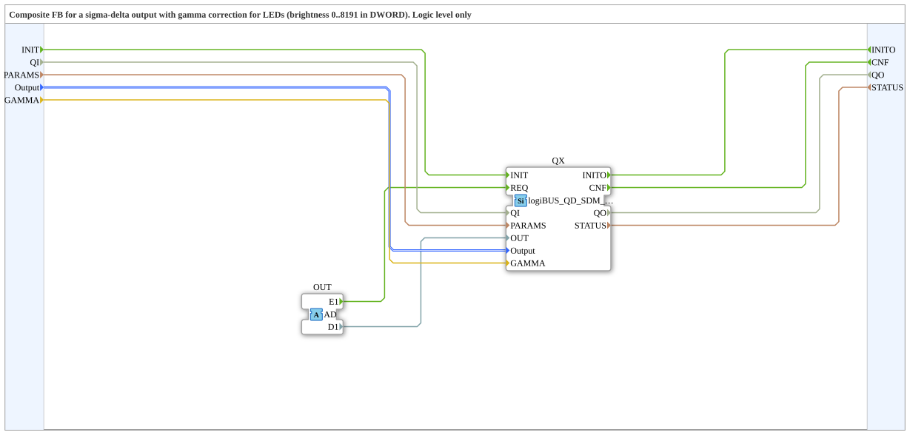

# logiBUS_QDA_SDM_G

* * * * * * * * * *

## Einleitung

Der Funktionsblock `logiBUS_QDA_SDM_G` ist ein Composite um `logiBUS_QD_SDM_G`. Er bekommt die Helligkeit über einen Adapter (Socket `OUT`, Typ `AD`, 0..8191 in `D1`) und `GAMMA` bei INIT.

**Nur Logikpegel.** Der Baustein ist für LEDs und LED-Treiber gedacht, nicht für die Leistungsausgänge: Die Hardware-Seite [Leistungsstufen der Ausgänge](https://meisterschulen-am-ostbahnhof-munchen-docs.readthedocs.io/projects/visual-programming-languages-docs/de/latest/hw/logiBUS/Leistungsstufen/) beschreibt, was hinter den Ausgängen sitzt. Die Firmware prüft das nicht.

## Schnittstellenstruktur

### **Ereignis-Eingänge**

| Ereignis | Typ | Verknüpft mit / Kommentar |
|---|---|---|
| INIT | EInit | Service-Initialisierung; verknüpft mit QI, PARAMS, Output, GAMMA |
| *kein weiterer Ereignis-Eingang* | | *Neue Werte kommen über den Adapter* |

### **Ereignis-Ausgänge**

| Ereignis | Typ | Verknüpft mit / Kommentar |
|---|---|---|
| INITO | EInit | Initialisierungsbestätigung; verknüpft mit QO, STATUS |
| CNF | Event | Bestätigung der angeforderten Service-Operation; verknüpft mit QO, STATUS |

### **Daten-Eingänge**

| Variable | Typ | Kommentar |
|---|---|---|
| QI | BOOL | Ereignis-Eingangsqualifizierer |
| PARAMS | STRING | Service-Parameter |
| Output | logiBUS::io::DQ::logiBUS_DO_S | Identifiziert den Ausgang Output_Q1..Q8; Initialwert `logiBUS_DO::Invalid` |
| GAMMA | REAL | Gamma der Helligkeitskurve, gelesen bei INIT: Pulsdichte aus (OUT / 8191)^GAMMA. `1.0` = linear, `2.2` = Näherung an sRGB (Initialwert). Ungültige Werte (≤ 0, nicht endlich) laufen linear wie `1.0`. |

### **Daten-Ausgänge**

| Variable | Typ | Kommentar |
|---|---|---|
| QO | BOOL | Ereignis-Ausgangsqualifizierer |
| STATUS | STRING | Service-Status |

### **Adapter**

| Typ | Name | Richtung | Kommentar |
|---|---|---|---|
| adapter::types::unidirectional::AD | OUT | Socket | Empfängt Ereignis (E1) und Helligkeit 0..8191 (D1) |

## Funktionsweise

Das Composite leitet `INIT` mit `QI`, `PARAMS`, `Output` und `GAMMA` an den internen `logiBUS_QD_SDM_G` (`QX`) weiter. Ereignis `E1` und Wert `D1` des Adapters `OUT` gehen als `REQ` und `OUT` an `QX`; `CNF` von `QX` geht nach außen.

## Technische Besonderheiten

- Pulsdichte mit 8 Bit (256 Stufen), 1 MHz.
- Wertebereich `OUT`: 0..8191 (13 Bit), keine Rampe.
- Kein LEDC- und kein MCPWM-Timer-Parameter (`FREQ`, `RAMP`) wie bei `logiBUS_QD_PWM`.
- Mit 8 Bit werden die untersten Stufen der Gammakurve grob; das steht im Kommentar des Bausteins.
- Quelle: Kommentare der `.fbt` in `logiBUS_io-3.3.0`; das Verhalten der Firmware ist dort beschrieben und hier nicht auf der Hardware geprüft.

## Vergleich

| Baustein | Unterschied |
|---|---|
| `logiBUS_QD_PWM` / `logiBUS_QD_PWM_G` | PWM mit Frequenz, Rampe und 13 Bit Auflösung (LEDC); geeignet auch für Leistungsausgänge, soweit die Leistungsstufe es zulässt |
| `logiBUS_QDA_SDM_G` | Pulsdichte mit 8 Bit bei 1 MHz, ohne Rampe, nur Logikpegel |

## Anwendungsszenarien

- Helligkeitssteuerung von LEDs und LED-Treibern am Logikausgang.
- Anwendungen, in denen eine hohe Taktfrequenz wichtiger ist als eine feine Auflösung.
