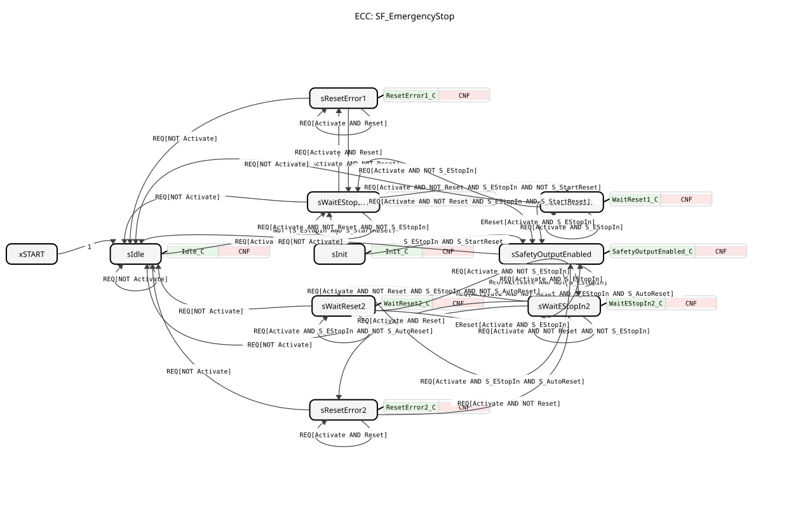

# SF_EmergencyStop

* * * * * * * * * *

## Einleitung

`SF_EmergencyStop` ist die PLCopen-Safety-Funktion `SF_EmergencyStop` (Part 1 v2.10, Kap. 6.5) zur **Überwachung eines Not-Halt-Gebers** (`S_EStopIn`). Der Ausgang `S_EStopOut` wird erst wieder `TRUE`, nachdem `S_EStopIn` wieder `TRUE` ist **und** eine Quittierung erfolgt ist (`S_StartReset`/`S_AutoReset`/`Reset`) – gemäß EN ISO 13849-1:2015 5.2.2 und IEC 60204-1:2016 9.2.3.4.

## Schnittstellenstruktur

### **Ereignis-Eingänge**

- **REQ**: Zyklische Auswertungsanforderung. Verbundene Daten: `Activate`, `S_EStopIn`, `S_StartReset`, `S_AutoReset`, `Reset`
- **EReset**: Eigenes Reset-Flankenereignis zusätzlich zu `REQ`, typischerweise direkt von `SF_ResetButton.EResetOut` gespeist. Verbundene Daten: `Activate`, `S_EStopIn`

### **Ereignis-Ausgänge**

- **CNF**: Bestätigung des angeforderten Dienstes. Verbundene Daten: `Ready`, `S_EStopOut`, `SafetyDemand`, `ResetRequest`, `Error`, `DiagCode`

### **Daten-Eingänge**

- **Activate** (`BOOL`, Vorgabe `FALSE`): Baustein-Freigabe; `FALSE` = inaktiv (`sIdle`)
- **S_EStopIn** (`BOOL`, Vorgabe `FALSE`): Not-Halt-Geber; `FALSE` = Not-Halt betätigt (Anforderung), `TRUE` = nicht betätigt
- **S_StartReset** (`BOOL`, Vorgabe `FALSE`): `TRUE` = automatische Quittierung bei der ersten Aktivierung des Bausteins
- **S_AutoReset** (`BOOL`, Vorgabe `FALSE`): `TRUE` = automatische Quittierung jeder späteren Erholung von `S_EStopIn`, kein `Reset` nötig
- **Reset** (`BOOL`, Vorgabe `FALSE`): Manueller Reset, typischerweise vom zugehörigen `SF_ResetButton.ResetOut` gespeist

### **Daten-Ausgänge**

- **Ready** (`BOOL`): Baustein aktiv, Ausgänge gültig
- **S_EStopOut** (`BOOL`): `TRUE` = keine Anforderung, quittiert, Anlauf erlaubt
- **SafetyDemand** (`BOOL`): `TRUE`, solange auf die Erholung von `S_EStopIn` gewartet wird
- **ResetRequest** (`BOOL`): Speist den zugehörigen Eingang `SF_ResetButton.ResetRequested`
- **Error** (`BOOL`): `TRUE` in einem Fehlerzustand, siehe `DiagCode`
- **DiagCode** (`WORD`, Vorgabe `16#0000`): Baustein-spezifischer Status-/Fehlercode (PLCopen Safety Part 1, Kap. 6.5.6)

### **Adapter**

Dieser Funktionsblock verwendet keine Adapter.

## Funktionsweise

Der Baustein ist ein Basic-FB mit neun Zuständen. Die Ausgänge werden in jedem Zustand über einen eigenen Algorithmus gesetzt; danach wird `CNF` ausgelöst.

| Zustand | DiagCode | S_EStopOut | SafetyDemand | ResetRequest | Error | Bedeutung |
| --- | --- | --- | --- | --- | --- | --- |
| `sIdle` | `0000` | FALSE | FALSE | FALSE | FALSE | Baustein nicht aktiv |
| `sInit` | `8001` | FALSE | FALSE | FALSE | FALSE | Aktiviert, `S_StartReset` wird geprüft |
| `sWaitEStopIn1` | `8802` | FALSE | TRUE | FALSE | FALSE | Erste Aktivierung, Warten auf `S_EStopIn` |
| `sResetError1` | `C001` | FALSE | FALSE | FALSE | TRUE | `Reset` hängt auf `TRUE`, während auf `S_EStopIn` gewartet wird |
| `sWaitReset1` | `8402` | FALSE | FALSE | TRUE | FALSE | `S_EStopIn` ist `TRUE`, Warten auf steigende Flanke von `Reset` |
| `sSafetyOutputEnabled` | `8000` | TRUE | FALSE | FALSE | FALSE | Sicherheitsausgang freigegeben |
| `sWaitEStopIn2` | `8804` | FALSE | TRUE | `NOT Reset` | FALSE | Anforderung erkannt, Warten auf `S_EStopIn` |
| `sResetError2` | `C011` | FALSE | FALSE | FALSE | TRUE | `Reset` hängt auf `TRUE`, während auf `S_EStopIn` gewartet wird |
| `sWaitReset2` | `8404` | FALSE | FALSE | `NOT Reset` | FALSE | Warten auf `S_AutoReset` oder steigende Flanke von `Reset` |

Ablauf:

1. `REQ` mit `Activate = TRUE` in `sIdle` führt nach `sInit`. Ist `S_EStopIn AND S_StartReset`, geht es direkt nach `sSafetyOutputEnabled`, sonst nach `sWaitEStopIn1`. `S_StartReset` zählt nur bei dieser allerersten Aktivierung.
2. Erste Aktivierung: In `sWaitEStopIn1` führt `Reset = TRUE` in den Fehler `sResetError1`; ist `S_EStopIn` wieder `TRUE`, folgt je nach `S_StartReset` `sSafetyOutputEnabled` oder `sWaitReset1`. In `sWaitReset1` führt das Ereignis `EReset` (bei `S_EStopIn`) nach `sSafetyOutputEnabled`; fällt `S_EStopIn`, geht es zurück nach `sWaitEStopIn1`.
3. Betrieb: In `sSafetyOutputEnabled` führt `S_EStopIn = FALSE` nach `sWaitEStopIn2`.
4. Folgezyklen: In `sWaitEStopIn2` führt `Reset = TRUE` in den Fehler `sResetError2`; ist `S_EStopIn` wieder `TRUE`, folgt je nach `S_AutoReset` `sSafetyOutputEnabled` oder `sWaitReset2`. In `sWaitReset2` führt `S_AutoReset` bzw. das Ereignis `EReset` nach `sSafetyOutputEnabled`; fällt `S_EStopIn`, geht es zurück nach `sWaitEStopIn2`.
5. Aus jedem Zustand führt `REQ` mit `Activate = FALSE` zurück nach `sIdle`.

## Technische Besonderheiten

- Der Fehlerzustand `sResetError1`/`sResetError2` verhindert, dass ein dauerhaft anstehendes `Reset` das Quittieren ersetzt (`Reset` muss eine Flanke sein).
- `ResetRequest` ist in den Folgezyklen (`sWaitEStopIn2`, `sWaitReset2`) mit `NOT Reset` verknüpft.
- Die Diagnosecodes stammen aus `logiBUS::safety::PLCopen::const::DiagCodes` und `EmergencyStopDiagCodes`.

## Anwendungsszenarien

- Überwachung eines Not-Halt-Tasters mit manueller Quittierung über `SF_ResetButton`
- Automatischer Wiederanlauf bei Bedarf über `S_StartReset`/`S_AutoReset`

## Fazit

`SF_EmergencyStop` setzt die PLCopen-Safety-Zustandsmaschine für die Not-Halt-Überwachung um und gibt erst nach Erholung des Gebers und Quittierung den Sicherheitsausgang frei.
