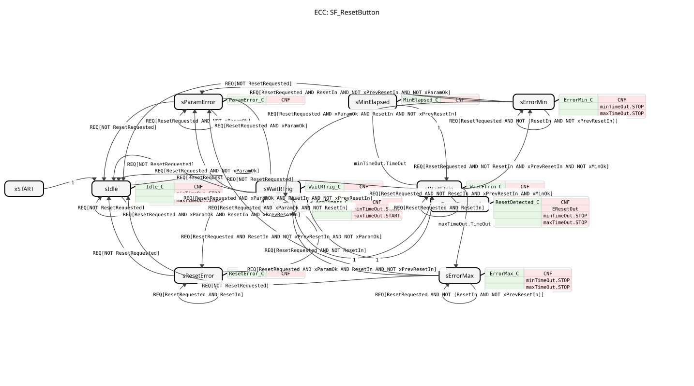

# SF_ResetButton

* * * * * * * * * *

## Einleitung

`SF_ResetButton` ist der PLCopen-Safety-Baustein `SF_ResetButton` (PLCopen TC5 Safety Part 1 v2.10, Kapitel 6.1) mit Trailing-Edge-Reset. Er überwacht einen Reset-Taster: Ein gültiger Reset liegt vor, wenn der Taster gedrückt (steigende Flanke) und nach einer Zeit zwischen `TrailingMinimum` und `TrailingMaximum` wieder losgelassen wird (fallende Flanke). Dann gibt `ResetOut` einen einzelnen Impuls aus.

## Schnittstellenstruktur

### **Ereignis-Eingänge**

- **REQ**: zyklische Auswertungsanforderung
    - **Verbundene Daten**: `ResetRequested`, `ResetIn`, `TrailingMinimum`, `TrailingMaximum`

### **Ereignis-Ausgänge**

- **CNF**: Bestätigung des angeforderten Service
    - **Verbundene Daten**: `Ready`, `ResetOut`, `Error`, `DiagCode`
- **EResetOut**: eigenes Ereignis, das genau einmal im Zyklus feuert, in dem ein gültiger Trailing-Edge-Reset erkannt wird (derselbe Zyklus wie `ResetOut = TRUE`)

### **Daten-Eingänge**

- **ResetRequested** (BOOL): vom gepaarten FB (`ResetRequest`-Ausgang). TRUE = `ResetIn` überwachen, FALSE = inaktiv (Default TRUE)
- **ResetIn** (BOOL): Reset-Taster-Eingang. FALSE = losgelassen, TRUE = betätigt (Default FALSE)
- **TrailingMinimum** (TIME): minimale Betätigungszeit (absolutes Minimum 100 ms). Kürzere Betätigungen werden nicht als Reset gewertet (Default `T#350ms`)
- **TrailingMaximum** (TIME): maximale Betätigungszeit. Längere Betätigungen werden nicht als Reset gewertet (Default `T#2s`)

### **Daten-Ausgänge**

- **Ready** (BOOL): FB aktiv, Ausgänge gültig
- **ResetOut** (BOOL): Ein-Zyklus-Impuls, wenn ein gültiger Trailing-Edge-Reset erkannt wurde
- **Error** (BOOL): TRUE, solange ein Fehlerzustand besteht (siehe `DiagCode`)
- **DiagCode** (WORD): FB-spezifischer Status-/Fehlercode (PLCopen Safety Part 1, Kap. 6.1.6)

### **Adapter**

- **minTimeOut** (Plug, `iec61499::events::ATimeOut`): Timer für `TrailingMinimum`
- **maxTimeOut** (Plug, `iec61499::events::ATimeOut`): Timer für `TrailingMaximum`

## Funktionsweise

Der Baustein ist ein Basic-FB mit einem ECC. Interne Variablen: `xPrevResetIn` (Wert von `ResetIn` im vorigen Zyklus zur Flankenerkennung), `xMinOk` (TRUE, sobald seit der steigenden Flanke `TrailingMinimum` verstrichen ist) und `xParamOk` (`TrailingMinimum <= TrailingMaximum` und `TrailingMinimum >= T#100ms`).

- **Aktivierung**: Bei `ResetRequested = FALSE` bleibt der Baustein im Zustand `sIdle`. Bei `ResetRequested = TRUE` wechselt er nach `sWaitRTrig`.
- **`sWaitRTrig`**: Sind die Parameter ungültig, folgt `sParamError`. War `ResetIn` schon vor der Aktivierung gedrückt (`ResetIn AND xPrevResetIn`), folgt `sResetError`. Eine frische steigende Flanke (`ResetIn AND NOT xPrevResetIn`) führt nach `sArmTimers`.
- **`sArmTimers`**: setzt `minTimeOut.DT := TrailingMinimum` und `maxTimeOut.DT := TrailingMaximum`, löscht `xMinOk`, startet beide Timer (`minTimeOut.START`, `maxTimeOut.START`) und geht unbedingt nach `sWaitFTrig`.
- **`sWaitFTrig`**: Läuft `minTimeOut` ab, wird über `sMinElapsed` `xMinOk` gesetzt. Läuft `maxTimeOut` ab, folgt `sErrorMax`. Wird der Taster losgelassen (`NOT ResetIn AND xPrevResetIn`), folgt bei `xMinOk` der Zustand `sResetDetected`, sonst `sErrorMin`.
- **`sResetDetected`**: `ResetOut := TRUE`, Ausgabe von `EResetOut`, beide Timer werden gestoppt; danach unbedingt zurück nach `sWaitRTrig`.
- **Fehlerzustände** (`sParamError`, `sResetError`, `sErrorMin`, `sErrorMax`): `Error := TRUE` mit dem jeweiligen `DiagCode`. Aus `sErrorMin`/`sErrorMax` führt eine neue steigende Flanke wieder nach `sArmTimers`, aus `sResetError` das Loslassen des Tasters nach `sWaitRTrig`. In jedem Zustand führt `ResetRequested = FALSE` zurück nach `sIdle`.

## Technische Besonderheiten

- `EResetOut` ist eine nicht wörtliche IEC-61499-Erweiterung der PLCopen-Schnittstelle: Ein eigenes Ereignis erlaubt es Verbrauchern, den Reset-Impuls direkt zu verdrahten, statt ihn aus `CNF` und `ResetOut` über ein externes Gatter abzuleiten (Version 1.1)
- Aufbau nach dem Muster `sequence_T_05` (ECC + `ATimeOut`-Plugs)
- `ResetOut` und `EResetOut` sind nur in genau einem Zyklus aktiv
- Die Diagnosecodes stammen aus den Konstanten `DiagCodes` und `ResetButtonDiagCodes` (`logiBUS::safety::PLCopen::const`)

## Zustandsübersicht

| Zustand | DiagCode | Bedeutung |
| ------- | -------- | --------- |
| xSTART | - | Anfangszustand, geht unbedingt nach `sIdle` |
| sIdle | 0000 | FB nicht aktiv |
| sParamError | C000 | Parameterfehler: `TrailingMinimum > TrailingMaximum` oder `TrailingMinimum < 100 ms` |
| sResetError | C001 | Reset-Fehler: `ResetIn` war bereits TRUE, als `ResetRequested` TRUE wurde |
| sWaitRTrig | 83E2 | aktiv, wartet auf Betätigung des Tasters (steigende Flanke) |
| sArmTimers | 83F2 | einmalig: beide Timer (neu) starten, danach `sWaitFTrig` |
| sWaitFTrig | 83F2 | Taster gedrückt, wartet auf Loslassen (fallende Flanke) |
| sMinElapsed | 83F2 | einmalig: `xMinOk` setzen, danach zurück nach `sWaitFTrig` |
| sErrorMin | C3F0 | Fehler: Loslassen vor Ablauf von `TrailingMinimum`, wartet auf neue steigende Flanke |
| sErrorMax | C3E0 | Fehler: `TrailingMaximum` vor dem Loslassen abgelaufen, wartet auf neue steigende Flanke |
| sResetDetected | 8000 | gültiger Reset, 1-Zyklus-Impuls auf `ResetOut` und `EResetOut` |

## Anwendungsszenarien

- Quittieren einer Sicherheitsfunktion (z. B. nach einem Not-Halt) mit bewusster, zeitlich begrenzter Tasterbetätigung
- Zusammenspiel mit einem Baustein, der über `ResetRequest` die Quittierung anfordert und mit `ResetRequested` ankoppelt

## 🛠️ Zugehörige Übungen

- [Uebung_006_SAFE_AX](https://meisterschulen-am-ostbahnhof-munchen-docs.readthedocs.io/projects/4diac-exercises-docs/de/latest/Uebungen/test_AX/Uebungen_doc/Uebung_006_SAFE_AX/)

## Fazit

`SF_ResetButton` erkennt einen gültigen Trailing-Edge-Reset nach PLCopen Safety, überwacht Mindest- und Höchstdauer der Betätigung mit zwei Timern und meldet Fehler über `Error` und `DiagCode`.
