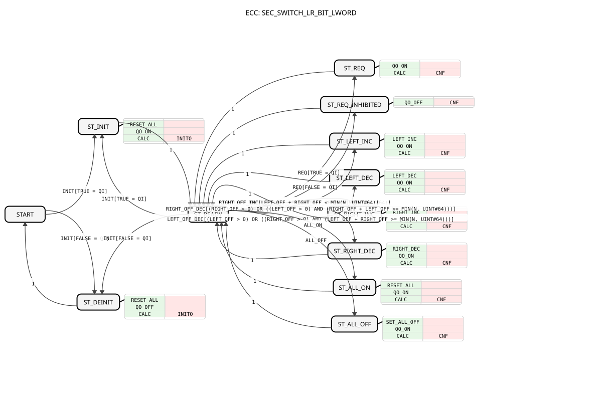
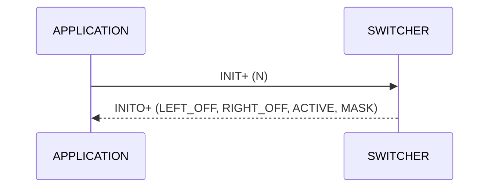
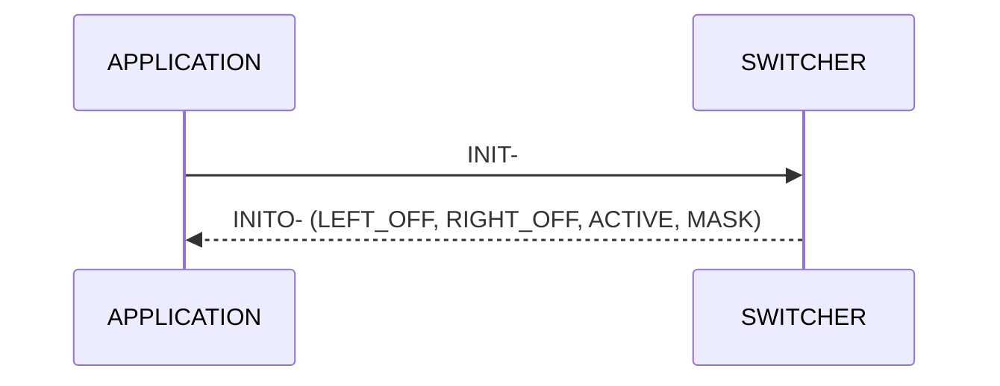
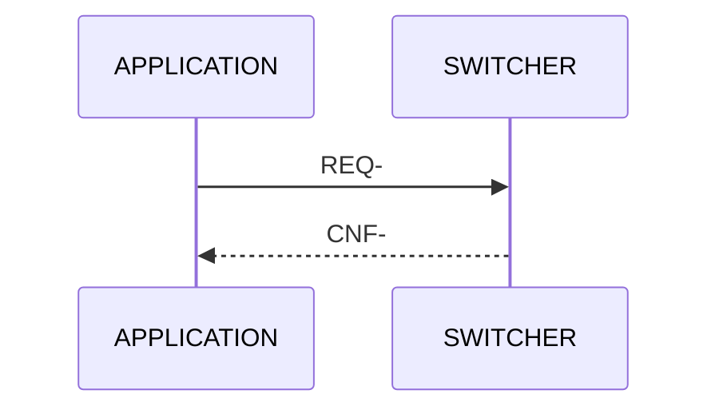
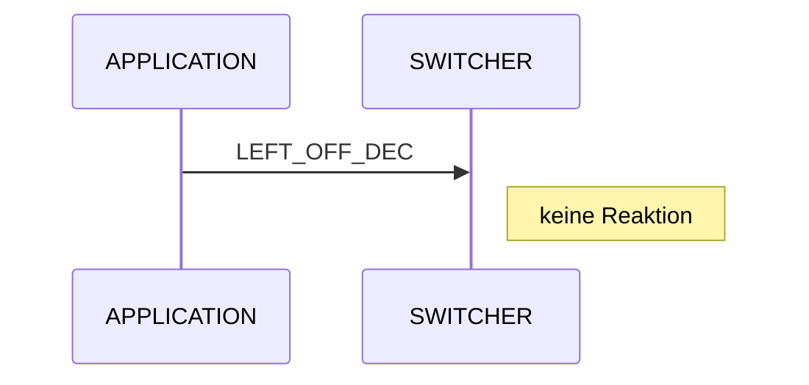
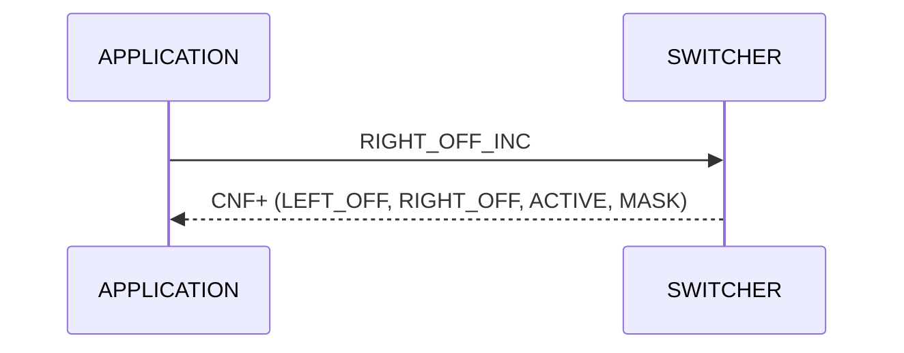
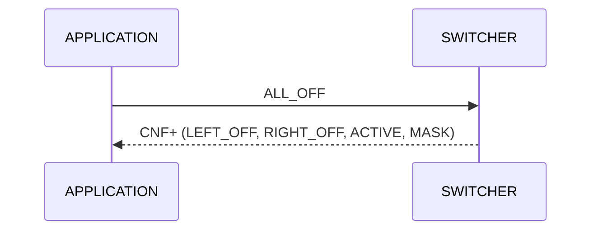
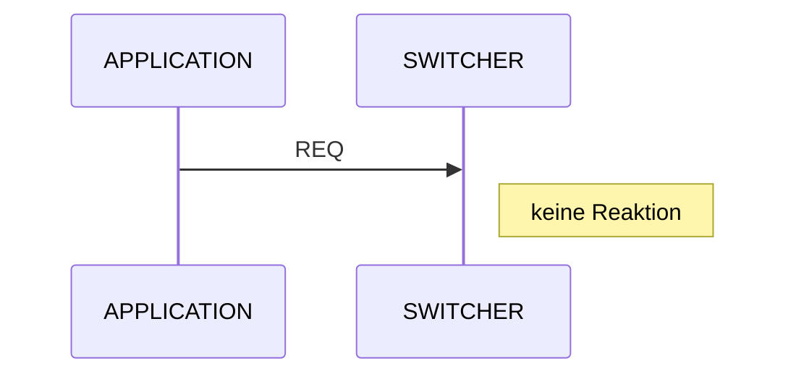

# SEC_SWITCH_LR_BIT_LWORD

* * * * * * * * * *

## Einleitung

Der Funktionsblock **SEC_SWITCH_LR_BIT_LWORD** ist ein Section-Switcher: Er schaltet Teilbreiten (Sections) von links und von rechts ab und wieder zu, zum Beispiel für einen Section-Switcher mit vier Tasten an einer Maschine. Er verwaltet bis zu 64 Sections und gibt die Maske als `LWORD` mit ein Bit je Section aus. Section 1 ist die linke Section und liegt in den niederwertigsten Bits. Der Baustein ist reines Structured Text und hängt nur von `core` ab, braucht also keinen ISOBUS.

## Schnittstellenstruktur

### **Ereignis-Eingänge**

| Name | Typ | Kommentar | Zugeordnete Daten |
| ---- | --- | --------- | ----------------- |
| INIT | EInit | Initialisierung, Zähler auf 0 | QI, N |
| REQ | Event | Maske und Zähler erneut ausgeben | QI |
| LEFT_OFF_INC | Event | Von links eine Section mehr abschalten | - |
| LEFT_OFF_DEC | Event | Von links eine Section wieder zuschalten | - |
| RIGHT_OFF_INC | Event | Von rechts eine Section mehr abschalten | - |
| RIGHT_OFF_DEC | Event | Von rechts eine Section wieder zuschalten | - |
| ALL_ON | Event | Alle Sections zuschalten (beide Zähler 0) | - |
| ALL_OFF | Event | Alle Sections abschalten (LEFT_OFF = N, RIGHT_OFF = 0) | - |

### **Ereignis-Ausgänge**

| Name | Typ | Kommentar | Zugeordnete Daten |
| ---- | --- | --------- | ----------------- |
| INITO | EInit | Initialisierung bestätigt | QO, LEFT_OFF, RIGHT_OFF, ACTIVE, MASK |
| CNF | Event | Zähler oder Maske neu berechnet | QO, LEFT_OFF, RIGHT_OFF, ACTIVE, MASK |

### **Daten-Eingänge**

| Name | Typ | Kommentar |
| ---- | --- | --------- |
| QI | BOOL | Nur an INIT und REQ: INIT+ aktiv, INIT- deaktiviert (Maske alle frei), REQ- ohne Wirkung |
| N | UINT | Anzahl Sections (1..64, größer wird auf 64 begrenzt) |

### **Daten-Ausgänge**

| Name | Typ | Kommentar |
| ---- | --- | --------- |
| LEFT_OFF | UINT | Anzahl von links abgeschalteter Sections |
| RIGHT_OFF | UINT | Anzahl von rechts abgeschalteter Sections |
| ACTIVE | UINT | Anzahl freier Sections |
| QO | BOOL | TRUE = aktiv und Ereignis ausgeführt |
| MASK | LWORD | Maske, ein Bit je Section (1 = frei), Bit 0 = Section 1 (links) |

### **Adapter**

Keine.

## Funktionsweise

- **Initialisierung:** `INIT` mit `QI` = TRUE übernimmt `N` (auf 64 begrenzt), setzt beide Zähler auf 0 (alle Sections frei) und meldet `INITO` mit `QO` = TRUE. Im aktiven Zustand initialisiert `INIT+` neu. `INIT` mit `QI` = FALSE deaktiviert den Baustein, die Maske ist dann komplett frei, `INITO` kommt mit `QO` = FALSE. Das gilt auch vor dem ersten `INIT+`, damit INIT-Ketten nicht hängen.
- **Abschalten von links oder rechts:** `LEFT_OFF_INC` bzw. `RIGHT_OFF_INC` schaltet eine weitere Section von der jeweiligen Seite ab, solange noch eine Section frei ist. Sind alle Sections aus, gibt es keine Reaktion.
- **Zuschalten:** `LEFT_OFF_DEC` bzw. `RIGHT_OFF_DEC` schaltet eine Section wieder zu. Ist der Zähler der Seite schon 0, gibt es keine Reaktion. Das gilt nicht, wenn alle Sections aus sind (siehe nächster Punkt).
- **Nach `ALL_OFF` symmetrisch zuschalten (seit Version 1.1):** Sind alle Sections aus und der eigene Zähler ist 0, übernimmt die Seite zuerst alle abgeschalteten Sections. `LEFT_OFF_DEC` schaltet dann die rechte Section `N` zu, danach `N-1` und so weiter, `RIGHT_OFF_DEC` die linke Section 1, danach 2.
- **`ALL_ON` und `ALL_OFF`:** `ALL_ON` setzt beide Zähler auf 0 (alle frei). `ALL_OFF` setzt `LEFT_OFF` = `N` und `RIGHT_OFF` = 0 (alle gesperrt).
- **`QI`:** `QI` ist nur an `INIT` und `REQ` verdrahtet. Tasten, `ALL_ON` und `ALL_OFF` wirken im aktiven Zustand ohne `QI`. `REQ` mit `QI` = FALSE ändert nichts und antwortet mit `CNF`, `QO` = FALSE.
- **Vor der Initialisierung:** `REQ`, Tasten, `ALL_ON` und `ALL_OFF` vor `INIT+` oder nach `INIT-` bleiben ohne Reaktion.
- **Berechnung (`CALC`):** Die Zähler werden auf `N` begrenzt, `ACTIVE` = `N` − `LEFT_OFF` − `RIGHT_OFF`. Die Maske wird ohne Schleife aus `ACTIVE` und `LEFT_OFF` berechnet. Frei ist 1, gesperrt ist 0.

### Beispiel

`N` = 8, `LEFT_OFF` = 2, `RIGHT_OFF` = 1: `ACTIVE` = 5, die Sections 3 bis 7 sind frei, die Sections 1, 2 und 8 gesperrt. `MASK` = `16#000000000000007C` (`2#01111100`).

## Verwendung

1. `INIT` mit `QI` = TRUE und `N` = Anzahl Sections auslösen.
2. Die vier Tasten auf `LEFT_OFF_INC/DEC` und `RIGHT_OFF_INC/DEC` legen, optional `ALL_ON`/`ALL_OFF`.
3. `MASK` (und bei Bedarf `LEFT_OFF`, `RIGHT_OFF`, `ACTIVE`) bei jedem `CNF` weiterverarbeiten.
4. Mit `REQ` lässt sich der aktuelle Stand jederzeit erneut ausgeben.

## Zustandsübersicht

Alle Ereignisse werden im Zustand `ST_READY` ausgewertet, jeder Zustand führt nach seiner Aktion zurück nach `ST_READY`. Die Bedingungen der Zähler-Ereignisse (zum Beispiel `LEFT_OFF + RIGHT_OFF < MIN(N, 64)`) stehen als Guard an den Übergängen.

| Zustand | Bedeutung |
| ------- | --------- |
| `START` | Nicht initialisiert bzw. deaktiviert |
| `ST_INIT` | `INIT+`: `N` übernehmen, Zähler 0, `INITO` |
| `ST_READY` | Aktiv, wartet auf Ereignisse |
| `ST_DEINIT` | `INIT-`: deaktiviert, Maske alle frei, `INITO` |
| `ST_REQ` | `REQ+`: Maske und Zähler ausgeben (`CNF`) |
| `ST_REQ_INHIBITED` | `REQ-`: nichts ändern, `CNF` mit `QO` = FALSE |
| `ST_LEFT_INC` | `LEFT_OFF_INC`: linken Zähler erhöhen |
| `ST_LEFT_DEC` | `LEFT_OFF_DEC`: linken Zähler verringern |
| `ST_RIGHT_INC` | `RIGHT_OFF_INC`: rechten Zähler erhöhen |
| `ST_RIGHT_DEC` | `RIGHT_OFF_DEC`: rechten Zähler verringern |
| `ST_ALL_ON` | `ALL_ON`: beide Zähler 0 |
| `ST_ALL_OFF` | `ALL_OFF`: `LEFT_OFF` = `N`, `RIGHT_OFF` = 0 |

## Service-Sequenzen

Der Typ hat ein `<Service>`-Element (LeftInterface `APPLICATION`, RightInterface `SWITCHER`). `QI` wirkt nur an `INIT` und `REQ` (INIT+/INIT-, REQ+/REQ-). Die Sequenzen sind unten als Sequenzdiagramme dargestellt.

### `normal_initialization`

INIT mit QI = TRUE: N übernehmen, alle Sections frei

### `re_initialization`

INIT+ im aktiven Zustand: neu initialisieren, Zähler 0

### `termination`

INIT mit QI = FALSE: deaktiviert, Maske alle frei

### `termination_without_initialization`

INIT- auch vor INIT+ wird mit INITO- beantwortet (INIT-Kette hängt nicht)

### `request`

Maske und Zähler erneut ausgeben

### `request_inhibited`

REQ mit QI = FALSE: nichts ändern

### `left_off_increment`

Von links eine Section mehr abschalten

### `left_off_increment_at_limit`

Alle Sections schon aus: keine Reaktion

### `left_off_decrement`

Von links eine Section wieder zuschalten

### `left_off_decrement_at_zero`

LEFT_OFF = 0: keine Reaktion

### `right_off_increment`

Von rechts eine Section mehr abschalten

### `right_off_decrement`

Von rechts eine Section wieder zuschalten

### `all_on`

Alle Sections zuschalten

### `all_off`

Alle Sections abschalten (LEFT_OFF = N)

### `event_before_initialization`

REQ, Tasten, ALL_ON/ALL_OFF vor INIT+ bzw. nach INIT-: keine Reaktion

### `left_on_after_all_off`

Nach ALL_OFF: LEFT_OFF_DEC schaltet die rechte Section N zu, dann N-1 ...

### `right_on_after_all_off`

Nach ALL_OFF: RIGHT_OFF_DEC schaltet die linke Section 1 zu, dann 2 ...

## Technische Besonderheiten

- Reiner Structured-Text-Baustein ohne ISOBUS-Bezug, Abhängigkeit nur von `core`.
- Die Ausgänge `QO`, `LEFT_OFF`, `RIGHT_OFF`, `ACTIVE` und `MASK` gehören zu `INITO` und `CNF`.
- `LEFT_OFF_DEC` und `RIGHT_OFF_DEC` schützen zusätzlich zur ECC-Bedingung gegen UINT-Unterlauf.
- Die Maske wird ohne Schleife berechnet (Schieben mit breiterem Zwischenwert, Sonderfall bei voller Breite).
- Die Einzelwert- und Array-Varianten unterscheiden sich nur in `N` und `MASK`. Siehe [Übersicht](index.md).

## Fazit

`SEC_SWITCH_LR_BIT_LWORD` schaltet Teilbreiten von links und rechts ab und zu und liefert die Maske als ein Bit je Section mit Section 1 links in den niederwertigsten Bits.
