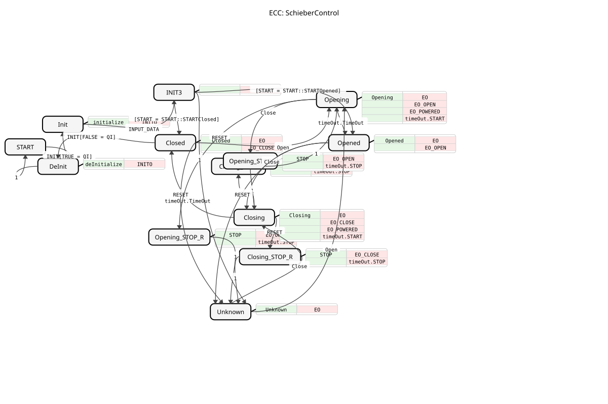

# SchieberControl

* * * * * * * * * *

## Einleitung

Der Funktionsblock `SchieberControl` ist ein Basis-Funktionsblock (Basic FB) gemäß IEC 61499 zur Steuerung eines Schieber-Antriebs (z. B. pneumatisch). Er realisiert eine vollständige Zustandsmaschine (ECC), die die Bewegung (Öffnen/Schließen), Haltezustände und Fehlerzustände eines Schiebers verwaltet. Der Baustein bietet eine Schnittstelle zur Parametrierung, zur Bedienung über die Ereignisse `Open`, `Close` und `RESET` sowie zur Ausgabe von Zustand und Steuersignalen für die Aktorik.

## Schnittstellenstruktur

### **Ereignis-Eingänge**

-   **`INIT`**: Initialisierungsanforderung. Setzt alle Werte. Ein vollständiges De-Initialisieren wird nicht vollständig unterstützt. Wird mit den Daten `QI`, `DT_Opening`, `DT_Closing` und `START` verknüpft.
-   **`Open`**: Startet den Öffnungsvorgang des Schiebers.
-   **`Close`**: Startet den Schließvorgang des Schiebers.
-   **`RESET`**: Setzt den internen Zustand auf "Unknown" (Unbekannt) zurück.

### **Ereignis-Ausgänge**

-   **`INITO`**: Initialisierungsbestätigung. Wird mit dem Datenausgang `QO` verknüpft.
-   **`EO`**: Allgemeines Ausgangsereignis, das den aktuellen Systemzustand und die konfigurierten Ausgangswerte liefert. Wird mit `iSTATE` und `STATE` verknüpft.
-   **`EO_POWERED`**: Steuersignal zum Betätigen des "Öffnen"-Ventils für die Pneumatik. Wird mit `DO_POWERED` verknüpft.
-   **`EO_OPEN`**: Steuersignal zum Betätigen des "Öffnen"-Ventils. Wird mit `DO_OPEN` verknüpft.
-   **`EO_CLOSE`**: Steuersignal zum Betätigen des "Schließen"-Ventils. Wird mit `DO_CLOSE` verknüpft.

### **Daten-Eingänge**

-   **`QI` (BOOL)**: Qualifizierer für das INIT-Ereignis.
-   **`DT_Opening` (TIME)**: Zeitdauer für den Öffnungsvorgang.
-   **`DT_Closing` (TIME)**: Zeitdauer für den Schließvorgang.
-   **`START` (UINT)**: Definiert den gewünschten Startzustand nach der Initialisierung (z. B. `START::STARTClosed`, `START::STARTOpened`, `START::STARTUnknown`).

### **Daten-Ausgänge**

-   **`QO` (BOOL)**: Qualifizierer für das INITO-Ereignis.
-   **`DO_POWERED` (BOOL)**: Binäres Signal zum Betätigen des "Öffnen"-Ventils für die Pneumatik.
-   **`DO_OPEN` (BOOL)**: Binäres Signal zum Betätigen des "Öffnen"-Ventils.
-   **`DO_CLOSE` (BOOL)**: Binäres Signal zum Betätigen des "Schließen"-Ventils.
-   **`iSTATE` (USINT)**: Numerischer Wert des aktuellen internen Zustands des FB (wird mit `EO` ausgegeben).
-   **`STATE` (STRING)**: Zeichenkette, die den aktuellen internen Zustand des FB beschreibt (z. B. "Closed", "Opening").

### **Adapter**

-   **`timeOut` (ATimeOut)**: Ein Stecker-Adapter vom Typ `ATimeOut`. Wird zur Realisierung der zeitgesteuerten Zustandsübergänge (Öffnen/Schließen) verwendet. Der FB startet (`START`) und stoppt (`STOP`) den Timer und reagiert auf dessen `TimeOut`-Ereignis.

## Funktionsweise

Der `SchieberControl`-FB arbeitet als zustandsgesteuerte Sequenz. Der interne Ablaufsteuerungsgraph (ECC) definiert die Zustände `Closed` (Geschlossen), `Opened` (Geöffnet), `Opening` (Öffnend), `Closing` (Schließend), verschiedene STOP-Zustände und `Unknown` (Unbekannt). Bei jedem Zustandswechsel wird ein entsprechender Algorithmus ausgeführt, der die Datenausgänge (wie `DO_OPEN`, `iSTATE`, `STATE`) setzt und bei Bedarf den Timer-Adapter startet. Die Bewegung zwischen `Closed` und `Opened` erfolgt zeitgesteuert über die Zustände `Opening` und `Closing`. Während einer Bewegung kann durch das gegenteilige Ereignis (`Open` während `Closing` oder `Close` während `Opening`) ein Stopp eingeleitet werden, der in einen entsprechenden STOP-Zustand überführt. Von jedem Zustand aus kann ein `RESET` den FB in den `Unknown`-Zustand versetzen.

## Technische Besonderheiten

-   **Zustandsinitialisierung**: Über den `START`-Eingang kann nach `INIT` der gewünschte Anfangszustand (`Closed`, `Opened` oder `Unknown`) vorgegeben werden.-   **Adapter-Nutzung**: Die Zeitsteuerung ist vollständig in den Adapter `timeOut` ausgelagert, was eine klare Trennung der Funktionalität und potenzielle Wiederverwendbarkeit ermöglicht.
-   **Zustandsausgabe**: Der aktuelle Zustand wird sowohl numerisch (`iSTATE`, USINT) als auch als Text (`STATE`, STRING) mit dem Ereignis `EO` ausgegeben und kann so von Bedienoberflächen ausgewertet werden.
-   **Power-Signal**: Das Signal `DO_POWERED` wird nur in den Zuständen `Opening` und `Opened` aktiviert, was auf eine spezifische pneumatische Ansteuerlogik hindeutet (z. B. Halten der Druckluft im geöffneten Zustand).

## Zustandsübersicht

Die ECC umfasst folgende Hauptzustände:

1.  **`START`**: Inaktiver Ausgangszustand.
2.  **`Init`/`INIT3`**: Initialisierungssequenz.
3.  **`Closed`**: Endzustand "geschlossen". Aktiviert `DO_CLOSE`.
4.  **`Opened`**: Endzustand "geöffnet". Aktiviert `DO_OPEN` und `DO_POWERED`.
5.  **`Opening`/`Closing`**: Bewegungszustände. Starten den Timer mit `DT_Opening`/`DT_Closing` und aktivieren die entsprechenden Aktorsignale sowie `DO_POWERED` (nur bei `Opening`).
6.  **`Opening_STOP`/`Closing_STOP`**: Stopp-Zustände während einer Bewegung, ausgelöst durch den gegenteiligen Befehl. Deaktivieren `DO_OPEN`/`DO_CLOSE` und stoppen den Timer.
7.  **`Opening_STOP_R`/`Closing_STOP_R`**: Stopp-Zustände während einer Bewegung, ausgelöst durch `RESET`. Führen zum `Unknown`-Zustand.
8.  **`Unknown`**: Fehler- oder unbekannter Zustand. Setzt alle Aktorsignale zurück.

## Anwendungsszenarien

-   **Steuerung pneumatischer Schieber** in Verpackungs-, Förder- oder Sortieranlagen.
-   **Integration in übergeordnete Sequenzer** für Materialfluss-Steuerungen.
-   **Anbindung an Bedienpanels (HMI)**, da der Zustand als Zahl (`iSTATE`) und Text (`STATE`) für Anzeigen bereitgestellt wird.
-   **Protokollierung und Visualisierung** des Schieberzustands über den `STATE`-String-Ausgang.

## ⚖️ Vergleich mit ähnlichen Bausteinen

Im Vergleich zu einfacheren binären Aktor-Bausteinen (z. B. einem einfachen Zylinder-FB) bietet `SchieberControl` eine deutlich höhere Funktionalität:

-   **Vollständige Zustandsmaschine** mit Bewegungs-, End- und Stopp-Zuständen.
-   **Integrierte Zeitsteuerung** für die Bewegung.
-   **Umfangreiche HMI-Schnittstelle** zur Konfiguration von Bedienelementen.
-   **Explizite Behandlung eines "Unbekannt"-Zustands** (`RESET`-Funktionalität).
Er ist spezialisierter und komplexer als ein generischer `E_SR` (Flip-Flop) oder ein einfacher Timer-Baustein, da er diese Funktionalitäten kombiniert und auf die Steuerung eines Schieberantriebs zuschneidet.

## Fazit

Der `SchieberControl` ist ein robust ausgelegter und funktional umfassender Steuerbaustein für Schieber-Antriebe. Seine Stärken liegen in der klaren Zustandslogik, der flexiblen Konfigurierbarkeit der Benutzerschnittstelle und der sauberen Trennung von Steuerlogik und Zeitgeber-Funktionalität durch Adapter. Er eignet sich gut für den Einsatz in mittleren bis komplexen Steuerungsanwendungen, bei denen eine zuverlässige und überwachbare Ansteuerung eines Schiebers erforderlich ist.
