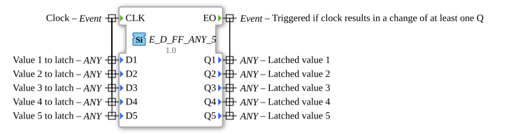

# E_D_FF_ANY_5

* * * * * * * * * *

## Einleitung

Der `E_D_FF_ANY_5` ist die Variante von [`E_D_FF_ANY`](E_D_FF_ANY.md) für **fünf** gleichzeitig zwischengespeicherte Werte beliebigen Datentyps (`ANY`). Er ist ein taktgesteuertes Daten-Latch (D-Flipflop) mit integrierter Änderungserkennung: Das Ausgangsereignis `EO` wird nur ausgelöst, wenn sich mindestens einer der fünf Ausgänge `Q1`..`Q5` durch den Takt ändert.

## Schnittstellenstruktur

### **Ereignis-Eingänge**

- **CLK**: Takt, übernimmt die aktuellen Werte von `D1`..`D5`
    - **Verbundene Daten**: `D1`, `D2`, `D3`, `D4`, `D5`

### **Ereignis-Ausgänge**

- **EO**: wird ausgelöst, wenn der Takt eine Änderung mindestens eines `Qi` bewirkt
    - **Verbundene Daten**: `Q1`, `Q2`, `Q3`, `Q4`, `Q5`

### **Daten-Eingänge**

- **D1** (ANY): zu speichernder Wert 1
- **D2** (ANY): zu speichernder Wert 2
- **D3** (ANY): zu speichernder Wert 3
- **D4** (ANY): zu speichernder Wert 4
- **D5** (ANY): zu speichernder Wert 5

### **Daten-Ausgänge**

- **Q1** (ANY): zwischengespeicherter Wert 1
- **Q2** (ANY): zwischengespeicherter Wert 2
- **Q3** (ANY): zwischengespeicherter Wert 3
- **Q4** (ANY): zwischengespeicherter Wert 4
- **Q5** (ANY): zwischengespeicherter Wert 5

### **Adapter**

Es werden keine Adapter verwendet.

## Funktionsweise

Bei jedem `CLK`-Ereignis werden `D1`..`D5` übernommen und mit den bisher gespeicherten Werten `Q1`..`Q5` verglichen. Unterscheidet sich mindestens ein `Di` vom zugehörigen `Qi`, werden die Werte gespeichert und `EO` wird ausgelöst; sind alle Werte unverändert, entsteht kein Ausgangsereignis. Der Baustein ist ein generischer FB (`eclipse4diac::core::GenericClassName = GEN_E_D_FF_ANY`); die native Implementierung `GEN_E_D_FF_ANY` (FORTE) wird benötigt.

## Technische Besonderheiten

- **Generischer Baustein**: Die Typen von `D1`..`D5` und `Q1`..`Q5` sind `ANY` und werden bei der Instanziierung festgelegt
- **Gemeinsame Änderungserkennung**: Ein einziges `EO` meldet die Änderung irgendeines der fünf Werte; welcher sich geändert hat, ist am Ereignis nicht erkennbar
- Version 1.0 (2026-08-26): Erweiterung von `E_D_FF_ANY` auf 5 Variablen

## Anwendungsszenarien

- Adapter-Wrapper um Funktionen, die fünf Ergebnisse liefern, mit Ausgabe nur bei Wertänderung
- Änderungsgesteuerte Weiterverarbeitung mehrerer Werte beliebigen Datentyps

## ⚖️ Vergleich mit ähnlichen Bausteinen

[`E_D_FF_ANY`](E_D_FF_ANY.md) speichert einen Wert, [`E_D_FF_ANY_2`](E_D_FF_ANY_2.md) zwei, [`E_D_FF_ANY_3`](E_D_FF_ANY_3.md) drei, [`E_D_FF_ANY_4`](E_D_FF_ANY_4.md) vier und `E_D_FF_ANY_5` fünf Werte.

## Fazit

`E_D_FF_ANY_5` ist ein generisches, änderungserkennendes Fünf-Wert-Latch, das nur dann `EO` ausgibt, wenn sich mindestens einer der fünf zwischengespeicherten Werte ändert.
