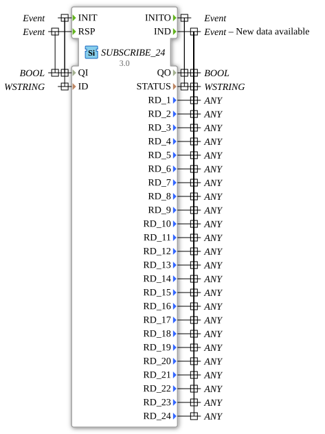

# SUBSCRIBE_24

* * * * * * * * * *

## Einleitung

Der Funktionsblock `SUBSCRIBE_24` abonniert einen [`PUBLISH_24`](PUBLISH_24.md)-Block und stellt die empfangenen Daten (bis zu 24 Werte) an seinen Ausgängen bereit.

## Schnittstellenstruktur

### **Ereignis-Eingänge**

- **INIT** (`EInit`): Initialisierung. Verknüpft mit `QI`, `ID`.
- **RSP**: Antwort (Response) auf eine Indikation. Verknüpft mit `QI`.

### **Ereignis-Ausgänge**

- **INITO** (`EInit`): Initialisierungsbestätigung. Verknüpft mit `QO`, `STATUS`.
- **IND**: Neue Daten verfügbar. Verknüpft mit `QO`, `STATUS`, `RD_1` bis `RD_24`.

### **Daten-Eingänge**

- **QI** (`BOOL`): Ereignis-Eingangsqualifizierer
- **ID** (`WSTRING`): Identifikationsstring des Kommunikationskanals (muss dem des `PUBLISH_24` entsprechen)

### **Daten-Ausgänge**

- **QO** (`BOOL`): Ereignis-Ausgangsqualifizierer
- **STATUS** (`WSTRING`): Statusinformation
- **RD_1** bis **RD_24** (`ANY`): empfangene Datenwerte

### **Adapter**

Keine Adapter-Schnittstellen vorhanden.

## Funktionsweise

Nach der Initialisierung mit `INIT` meldet der Block bei jedem Empfang neuer Daten `IND` und stellt die Werte `RD_1` bis `RD_24` bereit. Der Dienst ist als Service-Interface (`APPLICATION` ↔ `RESOURCE`) ausgeführt; `RSP` beantwortet die Indikation.

## Technische Besonderheiten

- Generischer Baustein (Generic Class `GEN_SUBSCRIBE`): Die Anzahl der Datenports ist hier 24, ihre Typen (`ANY`) werden bei der Instanziierung festgelegt
- Unicode-Strings (`WSTRING`) für `ID` und `STATUS`
- Gegenstück: `PUBLISH_24` mit `SD_1` bis `SD_24`

## Anwendungsszenarien

- Empfang vieler zusammengehöriger Werte, die ein `PUBLISH_24` an anderer Stelle sendet

## ⚖️ Vergleich mit ähnlichen Bausteinen

[`SUBSCRIBE_10`](SUBSCRIBE_10.md) empfängt bis zu 10 Datenwerte, `SUBSCRIBE_24` bis zu 24.

## Fazit

`SUBSCRIBE_24` ist das Empfangsgegenstück zu `PUBLISH_24` für bis zu 24 Datenwerte.
