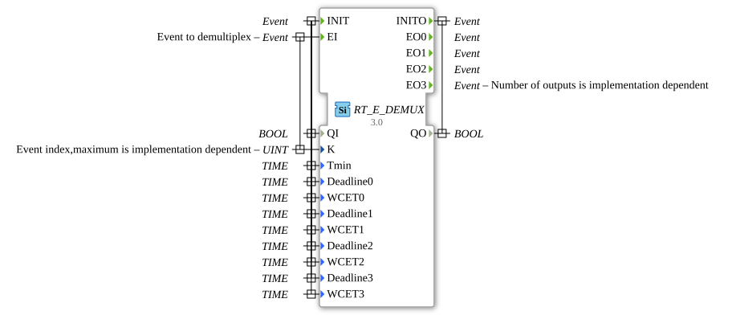

# RT_E_DEMUX

* * * * * * * * * *

## Einleitung

Echtzeit-Variante des E_DEMUX Bausteins. Leitet ein Eingangsereignis an einen von mehreren Ausgängen weiter.

## Schnittstelle

### Ereigniseingänge

| Ereignis | Zugehörige Variablen | Beschreibung |
| :------- | :------------------- | :----------- |
| INIT | QI, Tmin, Deadline0..Deadline3, WCET0..WCET3 | Initialisierung |
| EI | K | Zu demultiplexendes Ereignis |

### Ereignisausgänge

| Ereignis | Zugehörige Variablen | Beschreibung |
| :------- | :------------------- | :----------- |
| INITO | QO | Bestätigung der Initialisierung |
| EO0..EO3 | - | Ausgangsereignisse (die Anzahl der Ausgänge ist implementierungsabhängig) |

### Eingangsvariablen

| Name | Typ | Beschreibung |
| :--- | :-- | :----------- |
| QI | BOOL | Eingang der Initialisierung |
| K | UINT | Ereignisindex, das Maximum ist implementierungsabhängig |
| Tmin | TIME | Zeitparameter der Echtzeit-Variante (im Quelltext nicht weiter kommentiert) |
| Deadline0..Deadline3 | TIME | Zeitparameter der Echtzeit-Variante (im Quelltext nicht weiter kommentiert), je Ausgang EO0..EO3 |
| WCET0..WCET3 | TIME | Zeitparameter der Echtzeit-Variante (im Quelltext nicht weiter kommentiert), je Ausgang EO0..EO3 |

### Ausgangsvariablen

| Name | Typ | Beschreibung |
| :--- | :-- | :----------- |
| QO | BOOL | Ausgang der Initialisierung (zu INITO) |

## Metadaten

| Attribut    | Wert                             |
| :---------- | :------------------------------- |
| Lizenz      | EPL-2.0                          |
| Version     | 3.0 (2025-04-14, Patrick Aigner) |
| 4diac-Paket | eclipse4diac::rtevents           |

---

### 🌐 Passende Themen-Unterseiten auf ms-muc-docs.de

- [🌐 Eclipse 4diac IDE & Farb-Referenz auf ms-muc-docs.de](https://www.ms-muc-docs.de/iec-61499/eclipse-4diac/)
