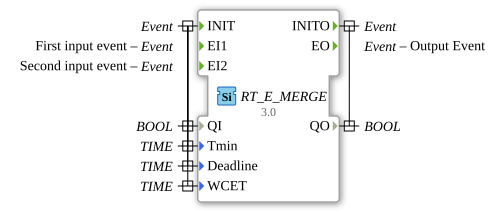

# RT_E_MERGE

* * * * * * * * * *

## Einleitung

Echtzeit-Variante des E_MERGE Bausteins. Führt mehrere Ereignisse zusammen.

## Schnittstelle

### Ereigniseingänge

| Ereignis | Zugehörige Variablen | Beschreibung |
| :------- | :------------------- | :----------- |
| INIT | QI, Tmin, Deadline, WCET | Initialisierung |
| EI1 | - | Erstes Eingangsereignis |
| EI2 | - | Zweites Eingangsereignis |

### Ereignisausgänge

| Ereignis | Zugehörige Variablen | Beschreibung |
| :------- | :------------------- | :----------- |
| INITO | QO | Bestätigung der Initialisierung |
| EO | - | Ausgangsereignis |

### Eingangsvariablen

| Name | Typ | Beschreibung |
| :--- | :-- | :----------- |
| QI | BOOL | Eingang der Initialisierung |
| Tmin | TIME | Zeitparameter der Echtzeit-Variante (im Quelltext nicht weiter kommentiert) |
| Deadline | TIME | Zeitparameter der Echtzeit-Variante (im Quelltext nicht weiter kommentiert) |
| WCET | TIME | Zeitparameter der Echtzeit-Variante (im Quelltext nicht weiter kommentiert) |

### Ausgangsvariablen

| Name | Typ | Beschreibung |
| :--- | :-- | :----------- |
| QO | BOOL | Ausgang der Initialisierung (zu INITO) |

## Metadaten

| Attribut    | Wert                             |
| :---------- | :------------------------------- |
| Lizenz      | EPL-2.0                          |
| Version     | 3.0 (2025-04-14, Patrick Aigner) |
| 4diac-Paket | eclipse4diac::rtevents           |

---

### 🌐 Passende Themen-Unterseiten auf ms-muc-docs.de

- [🌐 Eclipse 4diac IDE & Farb-Referenz auf ms-muc-docs.de](https://www.ms-muc-docs.de/iec-61499/eclipse-4diac/)
