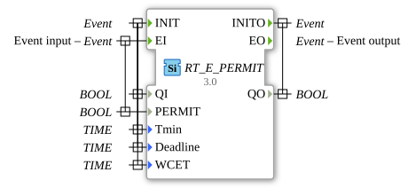

# RT_E_PERMIT

* * * * * * * * * *

## Einleitung

Echtzeit-Variante des E_PERMIT Bausteins. Lässt ein Ereignis nur durch, wenn die Bedingung (PERMIT) wahr ist.

## Schnittstellenstruktur

### **Ereignis-Eingänge**

- **INIT**: Initialisierung, trägt `QI`, `Tmin`, `Deadline` und `WCET`.
- **EI**: Ereigniseingang, trägt `PERMIT`.

### **Ereignis-Ausgänge**

- **INITO**: Bestätigt die Initialisierung, trägt `QO`.
- **EO**: Ereignisausgang; trägt keine Daten.

### **Daten-Eingänge**

- **QI** (`BOOL`): Qualifier für die Initialisierung.
- **PERMIT** (`BOOL`): Freigabebedingung für die Weitergabe des Ereignisses.
- **Tmin** (`TIME`): Echtzeitparameter (minimaler Abstand).
- **Deadline** (`TIME`): Echtzeitparameter (Deadline).
- **WCET** (`TIME`): Echtzeitparameter (maximale Ausführungszeit).

### **Daten-Ausgänge**

- **QO** (`BOOL`): Ausgangsqualifier der Initialisierung.

## Metadaten

| Attribut    | Wert                             |
| :---------- | :------------------------------- |
| Lizenz      | EPL-2.0                          |
| Version     | 3.0 (2025-04-14, Patrick Aigner) |
| 4diac-Paket | eclipse4diac::rtevents           |

---

### 🌐 Passende Themen-Unterseiten auf ms-muc-docs.de

- [🌐 Eclipse 4diac IDE & Farb-Referenz auf ms-muc-docs.de](https://www.ms-muc-docs.de/iec-61499/eclipse-4diac/)
