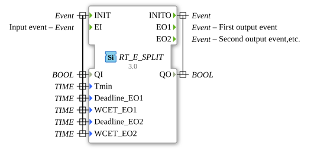

# RT_E_SPLIT

* * * * * * * * * *

## Einleitung

Echtzeit-Variante des E_SPLIT Bausteins. Teilt ein Ereignis in mehrere auf.

## Schnittstelle

| Port         | Typ   | Beschreibung                                                                   |
| :----------- | :---- | :----------------------------------------------------------------------------- |
| INIT         | Event | Initialisierung (mit QI, Tmin, Deadline_EO1, WCET_EO1, Deadline_EO2, WCET_EO2) |
| EI           | Event | Eingangsereignis                                                               |
| INITO        | Event | Initialisierung abgeschlossen (mit QO)                                         |
| EO1          | Event | Erstes Ausgangsereignis                                                        |
| EO2          | Event | Zweites Ausgangsereignis                                                       |
| QI           | BOOL  | Eingang (mit INIT)                                                             |
| Tmin         | TIME  | Echtzeit-Parameter (mit INIT)                                                  |
| Deadline_EO1 | TIME  | Echtzeit-Parameter für EO1 (mit INIT)                                          |
| WCET_EO1     | TIME  | Echtzeit-Parameter für EO1 (mit INIT)                                          |
| Deadline_EO2 | TIME  | Echtzeit-Parameter für EO2 (mit INIT)                                          |
| WCET_EO2     | TIME  | Echtzeit-Parameter für EO2 (mit INIT)                                          |
| QO           | BOOL  | Ausgang (mit INITO)                                                            |

## Metadaten

| Attribut    | Wert                             |
| :---------- | :------------------------------- |
| Lizenz      | EPL-2.0                          |
| Version     | 3.0 (2025-04-14, Patrick Aigner) |
| 4diac-Paket | eclipse4diac::rtevents           |

---

### 🌐 Passende Themen-Unterseiten auf ms-muc-docs.de

- [🌐 Eclipse 4diac IDE & Farb-Referenz auf ms-muc-docs.de](https://www.ms-muc-docs.de/iec-61499/eclipse-4diac/)
