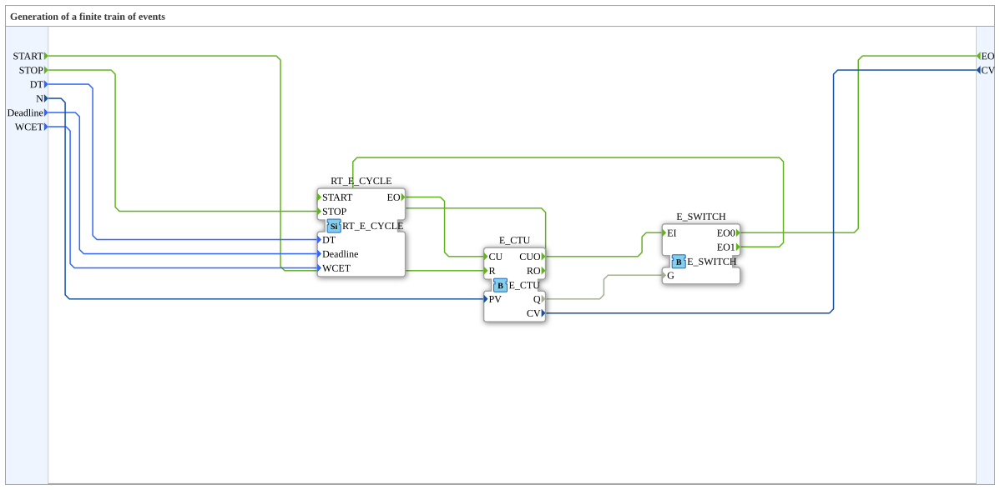

# RT_E_TRAIN

* * * * * * * * * *

## Einleitung

Echtzeit-Variante des E_TRAIN Bausteins. Erzeugt eine Folge von Ereignissen.

## Schnittstellenstruktur

### **Ereignis-Eingänge**

- **START**: Startet die Ereignisfolge, trägt `DT`, `N`, `Deadline` und `WCET`.
- **STOP**: Stoppt die Ereignisfolge; trägt keine Daten.

### **Ereignis-Ausgänge**

- **EO**: `N` Ereignisse im Abstand `DT`, beginnend `DT` nach `START`; trägt `CV`.

### **Daten-Eingänge**

- **DT** (`TIME`): Zeitabstand zwischen den Ereignissen.
- **N** (`UINT`): Anzahl der zu erzeugenden Ereignisse.
- **Deadline** (`TIME`): Echtzeitparameter (Deadline).
- **WCET** (`TIME`): Echtzeitparameter (maximale Ausführungszeit).

### **Daten-Ausgänge**

- **CV** (`UINT`): Index des aktuellen `EO` (0 bis N-1).

## Metadaten

| Attribut    | Wert                             |
| :---------- | :------------------------------- |
| Lizenz      | EPL-2.0                          |
| Version     | 3.0 (2025-04-14, Patrick Aigner) |
| 4diac-Paket | eclipse4diac::rtevents           |

---

### 🌐 Passende Themen-Unterseiten auf ms-muc-docs.de

- [🌐 Eclipse 4diac IDE & Farb-Referenz auf ms-muc-docs.de](https://www.ms-muc-docs.de/iec-61499/eclipse-4diac/)
