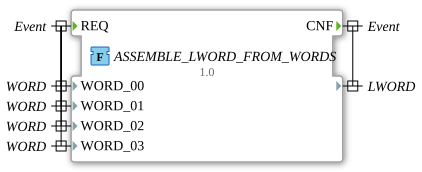

# ASSEMBLE_LWORD_FROM_WORDS



* * * * * * * * * *

## Einleitung

Die Funktion `ASSEMBLE_LWORD_FROM_WORDS` kombiniert vier 16-Bit-Wörter (`WORD`) zu einem 64-Bit-Langwort (`LWORD`).

## Schnittstellenstruktur

### **Ereignis-Eingänge**

- `REQ`: Startet die Verarbeitung. Verbundene Daten: `WORD_00`, `WORD_01`, `WORD_02`, `WORD_03`

### **Ereignis-Ausgänge**

- `CNF`: Signalisiert die Verarbeitung und die Ausgabe des kombinierten `LWORD`.

### **Daten-Eingänge**

- `WORD_00`: Wort 0 (`WORD`), unterste 16 Bit des Ergebnisses
- `WORD_01`: Wort 1 (`WORD`), Bits 16 bis 31
- `WORD_02`: Wort 2 (`WORD`), Bits 32 bis 47
- `WORD_03`: Wort 3 (`WORD`), oberste 16 Bit (Bits 48 bis 63)

### **Daten-Ausgänge**

- (kein Name): Das kombinierte 64-Bit-Langwort (`LWORD`), zugleich der Rückgabewert der Funktion

### **Adapter**

Diese Funktion verwendet keine Adapter.

## Funktionsweise

Die Funktion weist die vier Eingabewörter über den Teilzugriff `.%W0` bis `.%W3` dem Rückgabewert zu:

```text
ASSEMBLE_LWORD_FROM_WORDS.%W0 := WORD_00;
ASSEMBLE_LWORD_FROM_WORDS.%W1 := WORD_01;
ASSEMBLE_LWORD_FROM_WORDS.%W2 := WORD_02;
ASSEMBLE_LWORD_FROM_WORDS.%W3 := WORD_03;
```

`WORD_00` bildet damit das niederwertigste und `WORD_03` das höchstwertige Wort des `LWORD`.

## Technische Besonderheiten

- Implementierung in Structured Text (ST) als `FUNCTION` ohne internen Zustand
- Teil des Pakets `eclipse4diac::utils::assembling`
- Die Umkehrfunktion ist [`SPLIT_LWORD_INTO_DWORDS`](../splitting/SPLIT_LWORD_INTO_DWORDS.md) bzw. die jeweiligen `SPLIT_*`-Funktionen im Paket `splitting`

## Anwendungsszenarien

- Zusammensetzen eines 64-Bit-Werts aus vier 16-Bit-Registern (z. B. Fieldbus-/Modbus-Daten)
- Erzeugen von 64-Bit-Bitmustern aus einzelnen Wörtern

## Fazit

`ASSEMBLE_LWORD_FROM_WORDS` setzt vier `WORD`-Werte, beginnend mit dem niederwertigsten, zu einem `LWORD` zusammen.
