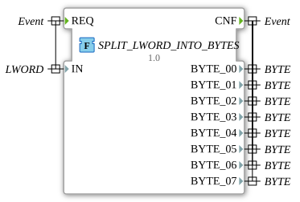

# SPLIT_LWORD_INTO_BYTES



* * * * * * * * * *

## Einleitung

Die Funktion `SPLIT_LWORD_INTO_BYTES` zerlegt ein 64-Bit-Langwort (`LWORD`) in seine acht Bytes (`BYTE`).

## Schnittstellenstruktur

### **Ereignis-Eingänge**

- `REQ`: Startet die Verarbeitung. Verbundene Daten: `IN`

### **Ereignis-Ausgänge**

- `CNF`: Signalisiert die Verarbeitung. Verbundene Daten: `BYTE_00` bis `BYTE_07`

### **Daten-Eingänge**

- `IN`: Das zu zerlegende Langwort (`LWORD`)

### **Daten-Ausgänge**

- `BYTE_00`: Byte 0 (`BYTE`), niederwertigstes Byte (Bits 0 bis 7)
- `BYTE_01`: Byte 1 (`BYTE`), Bits 8 bis 15
- `BYTE_02`: Byte 2 (`BYTE`), Bits 16 bis 23
- `BYTE_03`: Byte 3 (`BYTE`), Bits 24 bis 31
- `BYTE_04`: Byte 4 (`BYTE`), Bits 32 bis 39
- `BYTE_05`: Byte 5 (`BYTE`), Bits 40 bis 47
- `BYTE_06`: Byte 6 (`BYTE`), Bits 48 bis 55
- `BYTE_07`: Byte 7 (`BYTE`), höchstwertiges Byte (Bits 56 bis 63)

### **Adapter**

Diese Funktion verwendet keine Adapter.

## Funktionsweise

Die Funktion liest die acht Bytes über den Teilzugriff `.%B0` bis `.%B7` aus dem Eingang `IN`:

```text
BYTE_00 := IN.%B0;
BYTE_01 := IN.%B1;
BYTE_02 := IN.%B2;
BYTE_03 := IN.%B3;
BYTE_04 := IN.%B4;
BYTE_05 := IN.%B5;
BYTE_06 := IN.%B6;
BYTE_07 := IN.%B7;
```

`BYTE_00` ist damit das niederwertigste und `BYTE_07` das höchstwertige Byte des `LWORD`.

## Technische Besonderheiten

- Implementierung in Structured Text (ST) als `FUNCTION` ohne internen Zustand
- Teil des Pakets `eclipse4diac::utils::splitting`
- Version 1.0 (2026-05-16)

## Anwendungsszenarien

- Zerlegen eines 64-Bit-Werts in einzelne Bytes, z. B. für Telegramme oder Bus-Nachrichten (CAN: 8 Datenbytes)
- Analyse von 64-Bit-Bitmustern byteweise

## Fazit

`SPLIT_LWORD_INTO_BYTES` extrahiert die acht Bytes eines `LWORD`, beginnend mit dem niederwertigsten.
