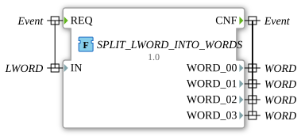

# SPLIT_LWORD_INTO_WORDS

* * * * * * * * * *

## Einleitung

Die Funktion `SPLIT_LWORD_INTO_WORDS` extrahiert die vier `WORD`-Werte aus einem `LWORD`. Sie ist nützlich, wenn ein 64-Bit-Wert (z. B. aus einem Kommunikationsprotokoll) in 16-Bit-Teile zerlegt werden muss.

## Schnittstellenstruktur

### **Ereignis-Eingänge**

- **REQ**: startet die Verarbeitung (assoziiert mit `IN`)

### **Ereignis-Ausgänge**

- **CNF**: signalisiert den Abschluss (assoziiert mit `WORD_00`..`WORD_03`)

### **Daten-Eingänge**

- **IN** (LWORD): aufzuteilender 64-Bit-Wert

### **Daten-Ausgänge**

- **WORD_00** (WORD): erstes Wort, Bits 0-15 (`IN.%W0`)
- **WORD_01** (WORD): zweites Wort, Bits 16-31 (`IN.%W1`)
- **WORD_02** (WORD): drittes Wort, Bits 32-47 (`IN.%W2`)
- **WORD_03** (WORD): viertes Wort, Bits 48-63 (`IN.%W3`)

### **Adapter**

Es werden keine Adapter verwendet.

## Funktionsweise

Die Funktion weist die vier Wörter per Partial-Access zu: `WORD_00 := IN.%W0;`, `WORD_01 := IN.%W1;`, `WORD_02 := IN.%W2;`, `WORD_03 := IN.%W3;`.

## Technische Besonderheiten

- Reine Bit-Zugriffe ohne Rechenaufwand; keine Zustände
- Paket `eclipse4diac::utils::splitting`, Version 1.0 (2026-05-16)

## Anwendungsszenarien

- Zerlegen von 64-Bit-Werten (z. B. aus OPC-UA oder CAN-Daten) in 16-Bit-Register

## ⚖️ Vergleich mit ähnlichen Bausteinen

Analoge Bausteine zerlegen kleinere Werte, etwa `SPLIT_BYTE_INTO_QUARTERS` (Byte in vier Viertelbytes) oder `SPLIT_DWORD_INTO_BOOLS`.

## Fazit

`SPLIT_LWORD_INTO_WORDS` zerlegt ein `LWORD` in vier `WORD`-Werte und liefert sie mit einem einzigen `CNF`-Ereignis.
