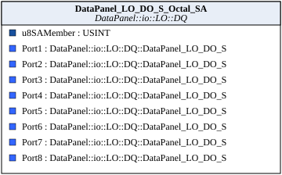

# DataPanel_LO_DO_S_Octal_SA

* * * * * * * * * *

## Introduction

Description from the comment of the type: DataPanel Modules with low IO density DO Struct + Source Address

Package: `DataPanel::io::LO::DQ`

## Interface structure

### **Fields**

-   **u8SAMember** (Type: `USINT`): Node SA 217..224 (Default: `LO_00`)
-   **Port1** (Type: `DataPanel::io::LO::DQ::DataPanel_LO_DO_S`): Identify the Port 1A..4B (Default: `InvalidL`)
-   **Port2** (Type: `DataPanel::io::LO::DQ::DataPanel_LO_DO_S`): Identify the Port 1A..4B (Default: `InvalidL`)
-   **Port3** (Type: `DataPanel::io::LO::DQ::DataPanel_LO_DO_S`): Identify the Port 1A..4B (Default: `InvalidL`)
-   **Port4** (Type: `DataPanel::io::LO::DQ::DataPanel_LO_DO_S`): Identify the Port 1A..4B (Default: `InvalidL`)
-   **Port5** (Type: `DataPanel::io::LO::DQ::DataPanel_LO_DO_S`): Identify the Port 1A..4B (Default: `InvalidL`)
-   **Port6** (Type: `DataPanel::io::LO::DQ::DataPanel_LO_DO_S`): Identify the Port 1A..4B (Default: `InvalidL`)
-   **Port7** (Type: `DataPanel::io::LO::DQ::DataPanel_LO_DO_S`): Identify the Port 1A..4B (Default: `InvalidL`)
-   **Port8** (Type: `DataPanel::io::LO::DQ::DataPanel_LO_DO_S`): Identify the Port 1A..4B (Default: `InvalidL`)

Note: This page was generated from the type definition (`DataPanel_LO_DO_S_Octal_SA.dtp`) and only shows the interface. A detailed description of the behavior is still missing.
