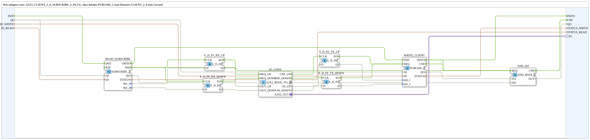

# A2X2_PUBLISH_2_SUBSCRIBE_2_PLUG

* * * * * * * * * *

## Introduction

`A2X2_PUBLISH_2_SUBSCRIBE_2_PLUG` is the local variant of `adapter::net::A2X2_CLIENT_2_0_SUBSCRIBE_2_PLUG`: instead of a remote `CLIENT_2_0`, a local `PUBLISH_2` writes (single device). The block subscribes to two BOOL values (UP/DOWN) with `SUBSCRIBE_2` and writes two BOOL values (UP/DOWN) with `PUBLISH_2`; both sit behind a single bidirectional `A2X2` adapter (plug `IO`). Internally the adapter converter `A2X2_BOOL_TO_2X` is used, because a SubApp cannot use the pins of an interface adapter directly. The block is created as a SubAppType so that FORTE does not need to know the type (no ELF for MyLib_AX).

## Interface Structure

### **Event Inputs**

- `INIT` (EInit): Initialization

### **Event Outputs**

- `INITO` (EInit): Initialization confirm
- `CNF` (Event): `QO`/`STATUS` updated

### **Data Inputs**

| Variable | Type | Comment |
|----------|-----|-----------|
| `QI` | BOOL | Qualifier for all internal network blocks |
| `ID_WRITE` | WSTRING | Target address (`ACTION=WRITE`) for both BOOLs (source comment: "remote target address") |
| `ID_READ` | WSTRING | Locally monitored state node (`ACTION=READ`) for both BOOLs |

### **Data Outputs**

| Variable | Type | Comment |
|----------|-----|-----------|
| `QO` | BOOL | TRUE only if `WRITE_CLIENT` and `READ_SUBSCRIBE` currently both report `QO = TRUE` |
| `STATUS_WRITE` | WSTRING | `STATUS` of `WRITE_CLIENT` |
| `STATUS_READ` | WSTRING | `STATUS` of `READ_SUBSCRIBE` |

### **Adapters**

| Adapter | Type | Direction | Comment |
|---------|-----|----------|-----------|
| `IO` | `adapter::types::bidirectional::A2X2` | Plug | UP/DOWN BOOLs to send (out), UP/DOWN BOOLs received (in) |

## Function Blocks Used (FBs)

- **WRITE_CLIENT** (`iec61499::net::PUBLISH_2`): writes the two BOOLs (`SD_1`, `SD_2`)
- **READ_SUBSCRIBE** (`iec61499::net::SUBSCRIBE_2`): provides the two received BOOLs (`RD_1`, `RD_2`)
- **IO_CONV** (`adapter::conversion::bidirectional::A2X2_BOOL_TO_2X`): adapter converter between the `A2X2` adapter and the individual BOOL/event pins; see [A2X2_BOOL_TO_2X](../../adapter/conversion/bidirectional/BOOL/A2X2_BOOL_TO_2X.md)
- **E_D_FF_RX_UP**, **E_D_FF_RX_DOWN** (`iec61499::events::E_D_FF`): buffer `RD_1` and `RD_2` on `IND` (receive side)
- **E_D_FF_TX_UP**, **E_D_FF_TX_DOWN** (`iec61499::events::E_D_FF`): buffer `IO_CONV.IN_UP` and `IN_DOWN` on `CNF_UP`/`CNF_DOWN` (send side)
- **AND_QO** (`iec61131::booleanOperators::AND_BOOL_2`): ANDs the `QO` values of `WRITE_CLIENT` and `READ_SUBSCRIBE`

## Program Flow and Connections

1. `INIT` -> `READ_SUBSCRIBE.INIT`; `READ_SUBSCRIBE.INITO` -> `WRITE_CLIENT.INIT`; `WRITE_CLIENT.INITO` -> `INITO` (sequential initialization).
2. `QI` -> `READ_SUBSCRIBE.QI` and `WRITE_CLIENT.QI`; `ID_READ` -> `READ_SUBSCRIBE.ID`; `ID_WRITE` -> `WRITE_CLIENT.ID`.
3. `READ_SUBSCRIBE.IND` -> `E_D_FF_RX_UP.CLK` and `E_D_FF_RX_DOWN.CLK`; `READ_SUBSCRIBE.RD_1` -> `E_D_FF_RX_UP.D`; `READ_SUBSCRIBE.RD_2` -> `E_D_FF_RX_DOWN.D`.
4. `E_D_FF_RX_UP.EO` -> `IO_CONV.REQ_UP`; `E_D_FF_RX_DOWN.EO` -> `IO_CONV.REQ_DOWN`; `E_D_FF_RX_UP.Q` -> `IO_CONV.OUT_UP`; `E_D_FF_RX_DOWN.Q` -> `IO_CONV.OUT_DOWN`.
5. `IO_CONV.CNF_UP` -> `E_D_FF_TX_UP.CLK`; `IO_CONV.CNF_DOWN` -> `E_D_FF_TX_DOWN.CLK`; `IO_CONV.IN_UP` -> `E_D_FF_TX_UP.D`; `IO_CONV.IN_DOWN` -> `E_D_FF_TX_DOWN.D`.
6. `E_D_FF_TX_UP.EO` and `E_D_FF_TX_DOWN.EO` -> `WRITE_CLIENT.REQ`; `E_D_FF_TX_UP.Q` -> `WRITE_CLIENT.SD_1`; `E_D_FF_TX_DOWN.Q` -> `WRITE_CLIENT.SD_2`.
7. `WRITE_CLIENT.INITO`, `WRITE_CLIENT.CNF` and `READ_SUBSCRIBE.IND` -> `AND_QO.REQ`; `WRITE_CLIENT.QO` -> `AND_QO.IN1`; `READ_SUBSCRIBE.QO` -> `AND_QO.IN2`; `AND_QO.CNF` -> `CNF`; `AND_QO.OUT` -> `QO`.
8. `WRITE_CLIENT.STATUS` -> `STATUS_WRITE`; `READ_SUBSCRIBE.STATUS` -> `STATUS_READ`.
9. `IO_CONV.A2X2_OUT` -> `IO` (plug).

## Technical Features

- The adapter converter is required because a SubApp cannot use the pins of an interface adapter directly; it maps the adapter pins to individual BOOL and event pins.
- The four `E_D_FF` blocks each buffer one BOOL value so that it is stable when the associated event occurs.
- `QO` is TRUE only if the write and read branches both report `QO = TRUE`; each of these events additionally triggers `CNF`.
- Local variant: `PUBLISH_2` instead of a remote `CLIENT_2_0` (single device).

## Application Scenarios

- Coupling two BOOL signals (UP/DOWN) via OPC-UA on a single device, e.g. in local exercise setups that would otherwise need two devices.
- Replacement for the same-named `adapter::net` variant with remote `CLIENT_2_0` when two devices are involved.

## Related Exercises

- [Uebung_OPC_L12_AX](https://meisterschulen-am-ostbahnhof-munchen-docs.readthedocs.io/projects/4diac-exercises-docs/en/latest/Uebungen/test_AX/Meins/OPC_UA_Lokal/Uebung_OPC_L12_AX/)

## Summary

`A2X2_PUBLISH_2_SUBSCRIBE_2_PLUG` combines `SUBSCRIBE_2` and `PUBLISH_2` behind an `A2X2` adapter (plug) and uses the adapter converter `A2X2_BOOL_TO_2X` for this. It is the local variant of the `adapter::net` block with remote `CLIENT_2_0`.

---

### 🌐 Related topic subpages on ms-muc-docs.de

- [🌐 Eclipse 4diac IDE & color reference on ms-muc-docs.de](https://www.ms-muc-docs.de/iec-61499/eclipse-4diac/)
