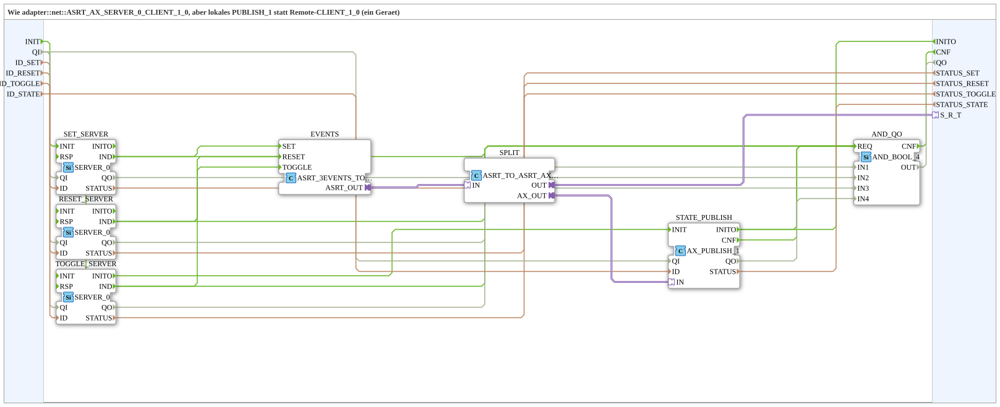

# ASRT_AX_SERVER_0_PUBLISH_1

* * * * * * * * * *

## Introduction

`ASRT_AX_SERVER_0_PUBLISH_1` is the local variant of [`adapter::net::ASRT_AX_SERVER_0_CLIENT_1_0`](../../adapter/net/ASRT_AX_SERVER_0_CLIENT_1_0.md): instead of a remote `CLIENT_1_0`, a local `AX_PUBLISH_1` writes (single device). The block receives three OPC-UA method calls via `SERVER_0` and publishes the resulting state locally; both sit behind a single bidirectional `ASRT_AX` adapter plug `S_R_T`. Internally adapter converters (`ASRT_3EVENTS_TO_SRT`, `ASRT_TO_ASRT_AX_SPLIT`) and `AX_PUBLISH_1` are used, because a SubApp cannot use the pins of an interface adapter directly. The block is created as a SubAppType so that FORTE does not need to know the type (no ELF for MyLib_AX).

## Interface Structure

### **Event Inputs**

- `INIT` (EInit): Initialization

### **Event Outputs**

- `INITO` (EInit): Initialization confirm
- `CNF` (Event): `QO`/`STATUS` updated

### **Data Inputs**

| Variable | Type | Comment |
|----------|-----|-----------|
| `QI` | BOOL | Qualifier for all internal network blocks |
| `ID_SET` | WSTRING | Local method address (`ACTION=CREATE_METHOD`) for the Set method call (`SET_SERVER`) |
| `ID_RESET` | WSTRING | Local method address (`ACTION=CREATE_METHOD`) for the Reset method call (`RESET_SERVER`) |
| `ID_TOGGLE` | WSTRING | Local method address (`ACTION=CREATE_METHOD`) for the Toggle method call (`TOGGLE_SERVER`) |
| `ID_STATE` | WSTRING | Local address (`ACTION=WRITE`) for the state (`STATE_PUBLISH`) |

### **Data Outputs**

| Variable | Type | Comment |
|----------|-----|-----------|
| `QO` | BOOL | TRUE only if `SET_SERVER`, `RESET_SERVER`, `TOGGLE_SERVER` and `STATE_PUBLISH` currently all report `QO = TRUE` |
| `STATUS_SET` | WSTRING | `STATUS` of `SET_SERVER` |
| `STATUS_RESET` | WSTRING | `STATUS` of `RESET_SERVER` |
| `STATUS_TOGGLE` | WSTRING | `STATUS` of `TOGGLE_SERVER` |
| `STATUS_STATE` | WSTRING | `STATUS` of `STATE_PUBLISH` |

### **Adapters**

| Adapter | Type | Direction | Comment |
|---------|-----|----------|-----------|
| `S_R_T` | `adapter::types::bidirectional::ASRT_AX` | Plug | Set/Reset/Toggle (in), state (out) |

## Function Blocks Used (FBs)

- **SET_SERVER** (`iec61499::net::SERVER_0`): receives the Set method call (`IND`)
- **RESET_SERVER** (`iec61499::net::SERVER_0`): receives the Reset method call (`IND`)
- **TOGGLE_SERVER** (`iec61499::net::SERVER_0`): receives the Toggle method call (`IND`)
- **EVENTS** (`adapter::conversion::unidirectional::ASRT_3EVENTS_TO_SRT`): adapter converter, maps the `IND` events onto the adapter; see [ASRT_3EVENTS_TO_SRT](../../adapter/conversion/unidirectional/EVENT/ASRT_3EVENTS_TO_SRT.md)
- **SPLIT** (`adapter::events::bidirectional::ASRT_TO_ASRT_AX_SPLIT`): splits the adapter into `OUT` (to plug `S_R_T`) and `AX_OUT` (to the state publish); see [ASRT_TO_ASRT_AX_SPLIT](../../adapter/events/bidirectional/ASRT_TO_ASRT_AX_SPLIT.md)
- **STATE_PUBLISH** (`adapter::net::AX_PUBLISH_1`): publishes the state locally; see [AX_PUBLISH_1](../../adapter/net/AX_PUBLISH_1.md)
- **AND_QO** (`iec61131::booleanOperators::AND_BOOL_4`): ANDs the `QO` values of all network blocks

## Program Flow and Connections

1. `INIT` -> `SET_SERVER.INIT`; `SET_SERVER.INITO` -> `RESET_SERVER.INIT`; `RESET_SERVER.INITO` -> `TOGGLE_SERVER.INIT`; `TOGGLE_SERVER.INITO` -> `STATE_PUBLISH.INIT`; `STATE_PUBLISH.INITO` -> `INITO` (sequential initialization).
2. `SET_SERVER.IND` -> `SET_SERVER.RSP`, `RESET_SERVER.IND` -> `RESET_SERVER.RSP`, `TOGGLE_SERVER.IND` -> `TOGGLE_SERVER.RSP` (self-loop directly on the server, see the rule below).
3. `SET_SERVER.IND` -> `EVENTS.SET`; `RESET_SERVER.IND` -> `EVENTS.RESET`; `TOGGLE_SERVER.IND` -> `EVENTS.TOGGLE`.
4. `EVENTS.ASRT_OUT` -> `SPLIT.IN`; `SPLIT.OUT` -> `S_R_T`; `SPLIT.AX_OUT` -> `STATE_PUBLISH.IN`.
5. `QI` -> `SET_SERVER.QI`, `RESET_SERVER.QI`, `TOGGLE_SERVER.QI` and `STATE_PUBLISH.QI`.
6. `ID_SET` -> `SET_SERVER.ID`, `ID_RESET` -> `RESET_SERVER.ID`, `ID_TOGGLE` -> `TOGGLE_SERVER.ID`, `ID_STATE` -> `STATE_PUBLISH.ID`.
7. `SET_SERVER.QO` -> `AND_QO.IN1`; `RESET_SERVER.QO` -> `AND_QO.IN2`; `TOGGLE_SERVER.QO` -> `AND_QO.IN3`; `STATE_PUBLISH.QO` -> `AND_QO.IN4`; `AND_QO.OUT` -> `QO`.
8. `STATE_PUBLISH.INITO`, `SET_SERVER.IND`, `RESET_SERVER.IND`, `TOGGLE_SERVER.IND` and `STATE_PUBLISH.CNF` -> `AND_QO.REQ`; `AND_QO.CNF` -> `CNF`.
9. `SET_SERVER.STATUS` -> `STATUS_SET`, `RESET_SERVER.STATUS` -> `STATUS_RESET`, `TOGGLE_SERVER.STATUS` -> `STATUS_TOGGLE`, `STATE_PUBLISH.STATUS` -> `STATUS_STATE`.

## Technical Features

- The adapter converters are required because a SubApp cannot use the pins of an interface adapter directly: the converter maps the `IND` events onto the adapter, and the split separates the plug part from the state path to `AX_PUBLISH_1`.
- Local variant: `AX_PUBLISH_1` instead of a remote `CLIENT_1_0` (single device).
- `QO` is TRUE only if all 4 network blocks report `QO = TRUE`; each indication and `STATE_PUBLISH.CNF` additionally trigger `CNF`.
- **Rule `IND` → `RSP`**: Every `SERVER_0` needs `IND` → `RSP` directly on its own block. Without `RSP`, FORTE waits in `onServerMethodCall` for up to 4 s and holds open62541's global service lock meanwhile. During that time **all** OPC-UA publishes of the station stall, not only the one of the method. The application's reaction hangs on a second, independent connection from the same `IND`; `RSP` is never delayed. See [SERVER_0](../../../StandardLibraries/net/SERVER_0.md).

## Application Scenarios

- Receiving OPC-UA method calls with local state publication on a single device, e.g. in local exercise setups.
- Replacement for the same-named `adapter::net` variant `ASRT_AX_SERVER_0_CLIENT_1_0` with remote `CLIENT_1_0` when two devices are involved.

## Comparison with Similar Blocks

- **[ASRT_AX_SERVER_0_CLIENT_1_0](../../adapter/net/ASRT_AX_SERVER_0_CLIENT_1_0.md)**: same interface, but remote `CLIENT_1_0` instead of a local `AX_PUBLISH_1`.

## Summary

`ASRT_AX_SERVER_0_PUBLISH_1` receives three method calls via `SERVER_0` and publishes the state locally via `AX_PUBLISH_1`, both behind an `ASRT_AX` plug. It is the local variant of `ASRT_AX_SERVER_0_CLIENT_1_0`.

---

### 🌐 Related topic subpages on ms-muc-docs.de

- [🌐 Eclipse 4diac IDE & color reference on ms-muc-docs.de](https://www.ms-muc-docs.de/iec-61499/eclipse-4diac/)
