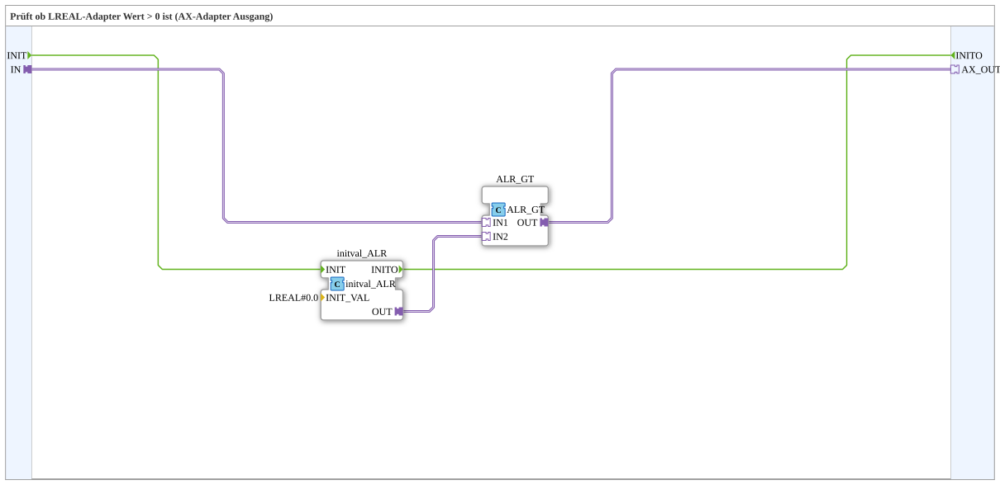

# ALR_GT_0

* * * * * * * * * *

## Introduction

`ALR_GT_0` checks whether a LREAL adapter value is greater than 0 and outputs the result as a boolean AX adapter signal. A typical input is a floating-point value (LREAL). The block is built identically for every numeric type (`AS`, `AI`, `ADI`, `ALI`, `AUS`, `AUI`, `AUDI`, `AULI`, `AR`, `ALR`).

## Interface

- **Event input**: `INIT` (initialization)
- **Event output**: `INITO` (initialization finished, comes from the internal `initval_ALR`)
- **Socket**: `IN` (`ALR`) — the value compared against 0
- **Plug**: `AX_OUT` (`AX`) — TRUE when `IN > 0`

## Function Blocks (FBs) Used

### Sub-blocks: ALR_GT_0

- **Type**: SubAppType
- **Internal FBs used**:
    - **initval_ALR**: `adapter::types::unidirectional::ALR::initval::initval_ALR` — supplies the fixed comparison constant `LREAL#0.0` as an adapter value (`INIT_VAL=LREAL#0.0`). An adapter socket cannot take the constant as a parameter, so it is fed in through this block.
    - **ALR_GT**: `adapter::iec61131::comparison::ALR_GT` — adapter-native comparison `IN1 > IN2`.
- **Functionality**: `IN` → `ALR_GT.IN1`; constant 0 → `ALR_GT.IN2`; result → `AX_OUT`.

## Program Flow and Connections

1. `INIT` → `initval_ALR.INIT`; `initval_ALR.INITO` → `INITO`.
2. `IN` (adapter) → `ALR_GT.IN1`.
3. `initval_ALR.OUT` (constant `LREAL#0.0`) → `ALR_GT.IN2`.
4. `ALR_GT.OUT` → `AX_OUT` (adapter).

## Application Scenarios

- Converting a floating-point value (LREAL) into a simple boolean adapter signal for VT status displays or enable logic.

## Summary

`ALR_GT_0` is a compact wrapper around the adapter-native comparison `ALR_GT` — converts "LREAL > 0" directly into an AX adapter signal, so the caller does not have to create and wire the zero constant itself.

---

### 🌐 Related topic subpages on ms-muc-docs.de

- [🌐 Eclipse 4diac IDE & color reference on ms-muc-docs.de](https://www.ms-muc-docs.de/iec-61499/eclipse-4diac/)
