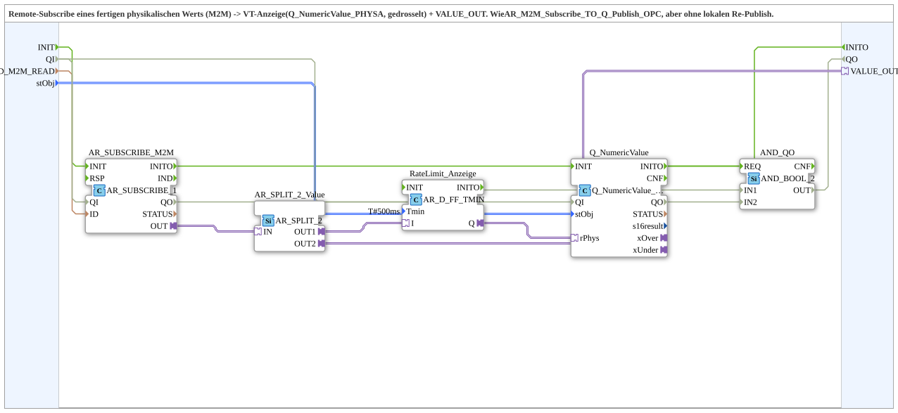

# AR_M2M_Subscribe_TO_Q_OPC

* * * * * * * * * *

## Introduction

`AR_M2M_Subscribe_TO_Q_OPC` subscribes remotely (M2M) to a finished physical value (`REAL`) and shows it on the VT (`Q_NumericValue_PHYSA`, throttled to at most one update per 500 ms). The value is also available as a read-only mirror on the plug `VALUE_OUT` for further local consumers. The block corresponds to [`AR_M2M_Subscribe_TO_Q_Publish_OPC`](./AR_M2M_Subscribe_TO_Q_Publish_OPC.md), but without local re-publish (no `ID_WRITE`) - the lean library variant.

## Interface Structure

### **Event Inputs**

- **INIT** (`EInit`): initialization request; starts the chain `AR_SUBSCRIBE_M2M` → `Q_NumericValue`

### **Event Outputs**

- **INITO** (`EInit`): initialization confirmation; comes from `Q_NumericValue.INITO`

### **Data Inputs**

| Variable | Type | Default | Comment |
|----------|------|---------|---------|
| `QI` | BOOL | TRUE | Quality input: enables the service; passed on to `AR_SUBSCRIBE_M2M` and `Q_NumericValue`. |
| `ID_M2M_READ` | WSTRING |  | Remote subscribe address of the finished physical value (`REAL`). |
| `stObj` | `logiBUS::utils::conversion::phys::NumericObjectPool_S` | `(u16ObjId := ID_NULL, r32Scale := 1.0, i32Offset := 0, u8Decimals := 0)` | Object pool properties of the VT number variable (`u16ObjId`, scale, offset, decimals). |

### **Data Outputs**

| Variable | Type | Default | Comment |
|----------|------|---------|---------|
| `QO` | BOOL |  | Quality output: AND of `AR_SUBSCRIBE_M2M.QO` and `Q_NumericValue.QO`. |

### **Adapters**

| Adapter | Type | Direction | Comment |
|---------|------|-----------|---------|
| `VALUE_OUT` | `adapter::types::unidirectional::AR` | Plug | Read-only mirror of the remotely subscribed value for further local consumers (unthrottled). |

## Function Blocks (FBs) Used

- **AR_SUBSCRIBE_M2M** (`adapter::net::AR_SUBSCRIBE_1`): remote subscribe of the value
- **AR_SPLIT_2_Value** (`adapter::events::unidirectional::AR_SPLIT_2`): splits the value into the display branch and `VALUE_OUT`
- **RateLimit_Anzeige** (`adapter::events::unidirectional::AR_D_FF_TMIN`, `Tmin = T#500ms`): throttles only the VT display to at most one update per `Tmin`
- **Q_NumericValue** (`isobus::UT::Q::Q_NumericValue_PHYSA`): writes the value to the VT number variable
- **AND_QO** (`iec61131::booleanOperators::AND_BOOL_2`): combines the two `QO` outputs

## Program Flow and Connections

1. Initialization: `INIT` -> `AR_SUBSCRIBE_M2M.INIT`; `AR_SUBSCRIBE_M2M.INITO` -> `Q_NumericValue.INIT`; `Q_NumericValue.INITO` -> `INITO` and -> `AND_QO.REQ`.
2. Data: `ID_M2M_READ` -> `AR_SUBSCRIBE_M2M.ID`; `stObj` -> `Q_NumericValue.stObj`.
3. Quality: `QI` -> `AR_SUBSCRIBE_M2M.QI` and `Q_NumericValue.QI`; `AR_SUBSCRIBE_M2M.QO` -> `AND_QO.IN1`; `Q_NumericValue.QO` -> `AND_QO.IN2`; `AND_QO.OUT` -> `QO`.
4. Value path: `AR_SUBSCRIBE_M2M.OUT` -> `AR_SPLIT_2_Value.IN`.
5. Display branch: `AR_SPLIT_2_Value.OUT1` -> `RateLimit_Anzeige.I`; `RateLimit_Anzeige.Q` -> `Q_NumericValue.rPhys`.
6. Mirror branch: `AR_SPLIT_2_Value.OUT2` -> `VALUE_OUT`.

## Technical Features

- The throttling (`T#500ms`) only acts on the display branch; `VALUE_OUT` remains unthrottled as in the original.
- Compared with [`AR_M2M_Subscribe_TO_Q_Publish_OPC`](./AR_M2M_Subscribe_TO_Q_Publish_OPC.md) the local publish and `ID_WRITE` are omitted.

## Application Scenarios

- Displaying an already physically scaled value delivered by another station on the VT when no local re-publish is needed.
- Passing the subscribed value on via `VALUE_OUT` to further local consumers.

## Summary

`AR_M2M_Subscribe_TO_Q_OPC` subscribes to a finished physical value remotely, shows it throttled on the VT and additionally provides it via `VALUE_OUT` - without local re-publish.

---

### 🌐 Related topic subpages on ms-muc-docs.de

- [🌐 Eclipse 4diac IDE & color reference on ms-muc-docs.de](https://www.ms-muc-docs.de/iec-61499/eclipse-4diac/)
