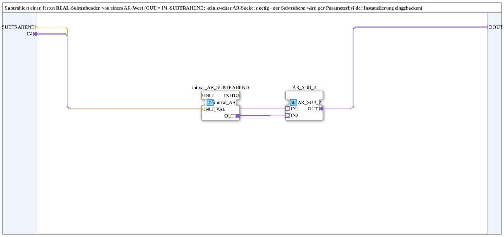

# AR_R_SUB

* * * * * * * * * *

## Introduction

`AR_R_SUB` is a SubApp that subtracts a fixed `REAL` subtrahend from an `AR` value (`OUT = IN - SUBTRAHEND`). The subtrahend is baked in as a parameter at instantiation, so no second `AR` socket has to be wired. It is the subtraction counterpart of [`AR_R_MUL`](./AR_R_MUL.md).

## Interface Structure

### **Event Inputs**

None.

### **Event Outputs**

None.

### **Data Inputs**

- **SUBTRAHEND** (`REAL`): Fixed subtrahend, set as a parameter at instantiation. Initial value `REAL#0.0`.

### **Data Outputs**

None.

### **Adapters**

- **IN** (socket, `adapter::types::unidirectional::AR`): minuend value
- **OUT** (plug, `adapter::types::unidirectional::AR`): `IN - SUBTRAHEND`

## Function Blocks (FBs) Used

- **`initval_AR_SUBTRAHEND`** (`adapter::types::unidirectional::AR::initval::initval_AR`): creates a constant `AR` value from `SUBTRAHEND`
- **`AR_SUB_2`** (`adapter::iec61131::arithmetic::AR_SUB_2`): subtracts two `AR` values

## Functionality

- `SUBTRAHEND` → `initval_AR_SUBTRAHEND.INIT_VAL`
- `IN` → `AR_SUB_2.IN1` (minuend)
- `initval_AR_SUBTRAHEND.OUT` → `AR_SUB_2.IN2` (subtrahend)
- `AR_SUB_2.OUT` → `OUT`

The block has no events of its own; the calculation follows the data flow of the `AR` adapter.

## Technical Details

- No second `AR` socket needed, the subtrahend is baked into the instance
- No change of the subtrahend at runtime is intended
- Pure wiring of existing blocks, no logic of its own

## Application Scenarios

- Subtracting a constant offset from a scaled or physical `AR` value

## Summary

`AR_R_SUB` subtracts a fixed, parameterised `REAL` value from an `AR` signal.

---

### 🌐 Related topic pages on ms-muc-docs.de

- [🌐 Eclipse 4diac IDE & color reference on ms-muc-docs.de](https://www.ms-muc-docs.de/iec-61499/eclipse-4diac/)
