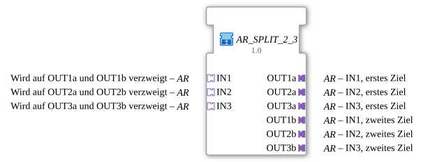

# AR_SPLIT_2_3

* * * * * * * * * *

## Introduction

`AR_SPLIT_2_3` branches **three independent AR values** onto two targets each (`IN1` → `OUT1a`/`OUT1b`, `IN2` → `OUT2a`/`OUT2b`, `IN3` → `OUT3a`/`OUT3b`) using one [`AR_SPLIT_2`](../../adapter/events/unidirectional/REAL/AR_SPLIT_2.md) each. It saves three individual `AR_SPLIT_2` blocks wherever several values must be distributed simultaneously to two independent consumers (e.g. threshold/dead band/hysteresis to control logic and to position/display logic, as in the automatic filling).

## Interface Structure

### **Event Inputs**

*No direct event inputs - events arrive via the adapter sockets/plugs*

### **Event Outputs**

*No direct event outputs*

### **Data Inputs**

*No data inputs*

### **Data Outputs**

*No data outputs*

### **Adapters**

All adapters are unidirectional of type `adapter::types::unidirectional::AR`.

- **IN1** (socket): branched to `OUT1a` and `OUT1b`
- **IN2** (socket): branched to `OUT2a` and `OUT2b`
- **IN3** (socket): branched to `OUT3a` and `OUT3b`
- **OUT1a**, **OUT2a**, **OUT3a** (plugs): first target of `IN1`/`IN2`/`IN3` respectively
- **OUT1b**, **OUT2b**, **OUT3b** (plugs): second target of `IN1`/`IN2`/`IN3` respectively

## Function Blocks (FBs) Used

- **Split_1**, **Split_2**, **Split_3**: each `adapter::events::unidirectional::AR_SPLIT_2`

## Program Flow and Connections

- `IN1` → `Split_1.IN`; `Split_1.OUT1` → `OUT1a`; `Split_1.OUT2` → `OUT1b`
- `IN2` → `Split_2.IN`; `Split_2.OUT1` → `OUT2a`; `Split_2.OUT2` → `OUT2b`
- `IN3` → `Split_3.IN`; `Split_3.OUT1` → `OUT3a`; `Split_3.OUT2` → `OUT3b`

The three branches are completely independent of each other.

## Application Scenarios

- Distributing several parameters (threshold, dead band, hysteresis) to two independent consumers at the same time

## Summary

`AR_SPLIT_2_3` bundles three `AR_SPLIT_2` blocks in one SubApp and thus keeps the calling block's network tidy.
