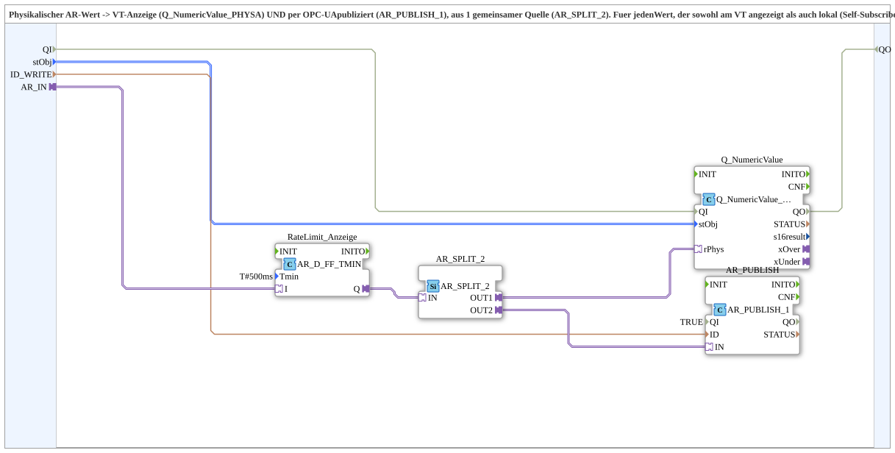

# AR_TO_Q_Publish_OPC

* * * * * * * * * *

## Introduction

`AR_TO_Q_Publish_OPC` routes a physical `AR` value from **one common source** both to a VT numeric display (`Q_NumericValue_PHYSA`) and to an OPC-UA publish (`AR_PUBLISH_1`). It is intended for values that are shown on the VT and additionally reused locally (self-subscribe) or across stations. Extracted from `TECU_Speeds`/`TECU_RPTO`, where the combination `AR_SPLIT_2` + `Q_NumericValue_PHYSA` + `AR_PUBLISH_1` occurred frequently.

## Interface Structure

### **Event Inputs**

None.

### **Event Outputs**

None.

### **Data Inputs**

- **stObj** (`logiBUS::utils::conversion::phys::NumericObjectPool_S`): object pool properties of the VT number variable (`u16ObjId`, scale, offset, decimals), e.g. `FBs::const::DefaultPool_Numeric::NumberVariable_X_N`
- **ID_WRITE** (`WSTRING`): publish address (REAL, `ACTION=PUBLISH`), local or cross-station

### **Data Outputs**

None.

### **Adapters**

- **AR_IN** (socket, `adapter::types::unidirectional::AR`): physical value (already scaled)

## Function Blocks (FBs) Used

- **`RateLimit_Anzeige`** (`adapter::events::unidirectional::AR_D_FF_TMIN`, `Tmin = T#500ms`): limits the update rate
- **`AR_SPLIT_2`** (`adapter::events::unidirectional::AR_SPLIT_2`): distributes the value to two targets
- **`Q_NumericValue`** (`isobus::UT::Q::Q_NumericValue_PHYSA`): writes the physical value into the VT number variable
- **`AR_PUBLISH`** (`adapter::net::AR_PUBLISH_1`, `QI = TRUE`): publishes the value via OPC-UA

## Functionality

- `AR_IN` → `RateLimit_Anzeige.I`; `RateLimit_Anzeige.Q` → `AR_SPLIT_2.IN`
- `AR_SPLIT_2.OUT1` → `Q_NumericValue.rPhys` (VT display); `stObj` → `Q_NumericValue.stObj`
- `AR_SPLIT_2.OUT2` → `AR_PUBLISH.IN`; `ID_WRITE` → `AR_PUBLISH.ID`

## Technical Details

- **Rate limiting before the split (intentional):** Since v1.2 `RateLimit_Anzeige` sits in front of `AR_SPLIT_2` and therefore throttles **both** branches (VT display and publish/self-subscribe consumers such as `CTRL_PID_AR.AR_ACT`) to at most one update per 500 ms. In v1.1 the throttle was only in the VT display branch. The motivation was sluggish behaviour with many quickly changing displays at the same time (suspected VT bus load).
- An adapter must not fan out to two targets, hence the explicit `AR_SPLIT_2`.

## Application Scenarios

- Speed or other measured values that are shown on the VT and at the same time published locally or to other stations

## Summary

`AR_TO_Q_Publish_OPC` bundles rate limiting, splitting, VT display and OPC-UA publish of an `AR` value in one SubApp.

---

### 🌐 Related topic pages on ms-muc-docs.de

- [🌐 Eclipse 4diac IDE & color reference on ms-muc-docs.de](https://www.ms-muc-docs.de/iec-61499/eclipse-4diac/)
