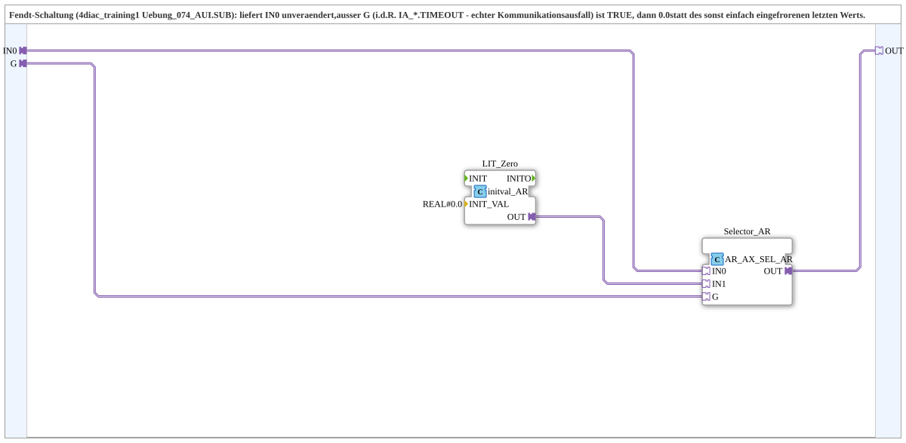

# AR_Timeout_Zero

* * * * * * * * * *

## Introduction

`AR_Timeout_Zero` passes the `REAL` value `IN0` through unchanged, unless the `AX` signal `G` (usually `IA_*.TIMEOUT`, a real communication failure) is `TRUE`: then `0.0` is output instead of the last value, which would otherwise simply stay frozen. The circuit originates from the Fendt exercise `Uebung_074_AUI`.

## Function Blocks (FBs) Used

### Sub-blocks: AR_Timeout_Zero

- **Type**: SubAppType
- **Internal FBs used**:
    - **LIT_Zero**: `adapter::types::unidirectional::AR::initval::initval_AR` with `INIT_VAL=0.0` - provides the constant `0.0`
    - **Selector_AR**: `adapter::iec61131::selection::AR_AX_SEL_AR` - selects between `IN0` and `IN1` depending on `G`
- **Functionality**: With `G=FALSE` the selector outputs the live value `IN0`, with `G=TRUE` the constant `0.0`.

## Interface Structure

### **Event Inputs / Event Outputs**

None - the SubApp has no event ports of its own; events travel via the adapters.

### **Data Inputs / Data Outputs**

No direct data ports.

### **Adapters**

- **IN0** (socket): `adapter::types::unidirectional::AR` - live value, e.g. `FIELDBUS_*_SCALED.OUT`
- **G** (socket): `adapter::types::unidirectional::AX` - `TRUE` = timeout, outputs `0.0` instead of `IN0`
- **OUT** (plug): `adapter::types::unidirectional::AR` - `IN0`, or `0.0` if `G=TRUE`

## Program Flow and Connections

- `IN0` → `Selector_AR.IN0`
- `LIT_Zero.OUT` → `Selector_AR.IN1`
- `G` → `Selector_AR.G`
- `Selector_AR.OUT` → `OUT`

## Technical Details

- The block replaces a frequently recurring wiring (`AR_AX_SEL_AR` with `initval_AR=0`) that had previously been built individually in the TECU blocks (`TECU_RPTO`, `TECU_FPTO`, `TECU_COGSOG`, `TECU_GBSD`, `TECU_WBSD`, `TECU_VDS`, `TECU_FHS`, `TECU_RHS`, `TECU_MSS`)
- Version 1.1 (2026-09-16): moved to `MyLib_AX-1.0.0::sys`, as it is generic and not TECU-specific

## Application Scenarios

- Forcing a measured value to zero on communication failure (timeout) instead of freezing the last value
- In general: substitute value `0.0` for an `AR` value, controlled by an `AX` signal

## Summary

`AR_Timeout_Zero` encapsulates an `AR` selector with the constant `0.0` into a reusable block that sets the value to zero on timeout.

## 🛠️ Related Exercises

- [Uebung_070d_AUI](https://meisterschulen-am-ostbahnhof-munchen-docs.readthedocs.io/projects/4diac-exercises-docs/en/latest/Uebungen/test_AX/Uebungen_doc/Uebung_070d_AUI/)
- [Uebung_079a_AUI](https://meisterschulen-am-ostbahnhof-munchen-docs.readthedocs.io/projects/4diac-exercises-docs/en/latest/Uebungen/test_AX/Uebungen_doc/Uebung_079a_AUI/)
