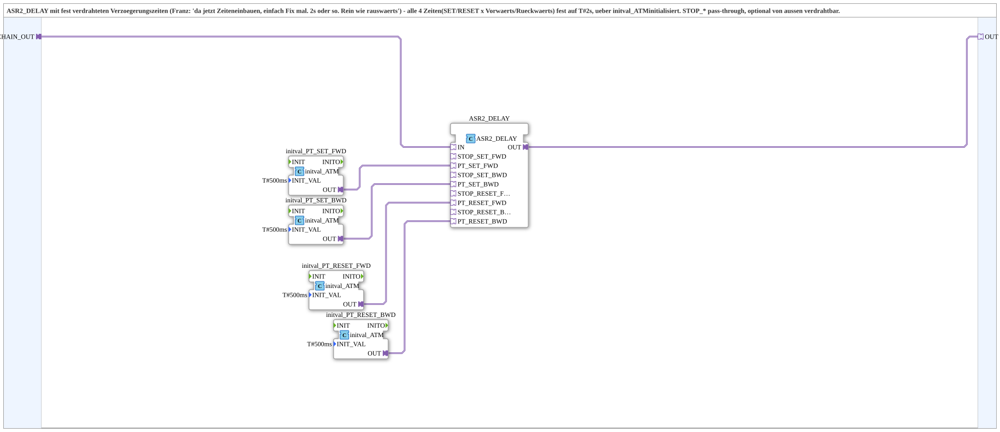

# ASR2_DELAY_SUB

* * * * * * * * * *

## Introduction

`ASR2_DELAY_SUB` is `ASR2_DELAY` with hard-wired delay times: the four times (set and reset, each forward and backward) are preset through `initval_ATM` instances so that the block can be inserted into an ASR2 chain as a delay element without any time wiring of its own.

## Interface Structure

### **Event Inputs**

The function block has no direct event inputs.

### **Event Outputs**

The function block has no direct event outputs.

### **Data Inputs**

The function block has no direct data inputs.

### **Data Outputs**

The function block has no direct data outputs.

### **Adapters**

- **CHAIN_OUT** (socket, `adapter::types::bidirectional::ASR2`): input of the chain; routed to `ASR2_DELAY.IN`
- **OUT** (plug, `adapter::types::bidirectional::ASR2`): delayed chain; comes from `ASR2_DELAY.OUT`

## Functionality

The network consists of one `ASR2_DELAY` instance (`adapter::events::bidirectional::ASR2_DELAY`) and four `initval_ATM` instances (`adapter::types::unidirectional::ATM::initval::initval_ATM`):

- `CHAIN_OUT` → `ASR2_DELAY.IN` and `ASR2_DELAY.OUT` → `OUT`
- `initval_PT_SET_FWD.OUT` → `ASR2_DELAY.PT_SET_FWD`
- `initval_PT_SET_BWD.OUT` → `ASR2_DELAY.PT_SET_BWD`
- `initval_PT_RESET_FWD.OUT` → `ASR2_DELAY.PT_RESET_FWD`
- `initval_PT_RESET_BWD.OUT` → `ASR2_DELAY.PT_RESET_BWD`

All four `initval_ATM` instances are parameterised with `INIT_VAL = T#500ms`.

## Technical Details

- The times are placeholder fixed values without functional requirement and can be made configurable later if needed; the type comment mentions `T#2s` as an example, the instances are currently set to `T#500ms`
- The interface consists only of the input `CHAIN_OUT` and the output `OUT`; the `STOP_*` sockets of `ASR2_DELAY` remain unwired in this SubApp
- Stateless at SubApp level; the state (running timers) resides in `ASR2_DELAY`

## Application Scenarios

- Time-staggered control of outputs in a set/reset chain (e.g. belt sequencing) when fixed delays are sufficient

## ⚖️ Comparison with Similar Blocks

For freely adjustable times, `ASR2_DELAY` is wired directly with your own `ATM` sources; `ASR2_DELAY_SUB`, in contrast, encapsulates the fixed values. For a single event per direction see [`AE2_DELAY`](../../adapter/events/bidirectional/AE2_DELAY.md).

## Conclusion

`ASR2_DELAY_SUB` is a plug-in delay element for ASR2 chains with preset times.
