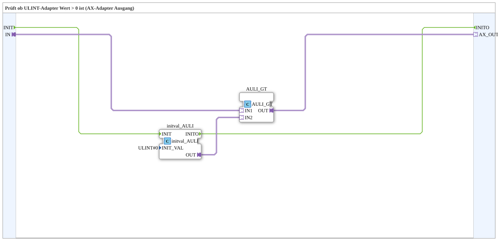

# AULI_GT_0

* * * * * * * * * *

## Introduction

`AULI_GT_0` checks whether a ULINT adapter value is greater than 0 and outputs the result as a boolean AX adapter signal. A typical input is an unsigned 64-bit counter value. The block is built identically for every numeric type (`AS`, `AI`, `ADI`, `ALI`, `AUS`, `AUI`, `AUDI`, `AULI`, `AR`, `ALR`).

## Interface

- **Event input**: `INIT` (initialization)
- **Event output**: `INITO` (initialization finished, comes from the internal `initval_AULI`)
- **Socket**: `IN` (`AULI`) — the value compared against 0
- **Plug**: `AX_OUT` (`AX`) — TRUE when `IN > 0`

## Function Blocks (FBs) Used

### Sub-blocks: AULI_GT_0

- **Type**: SubAppType
- **Internal FBs used**:
    - **initval_AULI**: `adapter::types::unidirectional::AULI::initval::initval_AULI` — supplies the fixed comparison constant `ULINT#0` as an adapter value (`INIT_VAL=ULINT#0`). An adapter socket cannot take the constant as a parameter, so it is fed in through this block.
    - **AULI_GT**: `adapter::iec61131::comparison::AULI_GT` — adapter-native comparison `IN1 > IN2`.
- **Functionality**: `IN` → `AULI_GT.IN1`; constant 0 → `AULI_GT.IN2`; result → `AX_OUT`.

## Program Flow and Connections

1. `INIT` → `initval_AULI.INIT`; `initval_AULI.INITO` → `INITO`.
2. `IN` (adapter) → `AULI_GT.IN1`.
3. `initval_AULI.OUT` (constant `ULINT#0`) → `AULI_GT.IN2`.
4. `AULI_GT.OUT` → `AX_OUT` (adapter).

## Application Scenarios

- Converting an unsigned 64-bit counter value into a simple boolean adapter signal for VT status displays or enable logic.

## Summary

`AULI_GT_0` is a compact wrapper around the adapter-native comparison `AULI_GT` — converts "ULINT > 0" directly into an AX adapter signal, so the caller does not have to create and wire the zero constant itself.

---

### 🌐 Related topic subpages on ms-muc-docs.de

- [🌐 Eclipse 4diac IDE & color reference on ms-muc-docs.de](https://www.ms-muc-docs.de/iec-61499/eclipse-4diac/)
