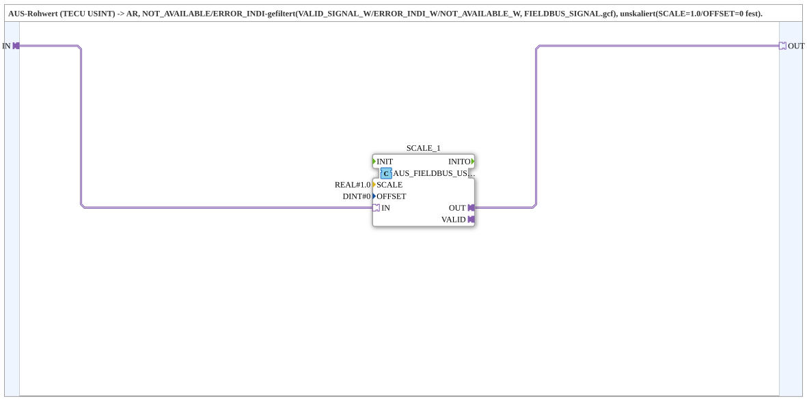

# AUS_FIELDBUS_USINT_TO_AR

* * * * * * * * * *

## Introduction

`AUS_FIELDBUS_USINT_TO_AR` converts an **AUS raw value** (TECU `USINT`) into an `AR` value. The values `NOT_AVAILABLE`/`ERROR_INDI` are filtered (`VALID_SIGNAL_W`/`ERROR_INDI_W`/`NOT_AVAILABLE_W`, `FIELDBUS_SIGNAL.gcf`); the scaling is fixed to `SCALE=1.0` and `OFFSET=0`, so the value remains unscaled.

The SubApp was extracted from `AUS_FIELDBUS_USINT_TO_SIGNAL_SCALED` because `SCALE=1.0`/`OFFSET=0` had to be parameterized individually every time in `TECU_FHS`/`TECU_RHS`; it lives in `MyLib_AX::sys` because it is generic and not TECU-specific.

## Interface Structure

### **Event Inputs**

*No direct event inputs - events arrive via the adapter sockets/plugs*

### **Event Outputs**

*No direct event outputs*

### **Data Inputs**

*No data inputs*

### **Data Outputs**

*No data outputs*

### **Adapters**

- **IN** (socket): Unidirectional adapter of type `adapter::types::unidirectional::AUS` - TECU raw value
- **OUT** (plug): Unidirectional adapter of type `adapter::types::unidirectional::AR` - `0.0` on `NOT_AVAILABLE`/`ERROR_INDI`, otherwise `IN` unscaled

## Function Blocks (FBs) Used

- **SCALE_1**: [`logiBUS::signalprocessing::fieldbus::AUS_FIELDBUS_USINT_TO_SIGNAL_SCALED`](../../logiBUS/signalprocessing/fieldbus/AUS_FIELDBUS_USINT_TO_SIGNAL_SCALED.md)
    - Parameters: `SCALE=1.0`, `OFFSET=0`

## Program Flow and Connections

- `IN` → `SCALE_1.IN`
- `SCALE_1.OUT` → `OUT`

The `VALID` plug of the inner block is not exposed.

## Application Scenarios

- Taking over TECU values (`USINT`) as a filtered, unscaled `AR` value

## Summary

`AUS_FIELDBUS_USINT_TO_AR` is a small wrapper SubApp that provides `AUS_FIELDBUS_USINT_TO_SIGNAL_SCALED` with the fixed parameters `SCALE=1.0`/`OFFSET=0`.
