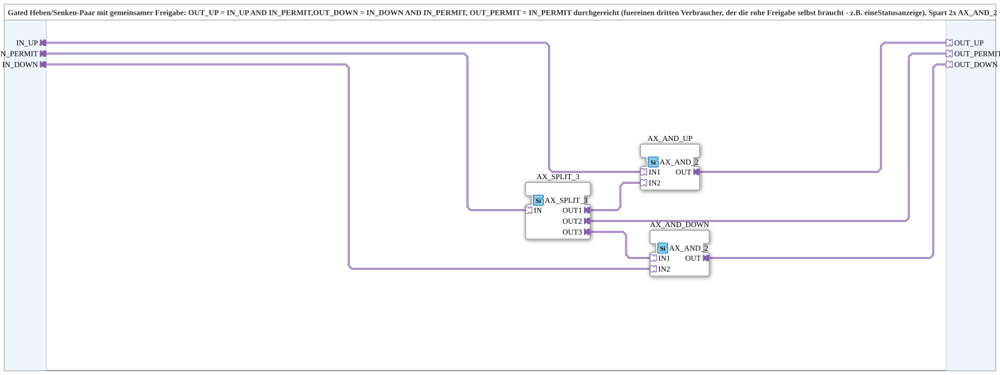

# AX_AND_2_DUAL

* * * * * * * * * *

## Introduction

`AX_AND_2_DUAL` is a gated raise/lower pair with a common permit: `OUT_UP = IN_UP AND IN_PERMIT` and `OUT_DOWN = IN_DOWN AND IN_PERMIT`. In addition, `IN_PERMIT` is passed through unchanged as `OUT_PERMIT`, e.g. for a third consumer such as a status display. The SubApp replaces two `AX_AND_2` plus one `AX_SPLIT_3` as individual blocks.

## Interface Structure

### **Event Inputs**

None.

### **Event Outputs**

None.

### **Data Inputs**

None.

### **Data Outputs**

None.

### **Adapters**

All adapters are of type `adapter::types::unidirectional::AX`.

- **IN_UP** (socket): raw raise signal, gated with `IN_PERMIT`
- **IN_PERMIT** (socket): common permit for `IN_UP`/`IN_DOWN`, additionally passed through unchanged to `OUT_PERMIT`
- **IN_DOWN** (socket): raw lower signal, gated with `IN_PERMIT`
- **OUT_UP** (plug): `IN_UP AND IN_PERMIT`
- **OUT_PERMIT** (plug): `IN_PERMIT` unchanged (for a third consumer, e.g. a status display)
- **OUT_DOWN** (plug): `IN_DOWN AND IN_PERMIT`

## Function Blocks (FBs) Used

- **`AX_SPLIT_3`** (`adapter::events::unidirectional::AX_SPLIT_3`): distributes `IN_PERMIT` to three targets
- **`AX_AND_UP`**, **`AX_AND_DOWN`** (each `adapter::booleanOperators::AX_AND_2`): AND combination

## Functionality

- `IN_PERMIT` → `AX_SPLIT_3.IN`
- `AX_SPLIT_3.OUT1` → `AX_AND_UP.IN2`; `IN_UP` → `AX_AND_UP.IN1`; `AX_AND_UP.OUT` → `OUT_UP`
- `AX_SPLIT_3.OUT3` → `AX_AND_DOWN.IN1`; `IN_DOWN` → `AX_AND_DOWN.IN2`; `AX_AND_DOWN.OUT` → `OUT_DOWN`
- `AX_SPLIT_3.OUT2` → `OUT_PERMIT`

## Technical Details

- Since an adapter must not branch to several targets, `AX_SPLIT_3` distributes the permit to both AND elements and the pass-through output
- No logic of its own beyond the standard blocks used

## Application Scenarios

- Any raise/lower signal pair that needs the same permit (e.g. an interlock), where the permit should additionally be available for a display

## Summary

`AX_AND_2_DUAL` gates a raise/lower pair with a common permit and additionally passes the permit through.

---

### 🌐 Related topic pages on ms-muc-docs.de

- [🌐 Eclipse 4diac IDE & color reference on ms-muc-docs.de](https://www.ms-muc-docs.de/iec-61499/eclipse-4diac/)
