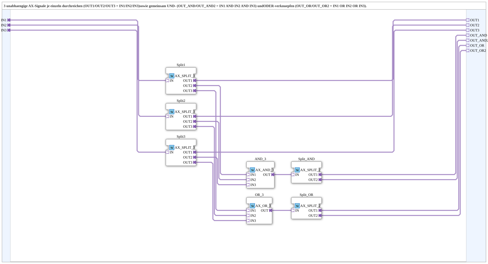

# AX_OR_AND_3_SPLIT

* * * * * * * * * *

## Introduction

`AX_OR_AND_3_SPLIT` passes **three independent AX signals** through individually (`OUT1`/`OUT2`/`OUT3` = `IN1`/`IN2`/`IN3`) and additionally combines them jointly with **AND** (`OUT_AND`/`OUT_AND2` = `IN1 AND IN2 AND IN3`) and **OR** (`OUT_OR`/`OUT_OR2` = `IN1 OR IN2 OR IN3`). The combined outputs are each provided twice (branch 1/branch 2).

## Interface Structure

### **Event Inputs**

*No direct event inputs - events arrive via the adapter sockets/plugs*

### **Event Outputs**

*No direct event outputs*

### **Data Inputs**

*No data inputs*

### **Data Outputs**

*No data outputs*

### **Adapters**

All adapters are unidirectional of type `adapter::types::unidirectional::AX`.

- **IN1**, **IN2**, **IN3** (sockets): input signals 1 to 3
- **OUT1**, **OUT2**, **OUT3** (plugs): passed-through input signals 1 to 3
- **OUT_AND**, **OUT_AND2** (plugs): `IN1 AND IN2 AND IN3` - collective status "all active" (branch 1/branch 2)
- **OUT_OR**, **OUT_OR2** (plugs): `IN1 OR IN2 OR IN3` - collective status "at least one active" (branch 1/branch 2)

## Function Blocks (FBs) Used

- **Split1**, **Split2**, **Split3**: each `adapter::events::unidirectional::AX_SPLIT_3` (branches each input signal onto three targets)
- **AND_3**: `adapter::booleanOperators::AX_AND_3`
- **OR_3**: `adapter::booleanOperators::AX_OR_3`
- **Split_AND**, **Split_OR**: each `adapter::events::unidirectional::AX_SPLIT_2` (duplicate the respective collective output)

## Program Flow and Connections

- `INx` → `Splitx.IN`
- `Splitx.OUT1` → `OUTx` (pass-through)
- `Splitx.OUT2` → `AND_3.INx`
- `Splitx.OUT3` → `OR_3.INx`
- `AND_3.OUT` → `Split_AND.IN`; `Split_AND.OUT1` → `OUT_AND`, `Split_AND.OUT2` → `OUT_AND2`
- `OR_3.OUT` → `Split_OR.IN`; `Split_OR.OUT1` → `OUT_OR`, `Split_OR.OUT2` → `OUT_OR2`

(with `x` = 1, 2, 3)

## Technical Details

- The AND and OR collective outputs are doubled (`AX_SPLIT_2`) so that two consumers each can be supplied.

## Application Scenarios

- Using several status signals (e.g. belts) individually and additionally forming a common status "all active" or "at least one active"

## Summary

`AX_OR_AND_3_SPLIT` bundles pass-through, AND and OR combination of three AX signals in one SubApp.
